<div align="center">

[简体中文](README.md) · **English** · [日本語](README.ja.md) · [Español](README.es.md)

# Signal Loom · 拾讯

**Gather the signals. Weave them into your day.**

A self-hosted reading room for public Telegram channels, with complete images and shareable stories.


[](LICENSE)

[Live site](https://douxiaohu.duckdns.org) · [Quick start](#quick-start) · [Development](#local-development) · [Configuration](#configuration) · [Documentation](#documentation)

</div>

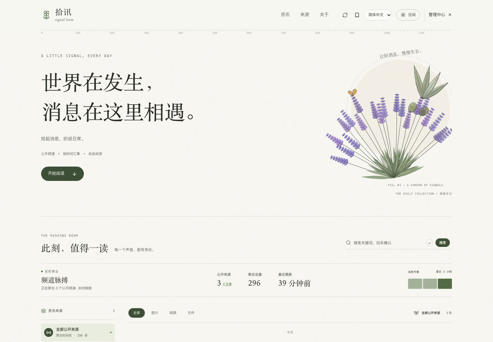

Signal Loom collects public Telegram posts into a quiet, chronological feed. The Go service handles collection, permissions and media caching; React provides the reading page and a separate admin console. SQLite keeps the deployment small, and public readers do not need an account.

## A tour of the features

| Reading and sharing | Collection and management |
| --- | --- |
| Filter by source, keyword and media type; retain filters in the URL | Add public Telegram channels, pause collection or crawl immediately |
| Paper and night themes, with letters assembling as posts enter view | Monitor source health, collection results and message history |
| Botanical motion and an illustrated Alfama footer | Create keyword rules; acknowledge and resolve matches |
| Complete image proportions and original-image previews | View traffic trends and recent visits; feedback is available through the API |
| Full-text, multi-image share cards with automatic pagination | Control collection and public visibility independently |
| Copy the current page, download PNG, or export every page as a ZIP | Admin-key login, server-side sessions and same-origin write checks |

### 01 · Find your next read

Choose a source, enter a keyword, or switch to photos, videos or files. The URL retains your selection for bookmarks and return visits. The channel pulse shows public source counts, message totals, the latest update and the hourly rhythm of the loaded posts.

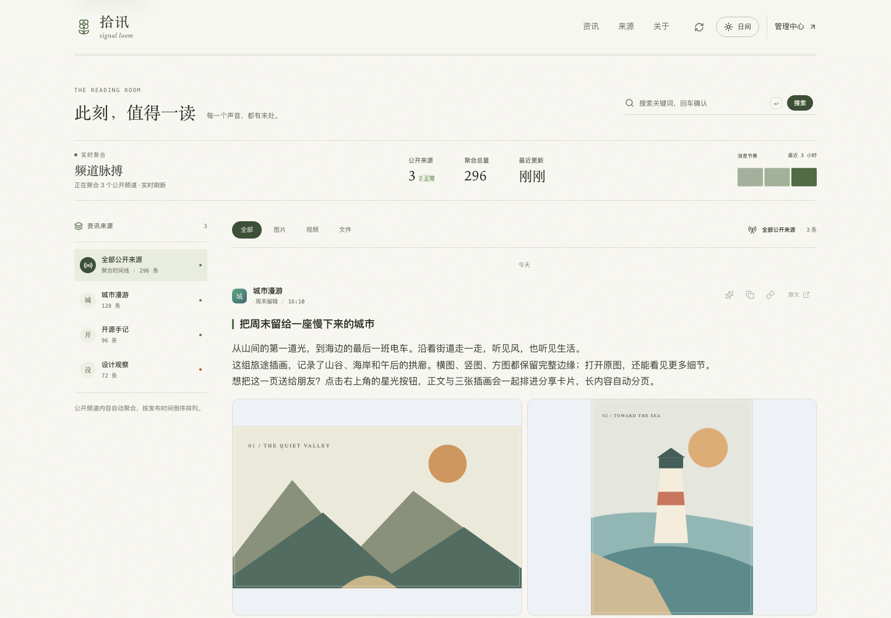

The introduction draws and types itself into place. Posts reveal their text as they enter view, with media appearing first and each post settling within about 3.2 seconds. User interaction reveals the full content immediately. Reduced-motion preferences show the completed state directly.

### 02 · See the whole image

Landscape, portrait and square images retain their complete proportions. Multiple attachments stay in order. Open a photo to view the original, download it, or press Esc to return.

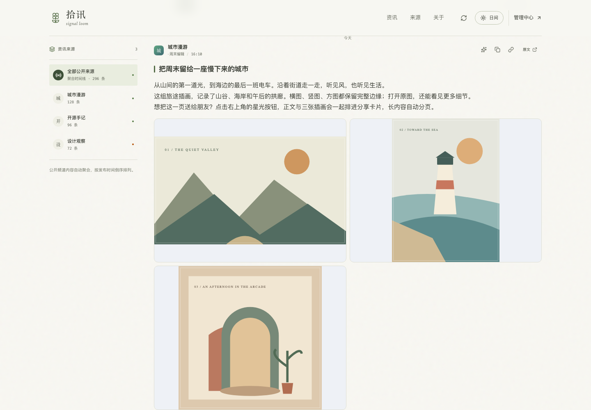

<details>
<summary>Original-image viewer</summary>

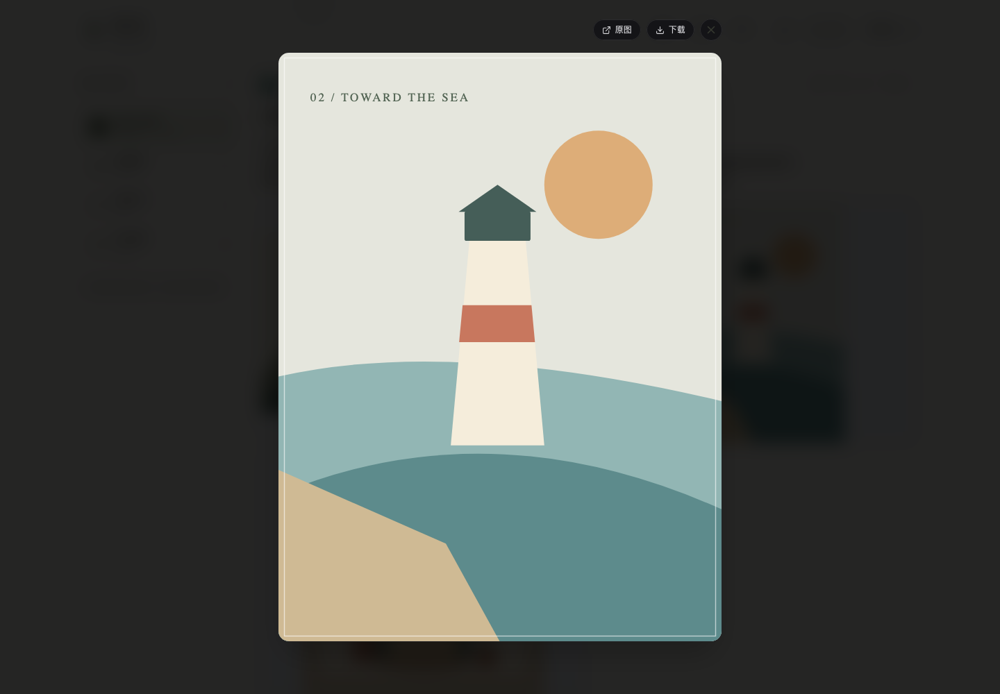

</details>

### 03 · Share the whole story

Use the sparkle button on a post to create share cards. Text wraps using actual font measurements, paragraphs are preserved, and every still image is drawn proportionally. Long stories and multiple images flow across pages.

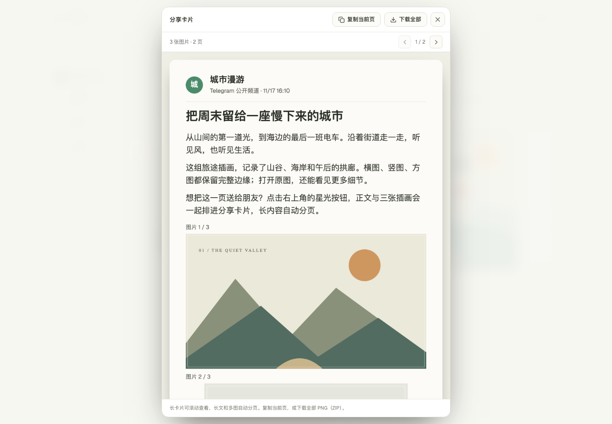

- Logical pages are bounded at 1080 × 2600; exported PNGs do not exceed 1620 × 3900.
- Copy the current page, download one PNG, or download all pages in a ZIP.
- Each page repeats the source, page number and website link.
- An unavailable image keeps a numbered placeholder so readers can consult the original post.
- The footer currently links to `https://douxiaohu.duckdns.org`. For your own deployment, change `WEBSITE_URL` in [`shareCard.ts`](frontend/src/lib/shareCard.ts).

<details>
<summary>Last page: complete image and website link</summary>

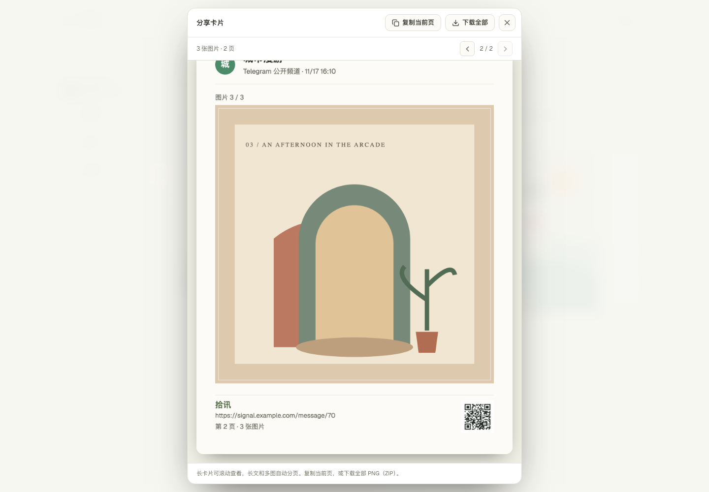

</details>

### 04 · A reading light and a little city

Switch between warm paper and night reading. Botanical illustrations and the Alfama watercolor footer follow the theme, with stars, lit windows and a tram. Motion pauses when the scene is offscreen or the page is hidden.

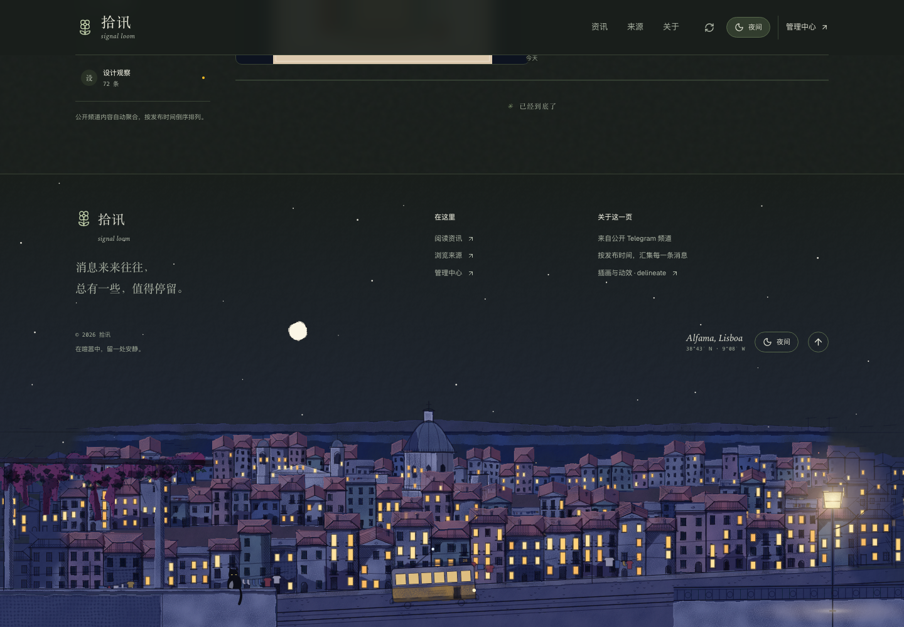

### 05 · Read comfortably on your phone

Navigation, search, source selection and media filters adapt to narrow screens. Images retain their proportions, and share previews remain scrollable and paginated.

<p align="center">
  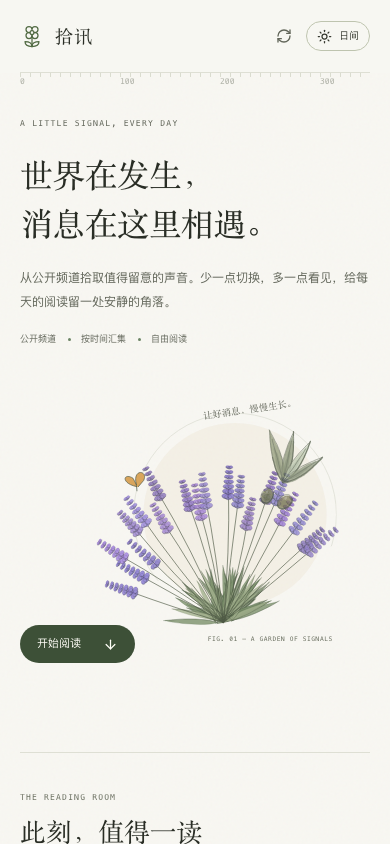
  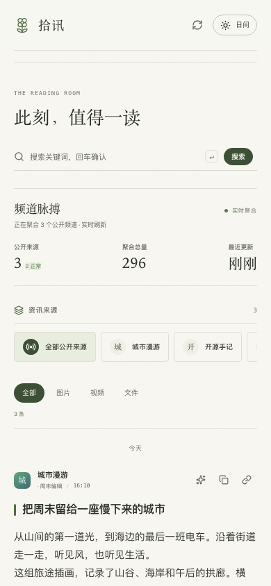
</p>

### 06 · Tend your information garden

The admin console provides an overview, source management, rule matches, message search and visit records. Its overview connects traffic trends, collection health and rule status.

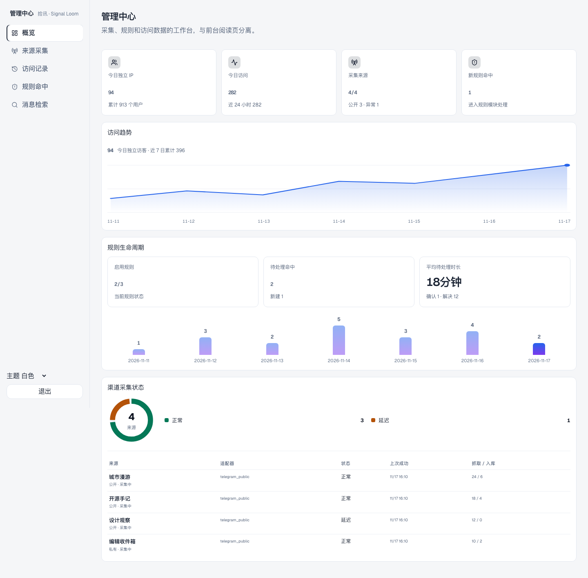

<details>
<summary><strong>Sources</strong> · Add channels and control collection and visibility</summary>

New sources collect by default and remain private until you publish them. Crawl immediately, inspect fetched/saved counts, or filter for consecutive failures and no new messages.

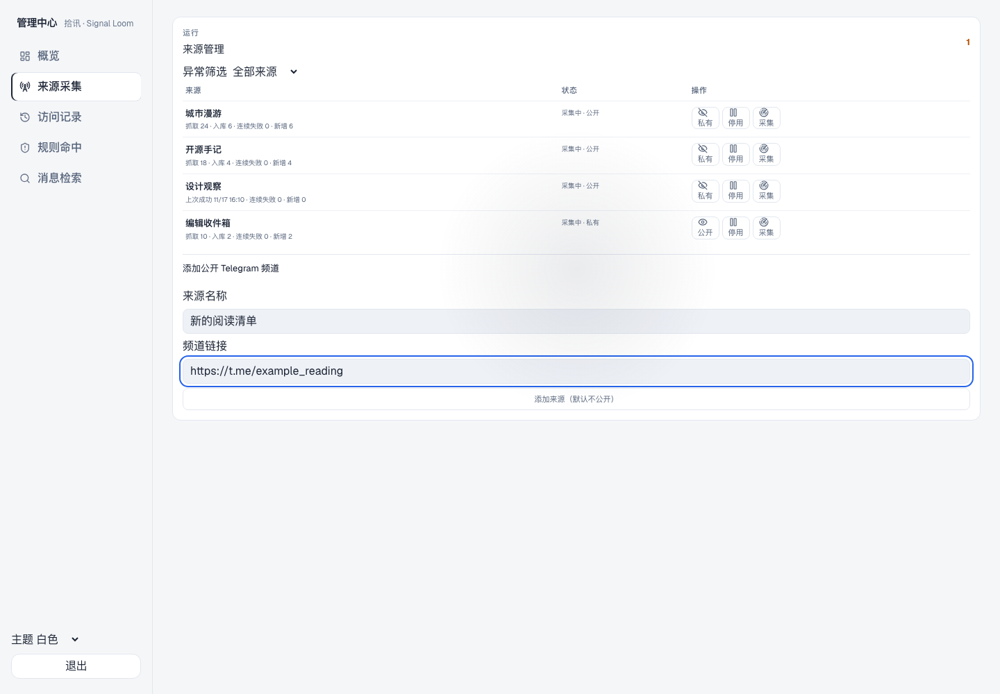

</details>

<details>
<summary><strong>Rules</strong> · Keyword matches, acknowledgement and resolution</summary>

Create plain-keyword rules, which start disabled. Enable them when ready, then review matches through the new, acknowledged and resolved states.

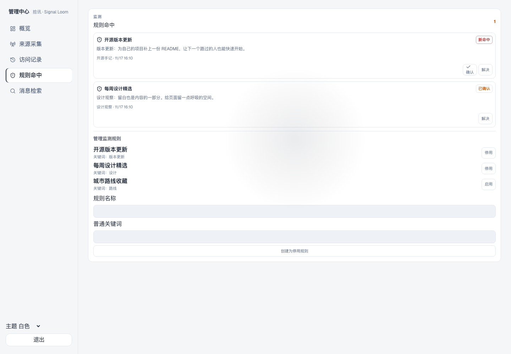

</details>

<details>
<summary><strong>Search</strong> · Inspect collected messages</summary>

Combine source, keyword and media filters in a dedicated workspace. Admin search also retains access to historical orphaned messages.

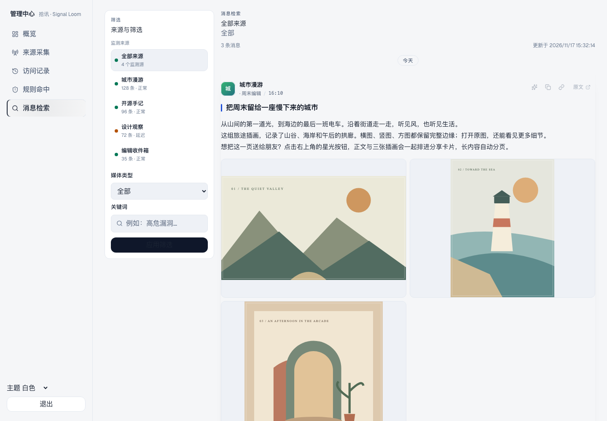

</details>

<details>
<summary><strong>Visits</strong> · Understand how the reading room is used</summary>

Inspect daily, recent and cumulative IP-based counts and recent request paths, referrers and devices. Correct client IP detection depends on trusted proxy configuration.

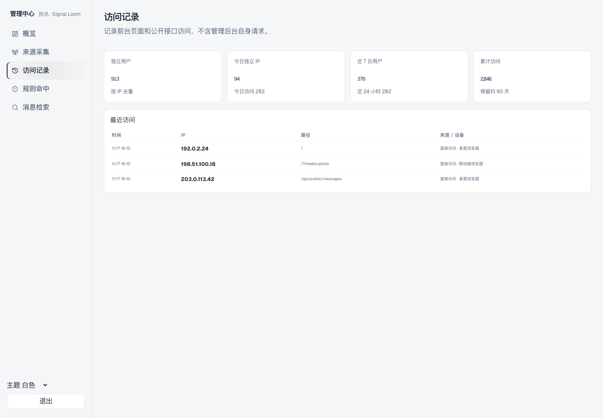

</details>

> These 14 screenshots were captured from the current frontend in a local browser with isolated demo messages, illustrations and statistics. IPs use documentation-only ranges; no production admin data or keys are shown. The application UI is currently primarily Chinese. These language editions translate the project documentation.

## Runtime and access

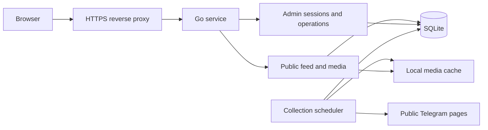

The current runtime is **Go + React 19 + SQLite**. The historical Python/FastAPI implementation remains in `app/` and `tests/`; Docker runs the Go binary built from `cmd/server`.

| Entry | Path | Access |
| --- | --- | --- |
| Reading room | `/` | No login; enabled, public sources only |
| Admin console | `/admin` | Admin-key login |
| Public API | `/api/public/*` | Sources, messages, media and feedback |
| Admin API | `/api/admin/*` | Valid admin session required |
| Health | `/health` | `{"status":"ok"}` |

Run **one application instance per database**. The server, scheduler and SQLite writer share a process. Admin sessions are kept in memory, so restarting requires a new login.

## Quick start

Install Docker Engine and Compose. The server must reach Telegram public pages; building requires access to npm, Go modules and base images.

```bash
git clone https://github.com/douxiaohu/telegram-github-radar.git
cd telegram-github-radar
cp .env.example .env
cp config/groups.example.yaml config/groups.yaml
mkdir -p data/media-cache
```

Generate separate keys and put the results in `.env`:

```bash
# ADMIN_API_KEY
openssl rand -hex 24
# SESSION_SECRET
openssl rand -hex 32
```

```dotenv
APP_ENV=production
ADMIN_API_KEY=<generated-admin-key>
SESSION_SECRET=<generated-session-secret>
SESSION_COOKIE_SECURE=true
DATABASE_URL=sqlite:///./data/telegram_forwarder.db
TIMEZONE=Asia/Shanghai
APP_UID=1000
APP_GID=1000
```

On Linux, set `APP_UID` and `APP_GID` to the deployment user's IDs so persisted directories are writable. Leave container `HOST` empty and keep the default port, 8000.

The Compose file references the external network `ai-internal`:

```bash
docker network inspect ai-internal >/dev/null 2>&1 || docker network create ai-internal
docker compose up -d --build
docker compose ps
curl -fsS http://127.0.0.1:8000/health
```

Compose binds to **127.0.0.1:8000**. Put an HTTPS reverse proxy on the same host; secure session cookies require HTTPS for admin login. Example Caddy configuration:

```caddy
signal.example.com {
    encode gzip
    reverse_proxy 127.0.0.1:8000
}
```

Preserve the browser's original `Host` and forward client IP information. With Nginx, use `proxy_set_header Host $host;`. Write requests validate `Origin` against `Host`; rewriting the host can cause 403 responses. Set `TRUSTED_PROXIES` to actual trusted proxy addresses or CIDRs.

Open `/admin`, log in with the admin key, and add a channel name and `https://t.me/channel` URL. New channels collect immediately by default but remain private until you enable public visibility.

`config/groups.yaml` seeds sources **only when the sources table is empty**. Valid seed channels start enabled and public; later YAML edits do not overwrite existing sources. Collection runs at startup, then every 300 seconds by default.

```yaml
groups:
  - source: "https://t.me/example_channel"
    name: "My reading list"
```

The Go runtime currently supports **`telegram_public` only**. Bot collection, long polling and RSS are not implemented in Go. `TELEGRAM_BOT_TOKEN` remains for compatibility with old configuration.

## Local development

Use **Go 1.26+, Node.js 22 LTS and npm**. Python is not needed for the current runtime.

```bash
cp .env.example .env
cp config/groups.example.yaml config/groups.yaml
mkdir -p data/media-cache
cd frontend
npm ci
npm run build
cd ..
```

Run the backend in one terminal:

```bash
APP_ENV=development HOST=127.0.0.1 SESSION_COOKIE_SECURE=false go run ./cmd/server
```

Run the frontend in another:

```bash
cd frontend
npm run dev -- --host 127.0.0.1
```

Vite prints its local URL and proxies `/api` to `127.0.0.1:8000`. Configure keys in `.env`. Development generates temporary keys if they are absent, and logs the temporary admin key locally. Production requires configured keys. Use `SESSION_COOKIE_SECURE=false` for local HTTP and `true` in production.

## Configuration

See [`.env.example`](.env.example) for all options. Process environment variables override `.env`.

| Variable | Purpose / default |
| --- | --- |
| `APP_ENV` | `production`, `staging`, `development` or `test`; unknown values fail startup |
| `ADMIN_API_KEY` | Admin key; at least 16 characters |
| `SESSION_SECRET` | Session HMAC secret; at least 32 bytes |
| `SESSION_COOKIE_SECURE` / `SESSION_TTL_HOURS` | HTTPS cookie / session lifetime; `true` / `12` |
| `HOST` / `PORT` | Listen address / port; all interfaces / `8000` |
| `DATABASE_URL` | `sqlite:///./data/telegram_forwarder.db` |
| `GROUPS_CONFIG_PATH` | Source seed file; `config/groups.yaml` |
| `CRAWL_INTERVAL_SECONDS` | Collection interval; `300` |
| `SOURCE_STALE_AFTER_SECONDS` | Source staleness threshold; `900` |
| `TIMEZONE` | Quiet hours and statistics timezone; `Asia/Shanghai` |
| `TRUSTED_PROXIES` | Trusted IP/CIDR list, or `private`, `loopback`, `none` |
| `MEDIA_CACHE_DIR` | `./data/media-cache` |
| `MEDIA_ALLOWED_HOSTS` | HTTPS only; `telesco.pe`, `cdn-telegram.org` and subdomains |
| `MEDIA_MAX_BYTES` | Maximum cached file size; 96 MiB |
| `LOGIN_MAX_ATTEMPTS` / `LOGIN_WINDOW_SECONDS` | Login rate limit; `5` / `900` |
| `FEEDBACK_RATE_LIMIT` / `FEEDBACK_RATE_WINDOW_SECONDS` | Feedback rate limit; `5` / `60` |

Keep real `.env`, `config/groups.yaml`, data, release packages and backups out of Git.

## Security and verification

Only enabled, public sources are accessible through public message and media endpoints. Non-public source queries return 404. Admin sessions use HttpOnly, SameSite=Strict cookies and are invalidated on logout. Writes require JSON, same-origin checks and request-size limits, with some checks relaxed during development. Media is cached server-side under an HTTPS host allowlist.

Unknown extensionless frontend paths may return the public SPA; `/docs` returning 200 alone does not mean API documentation is exposed. Unknown `/api/*` paths return JSON 404.

```bash
go test ./...
go vet ./...
cd frontend
npm ci
npm test
npm run build
npx playwright install chromium
npm run test:e2e
```

Browser tests cover 1440, 768 and 390 px widths with API fixtures, including search, image viewing, motion, themes, access boundaries and multi-image sharing. They do not write to production data. Production builds check raw JavaScript budgets of 260 KiB for reading, 36 KiB for lazy Assembly and 16 KiB for lazy sharing.

## Backup and upgrades

Use SQLite's online backup facility with WAL databases. Copying only the live main database file can miss changes.

```bash
mkdir -p backups
sqlite3 data/telegram_forwarder.db ".backup 'backups/telegram-forwarder-before-upgrade.db'"
```

Back up media, production configuration and the current image reference as well. Retain old frontend assets so already-open pages can still load their chunks.

```bash
git pull --ff-only
docker compose build telegram-forwarder
docker compose up -d --no-build telegram-forwarder
curl -fsS http://127.0.0.1:8000/health
```

Check the public feed, media, share export and anonymous admin API 401 responses. A frontend rollback should keep the current database to preserve newly collected posts.

## Documentation

| Topic | Reference |
| --- | --- |
| Language editions | [简体中文](README.md) · [日本語](README.ja.md) · [Español](README.es.md) |
| Environment settings | [`.env.example`](.env.example) |
| Reading room and motion design | [Design decision, Chinese](docs/architecture/notes/implemented/feature/2026-11-17-editorial-assembly-reading-room.md) |
| Complete media and paginated sharing | [Implementation notes, Chinese](docs/architecture/notes/implemented/bug-fix/2026-11-17-complete-media-and-paged-share-cards.md) |
| Deployment and rollback | [Release record, Chinese](docs/releases/2026-11-17-signal-loom-brand-release.md) |
| Source layout and detailed operations | [Main reference, Chinese](README.md#目录导航) |
| Security | [SECURITY.md](SECURITY.md) |
| Licensing | [MIT](LICENSE) · [Third-party notices](THIRD_PARTY_NOTICES.md) |

## Credits and license

The interface builds on Assembly, Climate Garden and Alfama from [appautomaton/delineate](https://github.com/appautomaton/delineate). Reused code and illustrations retain their MIT attribution. See the [vendor license](frontend/src/vendor/delineate/LICENSE) and [artwork license](frontend/public/artwork/LICENSE-delineate.txt).

Project code and documentation use the [MIT license](LICENSE). Third-party code, Geist fonts and dependencies retain their original licenses. Telegram posts and their images are not relicensed by this project; see [THIRD_PARTY_NOTICES.md](THIRD_PARTY_NOTICES.md).
