<div align="center">

[简体中文](README.md) · [English](README.en.md) · [日本語](README.ja.md) · **Español**

# Signal Loom · 拾讯

**Recoge las señales. Teje tu lectura diaria.**

Una sala de lectura autohospedada para canales públicos de Telegram, con imágenes completas y publicaciones fáciles de compartir.


[](LICENSE)

[Ver el sitio](https://douxiaohu.duckdns.org) · [Instalación](#instalación) · [Desarrollo](#desarrollo-local) · [Configuración](#configuración) · [Documentación](#documentación)

</div>

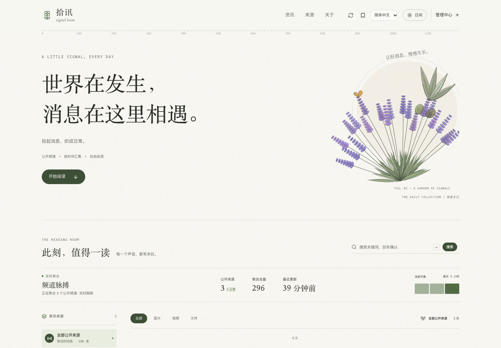

Signal Loom reúne publicaciones de canales públicos de Telegram en una página tranquila, ordenada por fecha. Go se encarga de la recopilación, los permisos y la caché de medios. React ofrece la lectura pública y un panel de administración independiente. SQLite simplifica el despliegue y los lectores no necesitan iniciar sesión.

## Un recorrido por sus funciones

| Lectura y contenido compartido | Recopilación y administración |
| --- | --- |
| Filtros por fuente, palabra clave y tipo de medio; condiciones guardadas en la URL | Añadir canales públicos, pausar o iniciar una recopilación inmediata |
| Temas de papel y nocturno, con letras que se ensamblan al entrar en pantalla | Consultar el estado de las fuentes, los resultados y los mensajes históricos |
| Animaciones botánicas y un pie de página ilustrado de Alfama | Crear reglas de palabras clave, confirmar coincidencias y resolverlas |
| Imágenes completas con su proporción original y visor ampliado | Resumen, tendencias y visitas recientes; comentarios disponibles mediante la API |
| Tarjetas con texto íntegro, varias imágenes y paginación automática | Controlar por separado la recopilación y la visibilidad pública |
| Copiar una página, descargar PNG o exportar todas en ZIP | Clave de administración, sesiones y validación del mismo origen |

### 01 · Encuentra tu próxima lectura

Selecciona una fuente, introduce una palabra clave o filtra fotos, vídeos y archivos. Las condiciones quedan en la URL para guardar la búsqueda. El resumen muestra fuentes públicas, volumen total, última actualización y distribución horaria de las publicaciones cargadas.

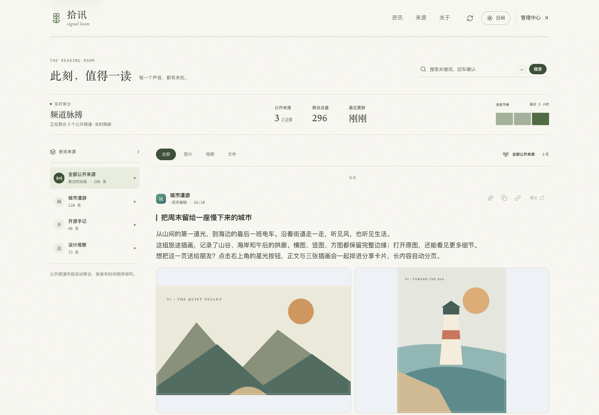

La introducción dibuja sus marcos y compone el texto. Las publicaciones revelan sus letras al entrar en pantalla, mostrando primero los medios; la animación de cada tarjeta dura como máximo unos 3,2 segundos. Cualquier interacción revela el contenido completo. Con movimiento reducido se presenta directamente el estado final.

### 02 · Mira la imagen entera

Las imágenes horizontales, verticales y cuadradas conservan toda su proporción y el orden de los adjuntos. Ábrelas para consultar o descargar el original. Esc cierra el visor.

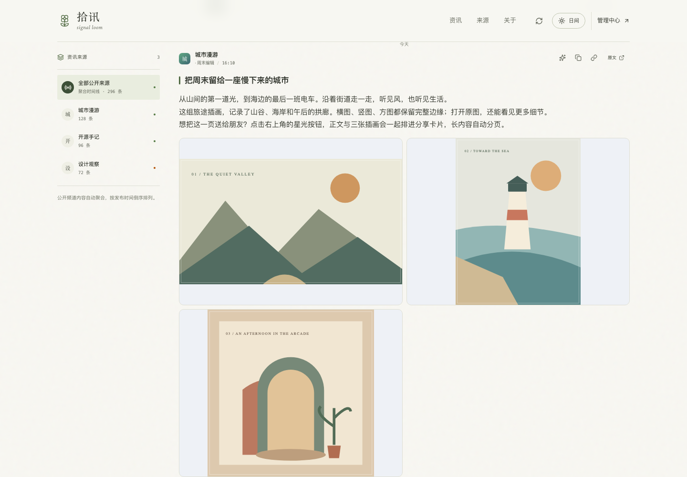

<details>
<summary>Visor de la imagen original</summary>

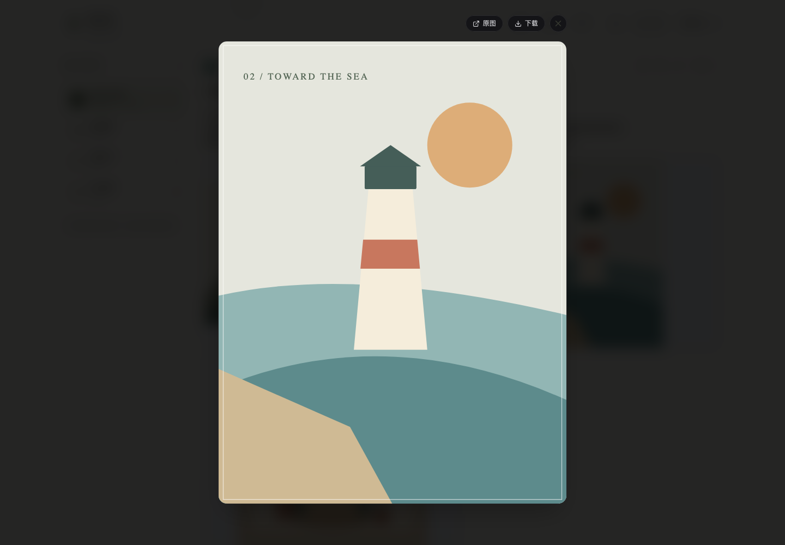

</details>

### 03 · Comparte la historia completa

El botón de destellos de cada publicación genera tarjetas para compartir. El texto se distribuye según las medidas reales de la fuente y conserva los párrafos. Todas las imágenes estáticas se dibujan completas y en proporción. Los textos largos y los conjuntos de imágenes se dividen automáticamente en páginas.

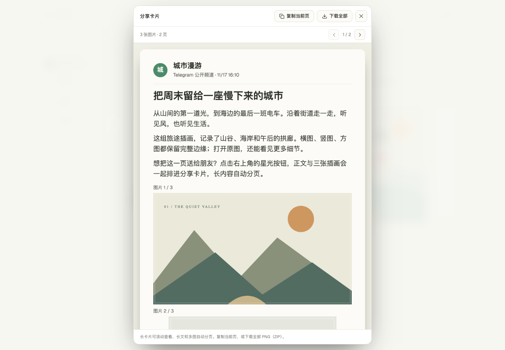

- Cada página lógica mide como máximo 1080 × 2600; el PNG exportado no supera 1620 × 3900.
- Copia la página actual, descarga un PNG o todas las páginas en un ZIP.
- Cada página repite la fuente, el número de página y el enlace al sitio.
- Las imágenes no disponibles mantienen un aviso numerado para consultar el original.
- El enlace actual es `https://douxiaohu.duckdns.org`. Para tu despliegue, cambia `WEBSITE_URL` en [`shareCard.ts`](frontend/src/lib/shareCard.ts).

<details>
<summary>Última página con imagen y enlace al sitio</summary>

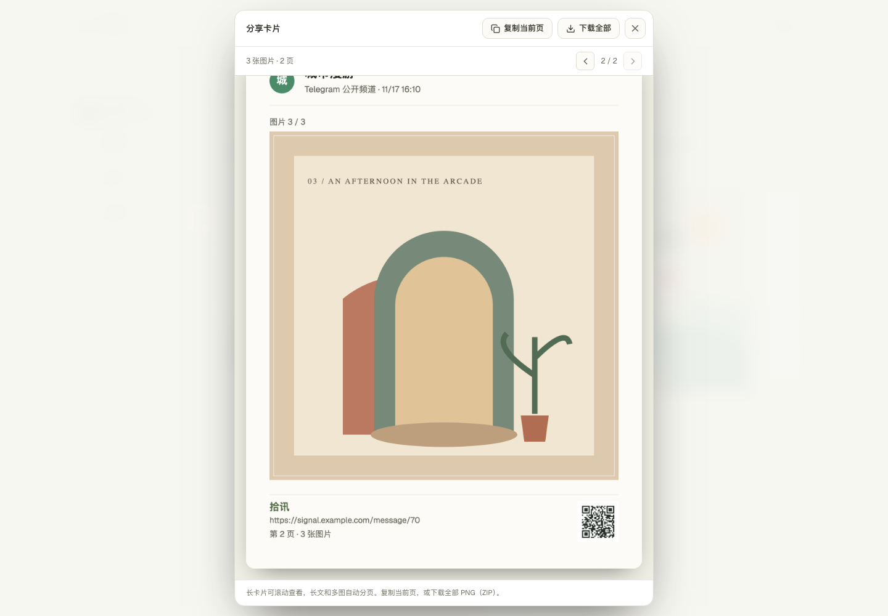

</details>

### 04 · Una luz de lectura y una pequeña ciudad

Alterna entre el papel cálido y el modo nocturno. Las plantas y el paisaje de Alfama cambian con el tema: estrellas, ventanas iluminadas y un tranvía acompañan el final de la lectura. Las animaciones se pausan fuera de pantalla o cuando se oculta la pestaña.

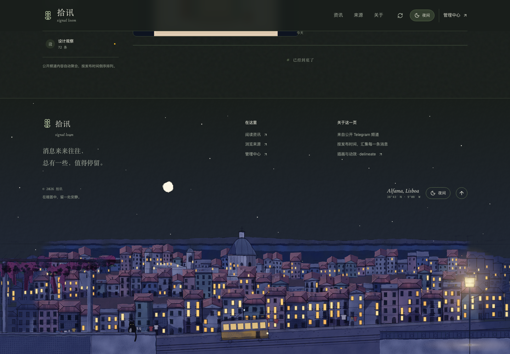

### 05 · También en el móvil

La navegación, la búsqueda y los filtros se adaptan a pantallas estrechas. Las imágenes conservan sus proporciones y la vista de las tarjetas permite desplazarse y cambiar de página.

<p align="center">
  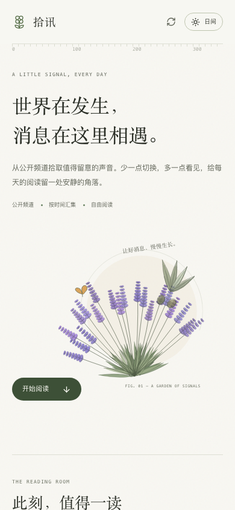
  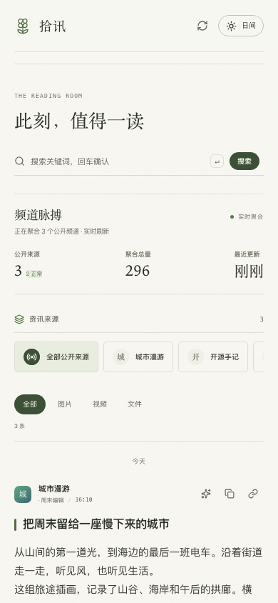
</p>

### 06 · Cuida tu jardín de información

El panel de administración reúne resumen, fuentes, coincidencias, búsqueda y visitas. El resumen conecta las tendencias de tráfico, el estado de recopilación y el ciclo de las reglas.

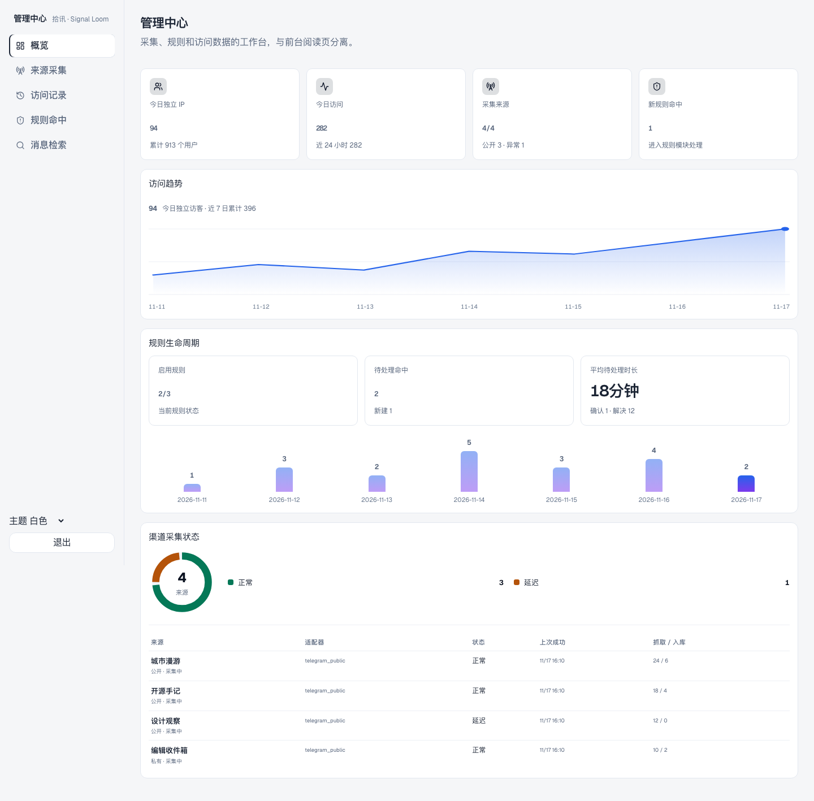

<details>
<summary><strong>Fuentes</strong> · Añadir canales y controlar su visibilidad</summary>

Las fuentes nuevas se recopilan de forma predeterminada y permanecen privadas hasta publicarlas. Puedes iniciar una recopilación inmediata, consultar mensajes obtenidos y guardados, o filtrar fallos consecutivos y fuentes sin novedades.

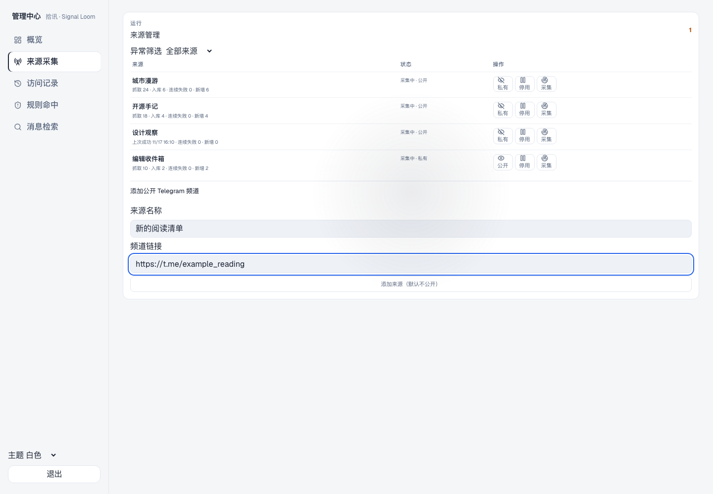

</details>

<details>
<summary><strong>Reglas</strong> · Confirmar y resolver coincidencias</summary>

Crea reglas de palabras clave simples. Se crean desactivadas y puedes activarlas tras revisarlas. Las coincidencias pasan por los estados nueva, confirmada y resuelta.

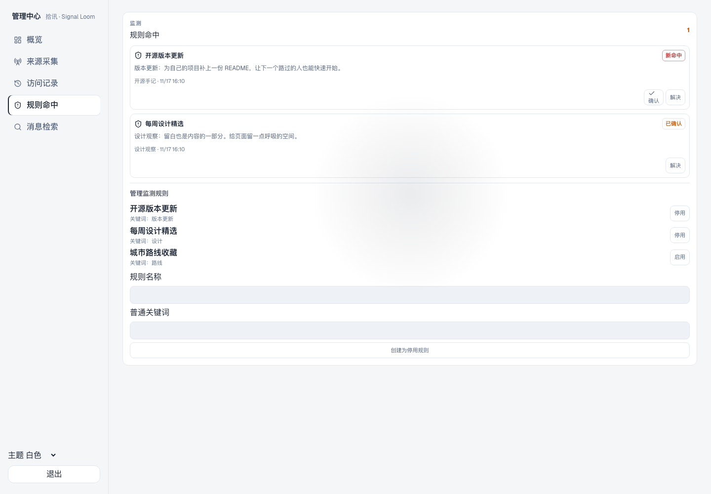

</details>

<details>
<summary><strong>Búsqueda</strong> · Revisar los mensajes recopilados</summary>

Combina fuente, palabra clave y tipo de medio en un espacio independiente. La administración conserva la consulta de mensajes históricos que ya no tienen una fuente asociada.

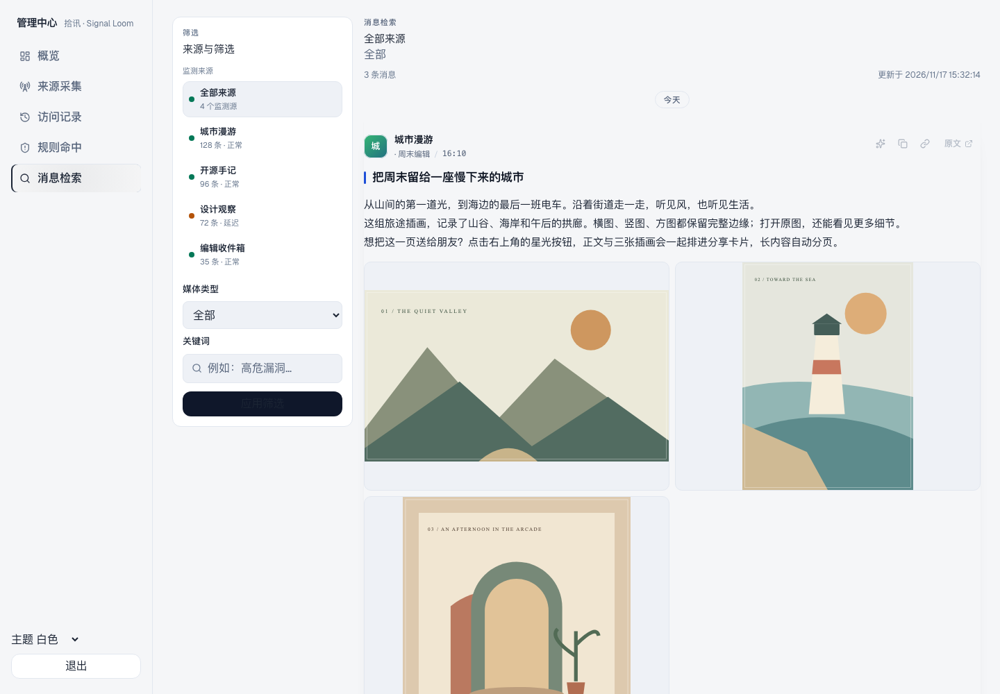

</details>

<details>
<summary><strong>Visitas</strong> · Entender el uso del sitio</summary>

Consulta recuentos diarios, recientes y acumulados por IP, junto con hora, ruta, referencia y dispositivo. La identificación correcta de la IP depende de la configuración de proxies de confianza.

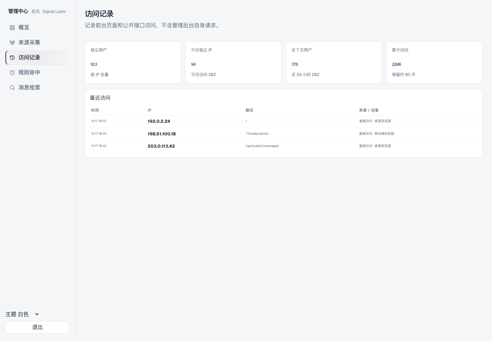

</details>

> Las 14 capturas se tomaron en un navegador local con el frontend actual y datos de demostración aislados: publicaciones, ilustraciones y estadísticas. Las IP pertenecen a rangos reservados para documentación. No se muestran claves ni datos del panel de producción. La interfaz de la aplicación está actualmente principalmente en chino; esta edición traduce la documentación del proyecto.

## Arquitectura y acceso

El entorno actual utiliza **Go + React 19 + SQLite**. La implementación histórica de Python/FastAPI permanece en `app/` y `tests/`; Docker ejecuta el binario Go generado desde `cmd/server`.

| Entrada | Ruta | Acceso |
| --- | --- | --- |
| Lectura pública | `/` | Sin sesión; solo fuentes activas y públicas |
| Administración | `/admin` | Inicio con clave de administración |
| API pública | `/api/public/*` | Fuentes, mensajes, medios y comentarios |
| API administrativa | `/api/admin/*` | Sesión administrativa válida |
| Estado del servicio | `/health` | `{"status":"ok"}` |

Servidor, planificador y escritura SQLite comparten un proceso. Ejecuta **una sola instancia por base de datos**. Las sesiones se guardan en memoria; después de reiniciar hay que volver a iniciar sesión.

## Instalación

Necesitas Docker Engine, Compose y acceso a las páginas públicas de Telegram. La compilación también necesita acceso a npm, módulos Go e imágenes base.

```bash
git clone https://github.com/douxiaohu/signal-loom.git
cd signal-loom
cp .env.example .env
cp config/groups.example.yaml config/groups.yaml
mkdir -p data/media-cache
```

Genera claves independientes y guarda las salidas en `ADMIN_API_KEY` y `SESSION_SECRET` dentro de `.env`:

```bash
openssl rand -hex 24
openssl rand -hex 32
```

```dotenv
APP_ENV=production
ADMIN_API_KEY=<generated-admin-key>
SESSION_SECRET=<generated-session-secret>
SESSION_COOKIE_SECURE=true
DATABASE_URL=sqlite:///./data/telegram_forwarder.db
TIMEZONE=Asia/Shanghai
APP_UID=1000
APP_GID=1000
```

En Linux, ajusta `APP_UID` y `APP_GID` a los IDs del usuario de despliegue para permitir la escritura en los directorios persistentes. Deja `HOST` vacío dentro del contenedor y conserva el puerto 8000.

```bash
docker network inspect ai-internal >/dev/null 2>&1 || docker network create ai-internal
docker compose up -d --build
docker compose ps
curl -fsS http://127.0.0.1:8000/health
```

Compose usa la red externa `ai-internal` y publica únicamente en **127.0.0.1:8000**. Utiliza un proxy HTTPS en el mismo servidor. Las cookies seguras del panel requieren HTTPS.

```caddy
signal.example.com {
    encode gzip
    reverse_proxy 127.0.0.1:8000
}
```

Conserva el `Host` original del navegador y transmite la IP del cliente. En Nginx, configura `proxy_set_header Host $host;`. Las escrituras validan `Origin` frente a `Host`, por lo que cambiarlo puede provocar respuestas 403. `TRUSTED_PROXIES` debe contener las IP o CIDR de los proxies que realmente son de confianza.

Abre `/admin`, entra con la clave y añade un nombre y una dirección `https://t.me/channel`. Las fuentes nuevas empiezan a recopilar, pero solo se hacen públicas al activar esa opción.

`config/groups.yaml` carga fuentes **solo si la tabla sources está vacía**. Los canales válidos de ese archivo empiezan activos y públicos. Cambiar el YAML después no sobrescribe las fuentes existentes. La recopilación se ejecuta al iniciar y, por defecto, cada 300 segundos.

```yaml
groups:
  - source: "https://t.me/example_channel"
    name: "Mi lista de lectura"
```

El entorno Go admite actualmente **solo `telegram_public`**. La recopilación mediante Bot, el sondeo prolongado y RSS todavía no están implementados en Go. `TELEGRAM_BOT_TOKEN` se conserva por compatibilidad con la configuración antigua.

## Desarrollo local

Usa **Go 1.26+, Node.js 22 LTS y npm**. Python no es necesario para ejecutar la versión actual. Prepara antes los archivos de configuración indicados arriba.

```bash
cd frontend
npm ci
npm run build
cd ..
APP_ENV=development HOST=127.0.0.1 SESSION_COOKIE_SECURE=false go run ./cmd/server
```

En otra terminal:

```bash
cd frontend
npm run dev -- --host 127.0.0.1
```

Vite muestra su dirección local y reenvía `/api` a `127.0.0.1:8000`. Las claves se leen de `.env`. En desarrollo, si faltan, se generan valores temporales y la clave administrativa aparece en el registro local. Producción exige claves configuradas. Usa `SESSION_COOKIE_SECURE=false` para HTTP local y `true` en producción.

## Configuración

Consulta todos los valores en [`.env.example`](.env.example). Las variables del proceso tienen prioridad sobre `.env`.

| Variable | Uso / valor predeterminado |
| --- | --- |
| `APP_ENV` | `production`, `staging`, `development` o `test`; un valor desconocido impide iniciar |
| `ADMIN_API_KEY` / `SESSION_SECRET` | Clave administrativa de al menos 16 caracteres / secreto HMAC de al menos 32 bytes |
| `SESSION_COOKIE_SECURE` / `SESSION_TTL_HOURS` | Cookie HTTPS / duración de sesión; `true` / `12` |
| `HOST` / `PORT` | Todas las interfaces / `8000` |
| `DATABASE_URL` | `sqlite:///./data/telegram_forwarder.db` |
| `GROUPS_CONFIG_PATH` | Fuentes iniciales; `config/groups.yaml` |
| `CRAWL_INTERVAL_SECONDS` / `SOURCE_STALE_AFTER_SECONDS` | Intervalo de recopilación `300` / umbral de retraso `900` |
| `TIMEZONE` | Zona horaria de horarios silenciosos y estadísticas; `Asia/Shanghai` |
| `TRUSTED_PROXIES` | IP/CIDR de confianza o `private`, `loopback`, `none` |
| `MEDIA_CACHE_DIR` | `./data/media-cache` |
| `MEDIA_ALLOWED_HOSTS` | Solo HTTPS; `telesco.pe`, `cdn-telegram.org` y sus subdominios |
| `MEDIA_MAX_BYTES` | Máximo por archivo; 96 MiB |
| `LOGIN_MAX_ATTEMPTS` / `LOGIN_WINDOW_SECONDS` | Límite de inicio de sesión; `5` / `900` |
| `FEEDBACK_RATE_LIMIT` / `FEEDBACK_RATE_WINDOW_SECONDS` | Límite de comentarios; `5` / `60` |

No subas a Git los `.env` reales, `config/groups.yaml`, datos, paquetes de publicación ni copias de seguridad.

## Pruebas y control de acceso

Las rutas públicas de mensajes y medios solo permiten fuentes activas y públicas. Las fuentes privadas devuelven 404. La administración usa cookies HttpOnly / SameSite=Strict y el cierre de sesión las invalida. Las escrituras exigen JSON, comprobación de origen y límite de tamaño; algunas condiciones se relajan en desarrollo. El servidor almacena medios conforme a una lista de hosts HTTPS permitidos.

Las rutas desconocidas del frontend sin extensión pueden devolver la SPA pública. Un 200 en `/docs` no demuestra por sí solo que haya documentación de API expuesta. Las rutas `/api/*` desconocidas devuelven JSON 404.

```bash
go test ./...
go vet ./...
cd frontend
npm ci
npm test
npm run build
npx playwright install chromium
npm run test:e2e
```

Las pruebas de navegador cubren anchos de 1440, 768 y 390 px con datos de API de prueba: búsqueda, imágenes, animaciones, temas, permisos y tarjetas con texto largo y varias imágenes. No escriben en producción. La compilación controla presupuestos de JavaScript sin comprimir: 260 KiB para lectura, 36 KiB para Assembly y 16 KiB para compartir, estos dos últimos cargados bajo demanda.

## Copias de seguridad y actualizaciones

Usa la copia de seguridad en línea de SQLite con bases WAL. Copiar solo el archivo principal mientras está activo puede perder cambios.

```bash
mkdir -p backups
sqlite3 data/telegram_forwarder.db ".backup 'backups/telegram-forwarder-before-upgrade.db'"
```

Guarda también medios, configuración de producción y referencia de la imagen actual. Conserva los recursos antiguos del frontend para las páginas que sigan abiertas.

```bash
git pull --ff-only
docker compose build telegram-forwarder
docker compose up -d --no-build telegram-forwarder
curl -fsS http://127.0.0.1:8000/health
```

Verifica lectura pública, medios, exportación y respuestas 401 de la API administrativa sin sesión. Si reviertes solo el frontend, conserva la base actual para mantener los mensajes recopilados después del despliegue.

## Documentación

| Tema | Referencia |
| --- | --- |
| Otros idiomas | [简体中文](README.md) · [English](README.en.md) · [日本語](README.ja.md) |
| Configuración completa | [`.env.example`](.env.example) |
| Lectura y animaciones | [Decisión de diseño, chino](docs/architecture/notes/implemented/feature/2026-11-17-editorial-assembly-reading-room.md) |
| Medios y tarjetas paginadas | [Notas de implementación, chino](docs/architecture/notes/implemented/bug-fix/2026-11-17-complete-media-and-paged-share-cards.md) |
| Despliegue y reversión | [Registro de publicación, chino](docs/releases/2026-11-17-signal-loom-brand-release.md) |
| Estructura del código | [Referencia principal, chino](README.md#目录导航) |
| Seguridad | [SECURITY.md](SECURITY.md) |
| Licencias | [MIT](LICENSE) · [Avisos de terceros](THIRD_PARTY_NOTICES.md) |

## Créditos y licencia

La interfaz parte de Assembly, Climate Garden y Alfama de [appautomaton/delineate](https://github.com/appautomaton/delineate). El código y las ilustraciones reutilizados conservan su atribución MIT en [vendor](frontend/src/vendor/delineate/LICENSE) y [artwork](frontend/public/artwork/LICENSE-delineate.txt).

El código y la documentación del proyecto usan [MIT](LICENSE). El código de terceros, las fuentes Geist y las dependencias conservan sus licencias originales. Las publicaciones de Telegram y sus imágenes no quedan relicenciadas por este proyecto; consulta [THIRD_PARTY_NOTICES.md](THIRD_PARTY_NOTICES.md).
