<div align="center">

[简体中文](README.md) · [English](README.en.md) · **日本語** · [Español](README.es.md)

# Signal Loom · 拾讯

**散らばる情報を拾い、日々の読書につなげる。**

公開 Telegram チャンネルをまとめて読む、セルフホスト型の小さな閲覧室。


[](LICENSE)

[公開サイト](https://douxiaohu.duckdns.org) · [導入](#導入) · [開発](#ローカル開発) · [設定](#設定) · [関連文書](#関連文書)

</div>

次のバージョン：[v2.0.0 のリリース準備・アップグレード案内（中国語・英語）](docs/releases/v2.0.0.md)。

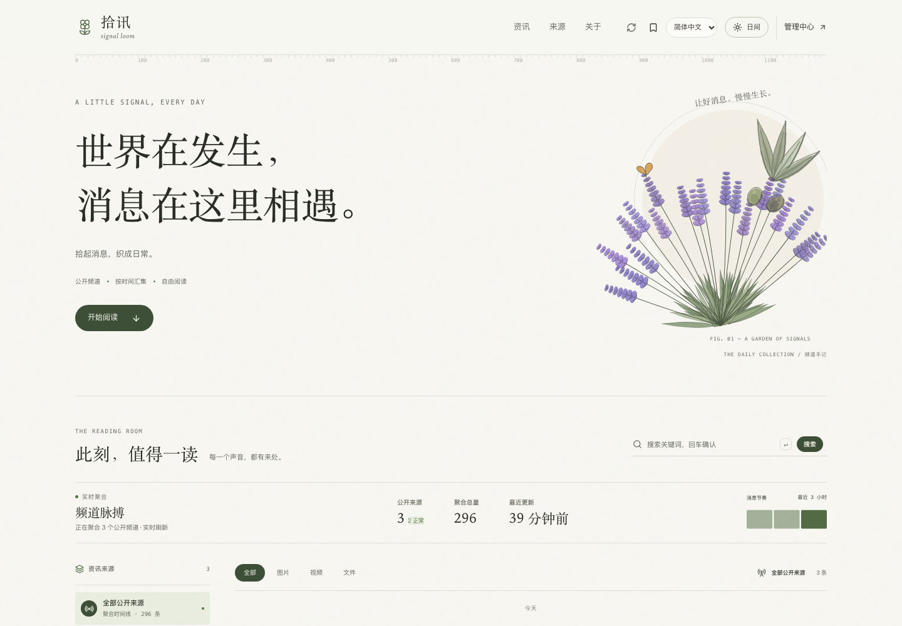

Signal Loom は公開 Telegram チャンネルの投稿を時系列で集め、落ち着いて読めるページにまとめます。Go が収集・権限管理・メディアキャッシュを担当し、React が公開ページと独立した管理画面を提供します。保存先は SQLite。公開ページの閲覧にログインは不要です。

## 機能を画面で見る

| 読む・共有する | 収集・管理する |
| --- | --- |
| 配信元・キーワード・メディア種別で絞り込み、条件を URL に保存 | 公開チャンネルの追加、収集の停止・再開、即時収集 |
| 紙のような昼間テーマと夜間テーマ、文字が組み上がる演出 | 配信元の状態、収集結果、過去のメッセージを確認 |
| 植物の動きと Alfama の水彩風フッター | キーワードルールを作成し、一致結果を確認・解決 |
| 画像全体を元の縦横比で表示、原寸画像のプレビュー | 概要、アクセス傾向、最近の訪問を表示。フィードバックは API で管理 |
| 長文と複数画像を省略せず共有カードに自動分割 | 収集の有効化と公開設定を個別に管理 |
| 現在のページをコピー、PNG 保存、全ページを ZIP 保存 | 管理キーによる認証、セッション管理、同一オリジン検証 |

### 01 · 読みたい情報を見つける

左側で配信元を選び、キーワードや写真・動画・ファイルのフィルターを組み合わせます。条件は URL に残るので、ブックマークや再訪にも使えます。公開配信元数、総メッセージ数、最終更新、読み込み済み投稿の時間別分布も確認できます。

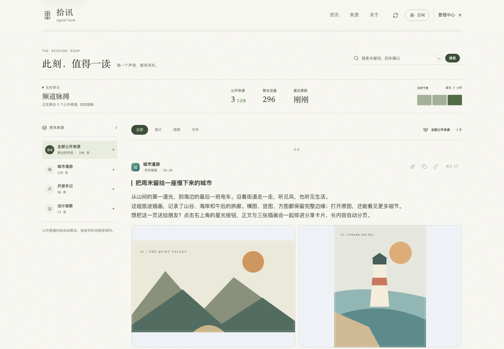

紹介文は枠や文字が組み上がりながら表示されます。投稿が画面に入ると文字が現れ、メディアを先に表示します。投稿ごとの演出は最大約 3.2 秒。操作すると全内容がすぐに表示され、「視差効果を減らす」設定では完成した状態を表示します。

### 02 · 横長も縦長も、画像全体を見る

横長・縦長・正方形の画像を切り抜かず、添付順に表示します。クリックすると画像ビューアーが開き、元画像の表示やダウンロードが可能です。Esc で閉じます。

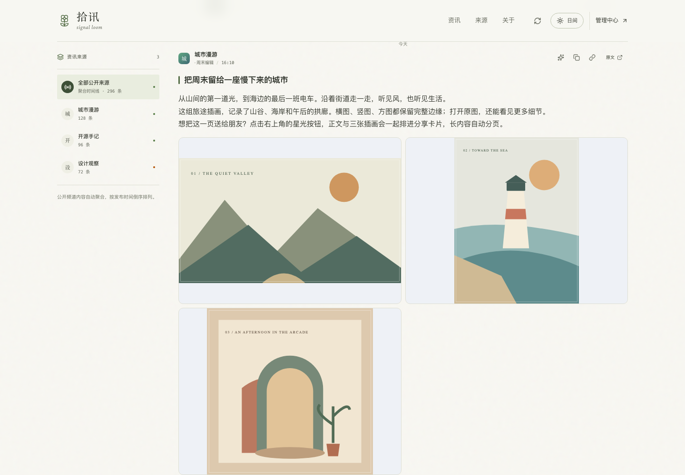

<details>
<summary>元画像のプレビュー</summary>

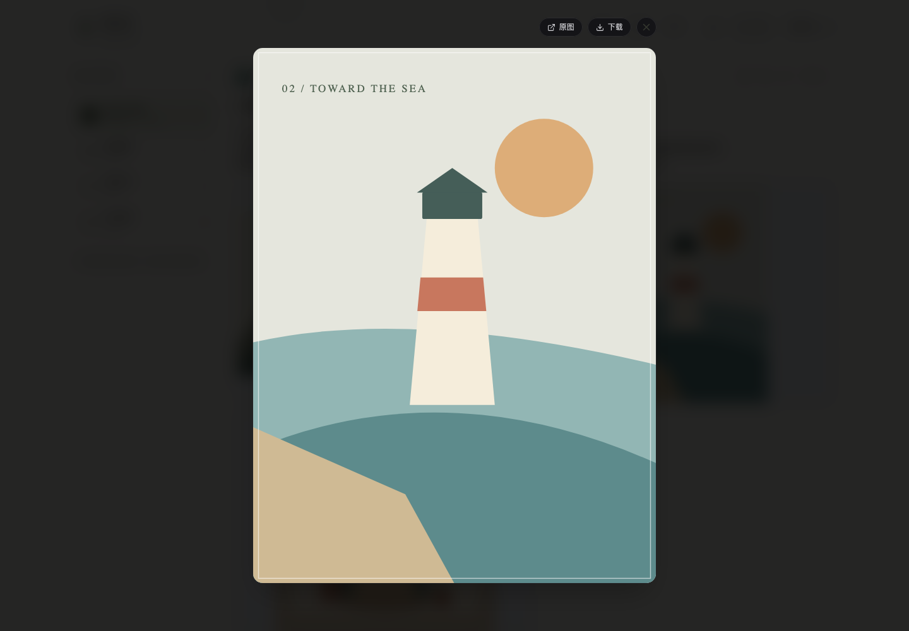

</details>

### 03 · 投稿をまるごと共有する

投稿右上の星形ボタンから共有カードを作成します。実際のフォントで改行位置を計測し、段落とすべての静止画像を保持します。長文や複数画像は自動的に複数ページへ分割されます。

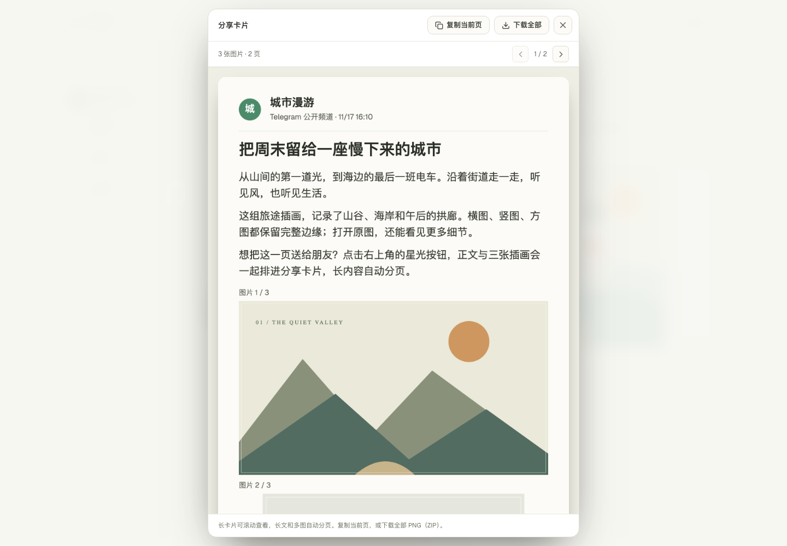

- 論理ページは最大 1080 × 2600、出力 PNG は最大 1620 × 3900。
- 現在のページをコピー、1 ページを PNG 保存、全ページを ZIP 保存できます。
- 各ページに配信元、ページ番号、サイトの URL を表示します。
- 読み込めない画像には番号付きの案内を残します。
- `PUBLIC_BASE_URL` でサイトの origin を設定します。共有ページには `/message/:id` と同じ URL の QR コードを表示します。未設定時は現在の origin を使い、ソース変更は不要です。

<details>
<summary>最終ページの画像とサイトリンク</summary>

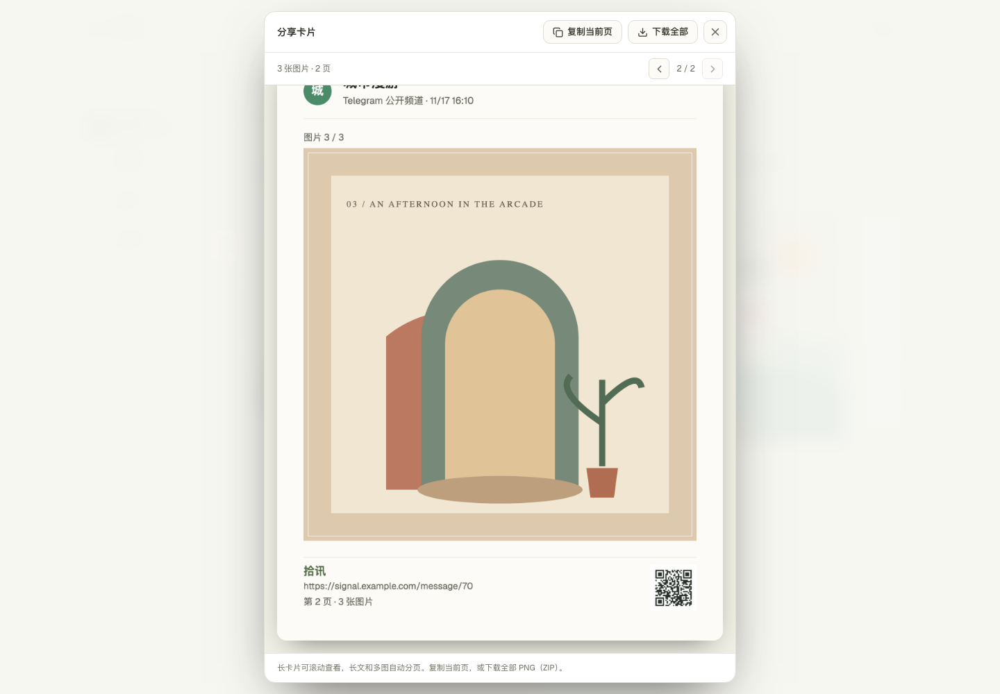

</details>

### 04 · 読書灯を切り替える

紙のような昼間表示と夜間表示を切り替えると、植物や Alfama の街並みも連動します。星、窓の明かり、路面電車が読書の終わりを彩ります。画面外や非表示のタブでは動きを停止します。

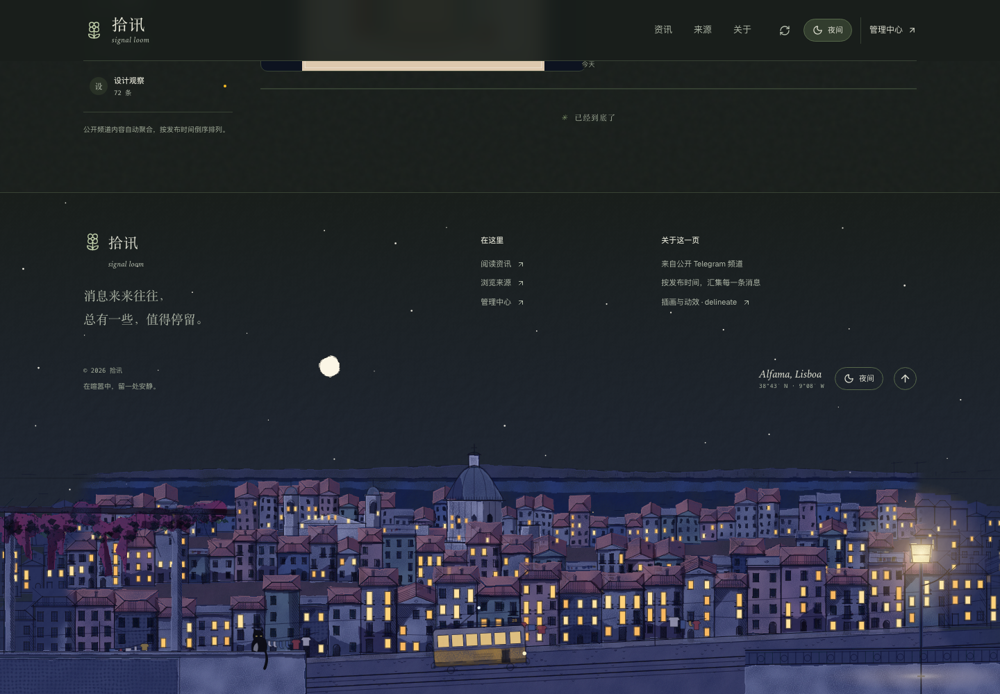

### 05 · スマートフォンでも読みやすく

ナビゲーション、検索、配信元、メディアフィルターが画面幅に合わせて配置されます。画像の縦横比を保持し、共有カードはスクロールとページ切り替えに対応します。

<p align="center">
  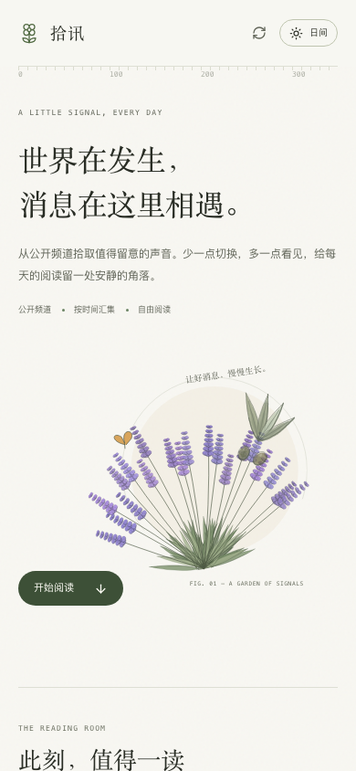
  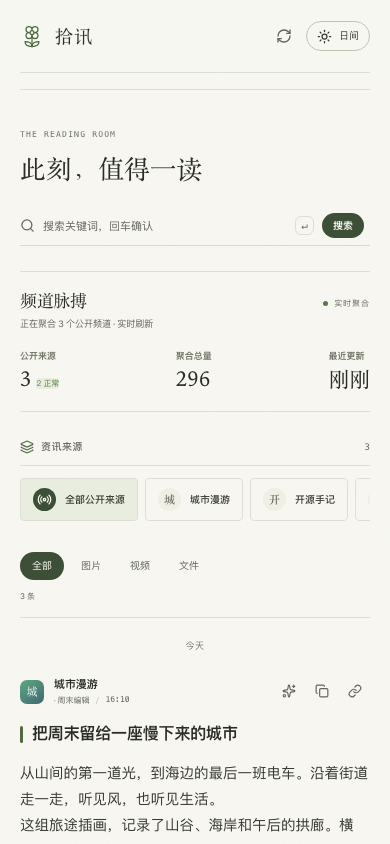
</p>

### 06 · 独立した管理画面

管理キーでログインすると、概要・収集元・ルール一致・メッセージ検索・アクセス記録を使えます。概要ではアクセス推移、収集状態、ルールの処理状況を確認できます。

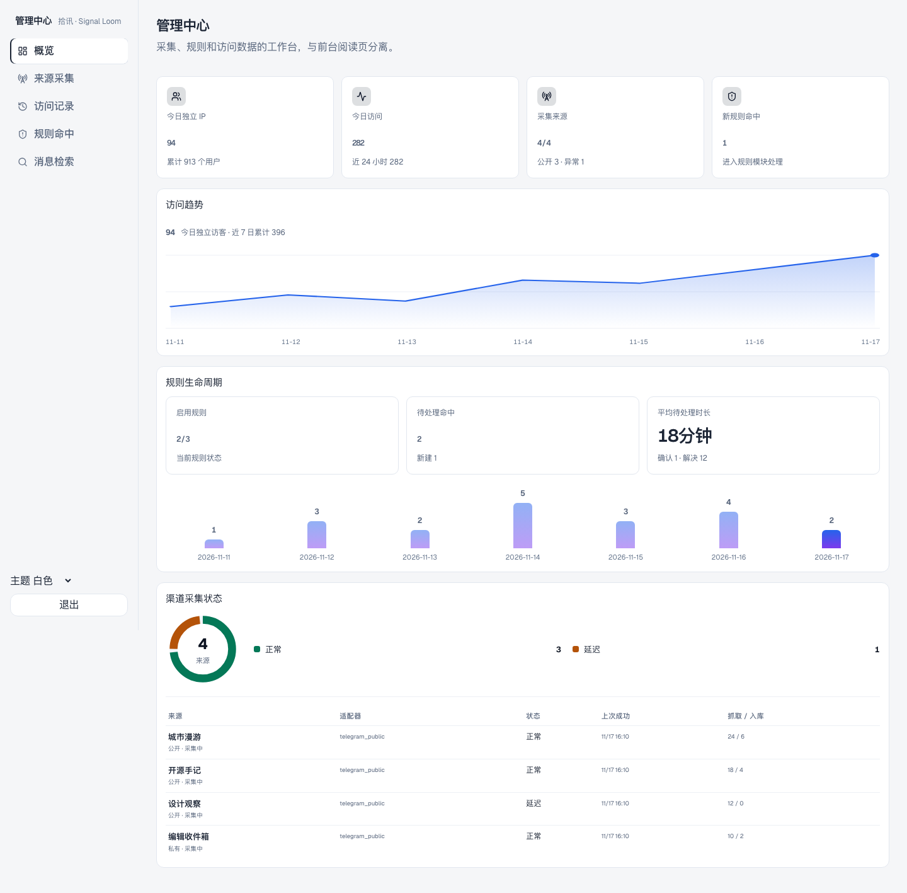

<details>
<summary><strong>収集元</strong> · チャンネル追加と公開範囲の管理</summary>

追加した収集元は初期状態で収集が有効、公開は無効です。即時収集、取得数・保存数の確認、連続失敗や新着なしによる絞り込みが可能です。

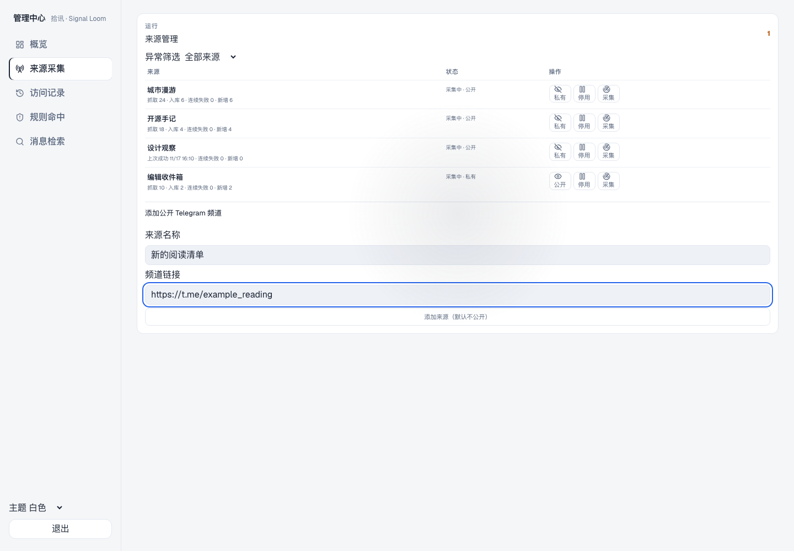

</details>

<details>
<summary><strong>ルール</strong> · キーワード一致を確認・解決</summary>

通常のキーワードでルールを作成します。新規ルールは無効状態で作られ、確認後に有効化できます。一致結果は新規・確認済み・解決済みの状態で管理します。

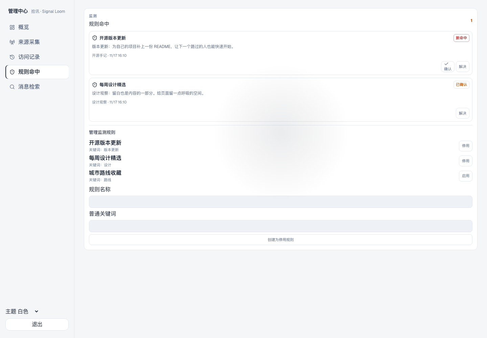

</details>

<details>
<summary><strong>検索</strong> · 収集した投稿を調べる</summary>

配信元・キーワード・メディア種別を組み合わせて検索します。配信元との関連が失われた過去のメッセージも管理画面から検索できます。

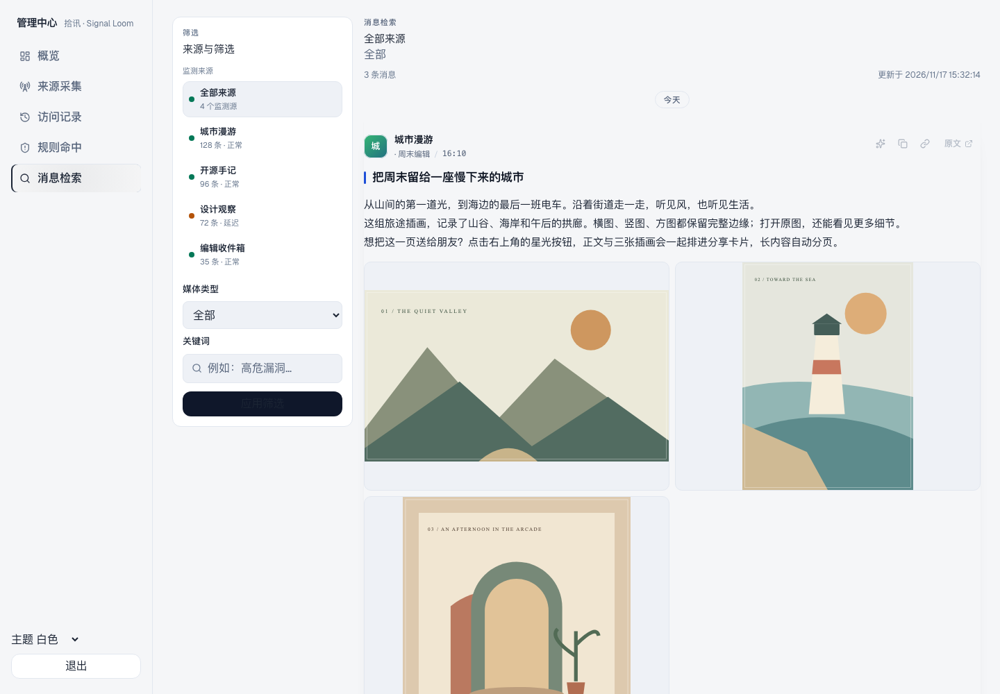

</details>

<details>
<summary><strong>アクセス</strong> · 閲覧状況を確認する</summary>

IP ベースの当日・直近・累計の統計に加え、時刻、パス、参照元、端末を確認できます。クライアント IP の識別には信頼するプロキシの正しい設定が必要です。

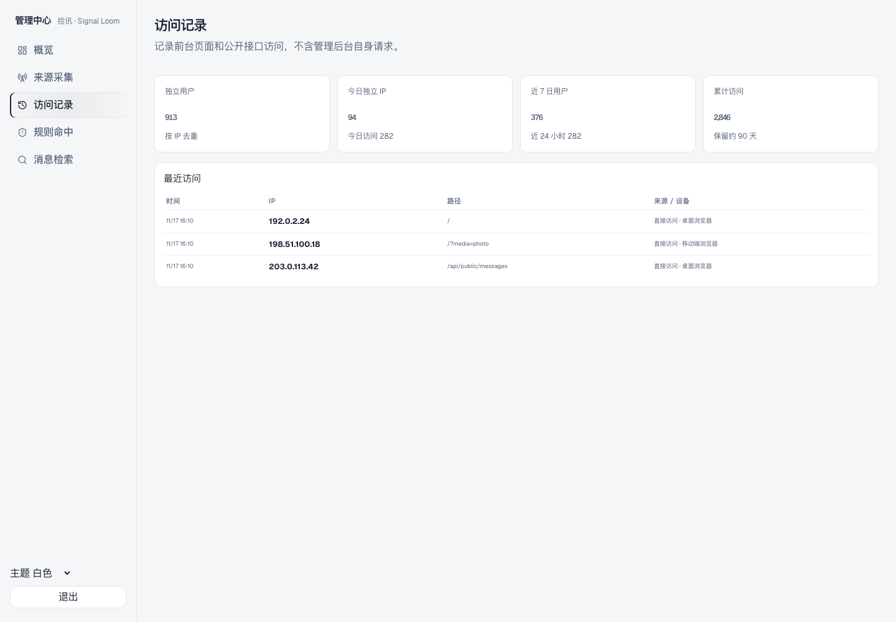

</details>

> 18 枚の画面は、現在のフロントエンドをローカルブラウザーで撮影したものです。独立したデモ用の投稿・イラスト・統計と、文書用に予約された IP アドレスを使っています。本番管理データやキーは含みません。公開 UI は簡体中文・English・日本語・Español に対応します。投稿本文は元の言語、管理画面は現在中国語です。

### 07 · 保存して、続きから読む

しおりは端末内にメッセージ ID だけを保存します。保存一覧では公開権限を再確認し、非公開・停止済み投稿は読めなくなります。読書の再開では検索条件と投稿位置を復元します。

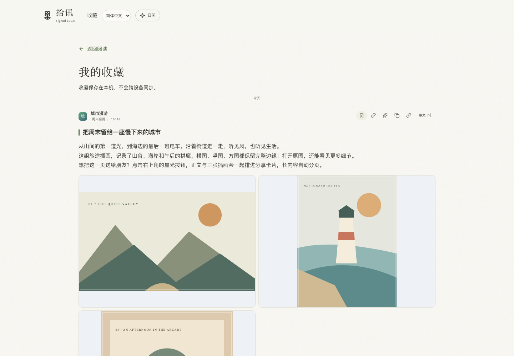

<details><summary>投稿ごとのリンクと QR コード</summary>

投稿には `/message/:id` のアドレスがあり、共有カードの QR コードでも開けます。

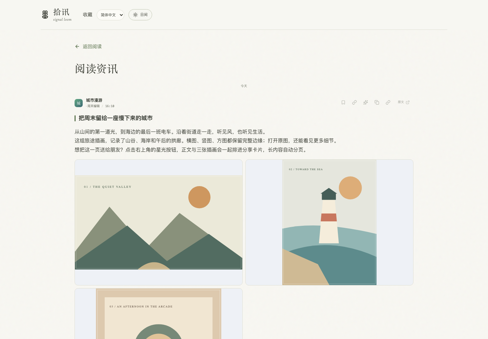

</details>

### 08 · 四言語とキャッシュ管理

公開 UI は中国語・英語・日本語・スペイン語に対応し、日付や共有文言も切り替わります。投稿本文は翻訳しません。翻訳辞書と QR 生成は必要時に読み込みます。

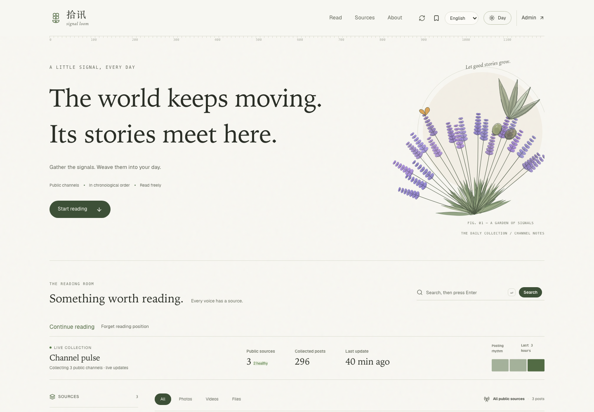

<details><summary>管理画面のキャッシュ容量</summary>

既定は 5 GiB・30 日、起動時と 15 分ごとに確認します。管理画面で容量とファイル数を確認し、すぐにメンテナンスできます。メッセージ DB は削除しません。

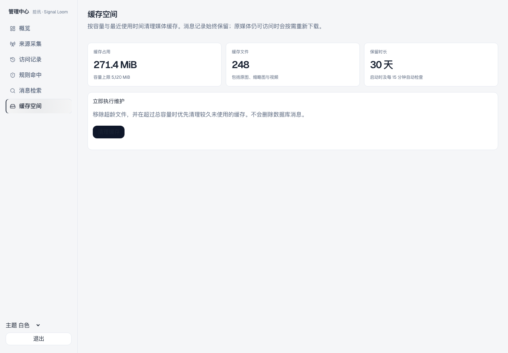

</details>

## 動作構成

**Go + React 19 + SQLite** で動作します。旧 Python/FastAPI 実装は `app/` と `tests/` に残っていますが、Docker は `cmd/server` から作成した Go バイナリを実行します。

| 入口 | パス | アクセス |
| --- | --- | --- |
| 公開ページ | `/` | ログイン不要。有効かつ公開の配信元のみ |
| 管理画面 | `/admin` | 管理キーでログイン |
| 公開 API | `/api/public/*` | 配信元、投稿、メディア、フィードバック |
| 管理 API | `/api/admin/*` | 管理セッションが必要 |
| ヘルスチェック | `/health` | `{"status":"ok"}` |

サーバー・スケジューラー・SQLite 書き込みは 1 プロセスです。**同じデータベースで複数のアプリインスタンスを動かさないでください。** セッションはメモリ上にあり、再起動後は再ログインが必要です。

## 導入

Docker Engine と Compose、および Telegram 公開ページへ接続できるネットワークが必要です。ビルド時は npm、Go モジュール、ベースイメージにも接続します。

```bash
git clone https://github.com/douxiaohu/signal-loom.git
cd signal-loom
cp .env.example .env
cp config/groups.example.yaml config/groups.yaml
mkdir -p data/media-cache
```

別々のキーを生成し、それぞれ `.env` の `ADMIN_API_KEY` と `SESSION_SECRET` に設定します。

```bash
openssl rand -hex 24
openssl rand -hex 32
```

```dotenv
APP_ENV=production
ADMIN_API_KEY=<generated-admin-key>
SESSION_SECRET=<generated-session-secret>
SESSION_COOKIE_SECURE=true
DATABASE_URL=sqlite:///./data/telegram_forwarder.db
TIMEZONE=Asia/Shanghai
APP_UID=1000
APP_GID=1000
```

Linux では `APP_UID` と `APP_GID` を配置先ユーザーの ID に合わせ、永続化ディレクトリへの書き込みを許可します。コンテナー内の `HOST` は空のまま、ポートは既定の 8000 を使います。

```bash
docker compose up -d --build
docker compose ps
curl -fsS http://127.0.0.1:8000/health
```

既定の Compose は外部ネットワークに依存せず、**127.0.0.1:8000** にのみ公開します。同一ホストの HTTPS リバースプロキシを通してください。管理ログインのセキュア Cookie には HTTPS が必要です。

```caddy
signal.example.com {
    encode gzip
    reverse_proxy 127.0.0.1:8000
}
```

ブラウザーの元の `Host` を保持し、クライアント IP を転送します。Nginx では `proxy_set_header Host $host;` を指定します。書き込み時は `Origin` と `Host` を検証するため、Host の変更は 403 の原因になります。`TRUSTED_PROXIES` には実際に信頼できる IP/CIDR を設定します。

`/admin` で管理キーを使ってログインし、チャンネル名と `https://t.me/channel` を追加します。新規追加のチャンネルは収集が有効、公開は無効です。

`config/groups.yaml` は **sources テーブルが空のときだけ** 初期データを投入します。有効な初期チャンネルは収集・公開とも有効です。その後 YAML を変更しても既存データは上書きされません。起動時に収集し、以後は既定で 300 秒ごとに実行します。

```yaml
groups:
  - source: "https://t.me/example_channel"
    name: "読書リスト"
```

現在の Go 実装は **`telegram_public` のみ** 対応します。Bot、ロングポーリング、RSS は未実装です。`TELEGRAM_BOT_TOKEN` は旧設定との互換用に残っています。

## ローカル開発

**Go 1.27.4+ と npm** を使います。Node.js の対応範囲は `^22.22.2 || ^24.15.0 || >=26.0.0` です。現在のアプリ実行に Python は不要です。上記の設定ファイルを用意してから実行します。

```bash
cd frontend
npm ci
npm run build
cd ..
APP_ENV=development HOST=127.0.0.1 SESSION_COOKIE_SECURE=false go run ./cmd/server
```

別のターミナルでフロントエンドを起動します。

```bash
cd frontend
npm run dev -- --host 127.0.0.1
```

Vite はローカル URL を表示し、`/api` を `127.0.0.1:8000` に転送します。キーは `.env` から読み込みます。開発環境でキーがなければ一時キーを生成し、管理キーをローカルログへ出力します。本番は設定済みのキーが必須です。ローカル HTTP では `SESSION_COOKIE_SECURE=false`、本番は `true` にします。

## 設定

全項目と既定値は [`.env.example`](.env.example) を参照してください。プロセス環境変数が `.env` より優先されます。

| 変数 | 用途・既定値 |
| --- | --- |
| `SITE_NAME` / `SITE_DESCRIPTION` | 実行時のサイト名・説明 |
| `PUBLIC_BASE_URL` | 投稿リンクと QR の origin。空なら現在の origin |
| `MEDIA_CACHE_MAX_BYTES` / `MEDIA_CACHE_MAX_AGE_DAYS` | 総容量 / 保留期間。5 GiB / 30 日 |
| `APP_ENV` | `production` / `staging` / `development` / `test`。未知の値は起動失敗 |
| `ADMIN_API_KEY` / `SESSION_SECRET` | 管理キー 16 文字以上 / セッション HMAC キー 32 バイト以上 |
| `SESSION_COOKIE_SECURE` / `SESSION_TTL_HOURS` | HTTPS Cookie / 有効時間。`true` / `12` |
| `HOST` / `PORT` | 全インターフェース / `8000` |
| `DATABASE_URL` | `sqlite:///./data/telegram_forwarder.db` |
| `GROUPS_CONFIG_PATH` | 初期配信元。`config/groups.yaml` |
| `CRAWL_INTERVAL_SECONDS` / `SOURCE_STALE_AFTER_SECONDS` | 収集間隔 `300` / 遅延判定 `900` |
| `TIMEZONE` | サイレント時間帯と統計のタイムゾーン。`Asia/Shanghai` |
| `TRUSTED_PROXIES` | 信頼する IP/CIDR、または `private` / `loopback` / `none` |
| `MEDIA_CACHE_DIR` | `./data/media-cache` |
| `MEDIA_ALLOWED_HOSTS` | HTTPS のみ。`telesco.pe`、`cdn-telegram.org` とサブドメイン |
| `MEDIA_MAX_BYTES` | 1 ファイルの上限。96 MiB |
| `LOGIN_MAX_ATTEMPTS` / `LOGIN_WINDOW_SECONDS` | ログイン制限。`5` / `900` |
| `FEEDBACK_RATE_LIMIT` / `FEEDBACK_RATE_WINDOW_SECONDS` | フィードバック制限。`5` / `60` |

実際の `.env`、`config/groups.yaml`、データ、リリースパッケージ、バックアップは Git に含めません。

## テストとアクセス制御

公開 API は有効かつ公開の配信元だけにアクセスできます。非公開配信元は 404 です。管理セッションは HttpOnly / SameSite=Strict Cookie を使い、ログアウトで無効になります。書き込みは JSON、同一オリジン、本文サイズの検証を行い、開発時は一部条件を緩和します。メディアは HTTPS ホスト許可リストに基づきサーバー側でキャッシュします。

拡張子のない未知のフロントエンドパスは公開 SPA にフォールバックする場合があります。`/docs` の 200 だけでは API 文書の公開を意味しません。未知の `/api/*` は JSON の 404 を返します。

```bash
go test ./...
go vet ./...
cd frontend
npm ci
npm test
npm run build
npx playwright install chromium
npm run test:e2e
```

ブラウザーテストは 1440・768・390 px の幅で、検索、画像、テーマ、動き、権限、長文と複数画像の共有を API フィクスチャーで確認します。本番 DB には書き込みません。ビルド時の JavaScript 上限は閲覧 280 KiB、遅延読込 Assembly 36 KiB、共有 16 KiB です。

## バックアップと更新

WAL を含むオンラインバックアップを実行します。

```bash
python3 scripts/release.py backup data/telegram_forwarder.db backups/before-upgrade.db
```

正式リリースツールはプログラム・フロントエンド・チェックサムだけを梱包します。バックアップ後に独立した候補を確認し、切り替え後はファイル、権限、管理 API の 401 を検証します。失敗時はイメージと環境を戻し、現在の DB は保持します。

手順は[運用ガイド](docs/operations.md)を参照してください。共有ネットワークは `docker-compose.server.yml` で任意に設定できます。GitHub Actions でテスト、ブラウザー、ビルド容量、リリースツール、機密情報・依存関係、Docker 構築を検査し、Dependabot が更新 PR を作成します。

## 関連文書

| 内容 | リンク |
| --- | --- |
| 他の言語 | [简体中文](README.md) · [English](README.en.md) · [Español](README.es.md) |
| 現行アーキテクチャ | [Go 実行構成・中国語](docs/architecture/current-go-runtime.md) |
| リリースとバックアップ | [運用ガイド・中国語](docs/operations.md) |
| 貢献と更新履歴 | [Contributing](CONTRIBUTING.md) · [Changelog](CHANGELOG.md) |
| 完全な環境設定 | [`.env.example`](.env.example) |
| 閲覧室と動きの設計 | [設計記録・中国語](docs/architecture/notes/implemented/feature/2026-11-17-editorial-assembly-reading-room.md) |
| 画像と共有カード | [実装記録・中国語](docs/architecture/notes/implemented/bug-fix/2026-11-17-complete-media-and-paged-share-cards.md) |
| リリースと復旧 | [運用記録・中国語](docs/releases/2026-11-17-reader-and-verified-operations.md) |
| ディレクトリ構成 | [中国語リファレンス](README.md#目录导航) |
| セキュリティ | [SECURITY.md](SECURITY.md) |
| ライセンス | [MIT](LICENSE) · [第三者の権利表示](THIRD_PARTY_NOTICES.md) |

## 謝辞とライセンス

画面は [appautomaton/delineate](https://github.com/appautomaton/delineate) の Assembly、Climate Garden、Alfama を参考にしています。再利用コードとイラストの MIT 表示は [vendor](frontend/src/vendor/delineate/LICENSE) と [artwork](frontend/public/artwork/LICENSE-delineate.txt) に保持しています。

プロジェクトのコードと文書は [MIT](LICENSE) です。第三者コード、Geist フォント、依存ライブラリーには元のライセンスが適用されます。Telegram 投稿や画像は本プロジェクトの MIT の対象ではありません。[第三者の権利表示](THIRD_PARTY_NOTICES.md) を確認してください。
