<div align="center">

**简体中文** · [English](README.en.md) · [日本語](README.ja.md) · [Español](README.es.md)

# 拾讯 · Signal Loom

**拾起消息，织成日常。**

「拾」是发现，「讯」是连接。Signal Loom，把散落在频道里的声音，织成一页值得停留的阅读。

Telegram 公开频道聚合 · 安静阅读 · 完整图片 · 长文与多图分享


[](LICENSE)

[在线阅读](https://douxiaohu.duckdns.org) · [快速开始](#快速开始) · [本地开发](#本地开发) · [配置](#配置) · [文档导航](#文档导航)

</div>

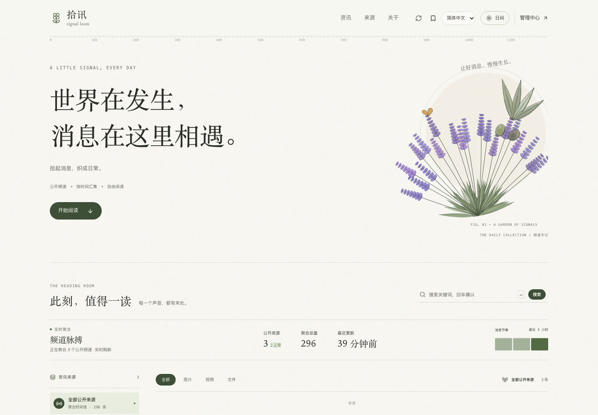

> 一个可以单机部署的资讯阅读站。Go 负责采集、权限与媒体缓存，React 提供公开阅读页和独立管理中心；一份 SQLite 保存消息与来源，日常浏览无需登录。

## 这一版能做什么

| 阅读与分享 | 采集与管理 |
| --- | --- |
| 来源、关键词、媒体类型筛选，URL 保留检索条件 | 添加公开 Telegram 频道，启停与立即采集 |
| 纸张日间与夜间阅读，滚动触发逐字组装 | 频道健康、采集状态、消息检索 |
| 植物生长动效、Alfama 水彩城市页脚 | 监测规则与命中确认、解决 |
| 图片按完整比例展示，点击查看原图 | 概览、访问统计与反馈管理 API |
| 长文不截断、多图不裁切，自动生成分享分页 | 新增来源默认采集，单独控制是否公开 |
| 复制当前页、下载 PNG 或整套 PNG 的 ZIP | 管理密钥登录、会话与同源写入校验 |

### 01 · 在纸张阅读室里发现消息

暖白纸张、中文衬线标题与橄榄绿控件，让消息聚合页也有杂志的阅读节奏。介绍区会拉框排字，消息滚入视口后逐字显现，媒体优先展开，单卡动画最多约 3.2 秒。点击、键盘操作会立即显示完整内容；开启“减少动态效果”时直接显示完成状态。

选择左侧来源，组合关键词与媒体类型筛选；检索条件保留在 URL，方便收藏和回访。频道脉搏展示公开来源数量、聚合总量、最近更新和当前已加载消息的小时节奏。

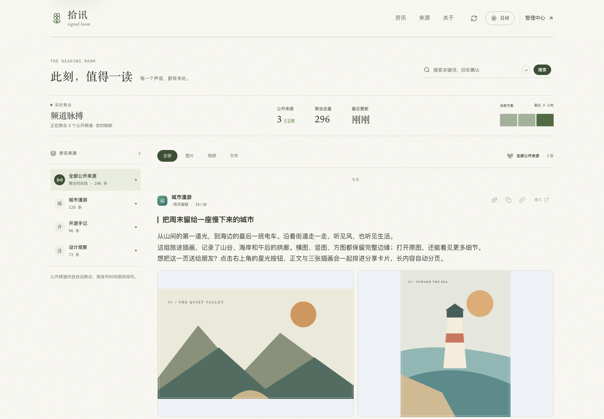

### 02 · 横图、竖图、方图，都能完整看见

图片按原始比例完整展示，多图保持附件顺序。点击任一图片进入大图预览，可打开原图或下载，按 Esc 返回阅读。

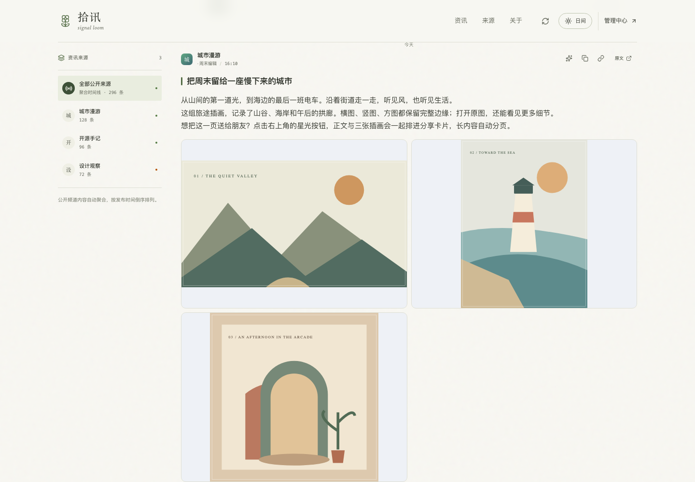

<details>
<summary>查看原图预览界面</summary>


</details>

### 03 · 把整篇内容，分享给另一个人

点击消息右上角的星光按钮，生成带来源与网站链接的分享卡片。正文按实际字体测量换行，保留段落；全部静态图片优先使用原图，按附件顺序等比绘制。长文与多图自动分页，每页都有来源、页号、本站消息链接与二维码。

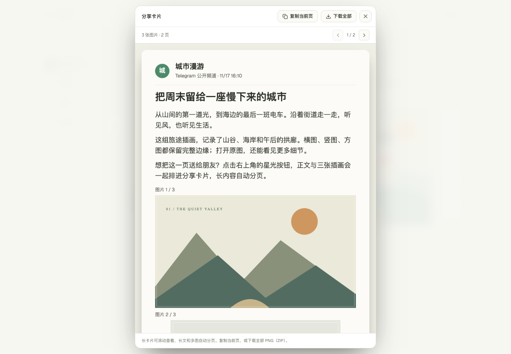

- 单页逻辑尺寸不超过 1080 × 2600，输出 PNG 不超过 1620 × 3900，避免无限长画布。
- 可复制当前页，单页下载 PNG，多页一次下载 ZIP。
- 图片加载失败时保留带编号的提示，方便回到原文查阅。
- 每页页脚使用部署者设置的 `PUBLIC_BASE_URL`，链接到 `/message/:id`；二维码指向同一条消息。网址留空时使用当前站点 origin，无需修改源码。

<details>
<summary>查看多图分享末页与网站链接</summary>

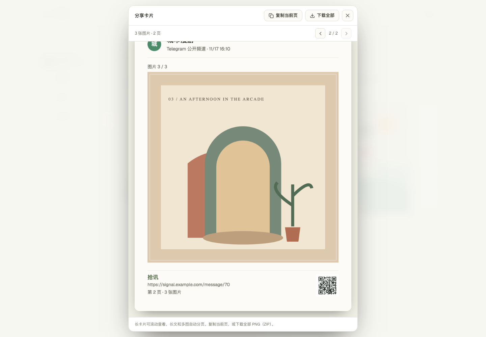

</details>

### 04 · 一盏阅读灯，一座会呼吸的城市

日间纸张与夜间阅读一键切换，植物插画与 Alfama 水彩页脚同步变化。星空、窗灯和电车组成阅读末尾的小风景；插画离开视口或页面隐藏时暂停，减少无效动画。

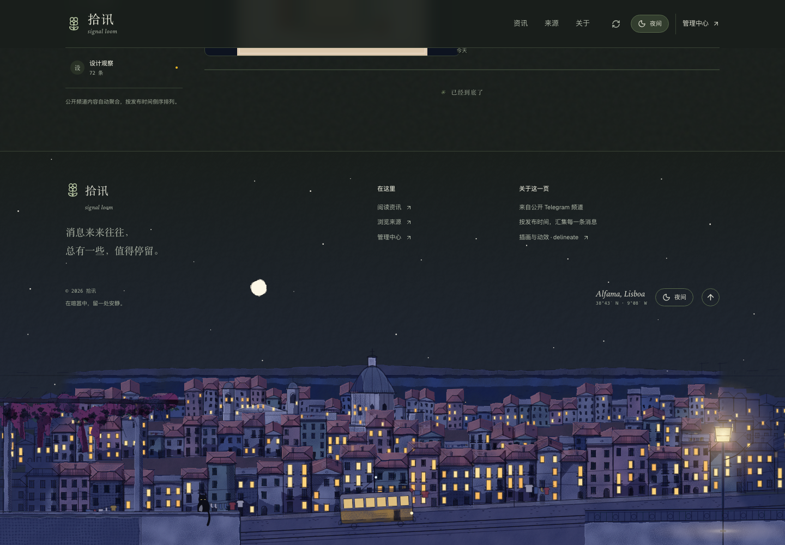

### 05 · 在手机上，也能轻松翻阅

导航、搜索、来源与媒体筛选适配窄屏；图片继续保留完整比例，分享预览支持滚动和分页。

<p align="center">
  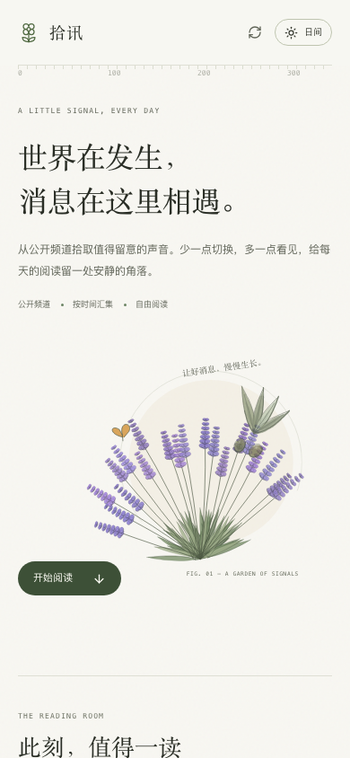
  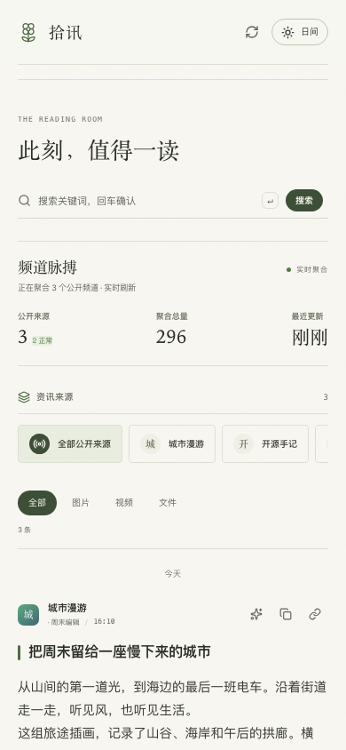
</p>

### 06 · 用独立工作台，管理自己的信息花园

管理中心通过管理密钥登录，提供概览、来源采集、规则命中、消息检索与访问记录。概览串起访问趋势、来源健康和规则生命周期，快速找到需要处理的事项。

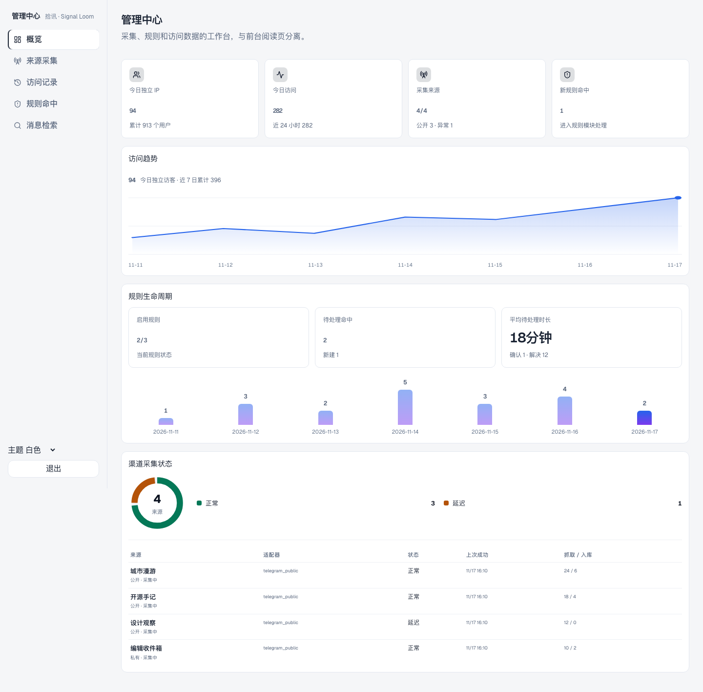

<details>
<summary><strong>来源管理</strong> · 添加频道、启停采集、控制是否公开</summary>

新添加的来源默认采集、默认不公开。可以立即采集，查看抓取与入库数量，按连续失败或无新增消息筛选来源；公开展示独立控制。

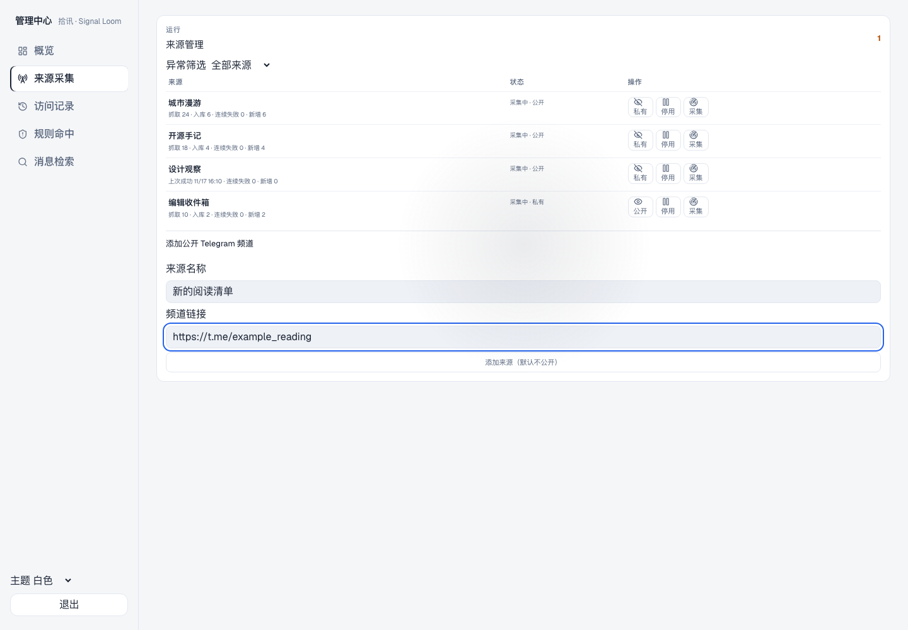

</details>

<details>
<summary><strong>规则监测</strong> · 从关键词命中，到确认与解决</summary>

创建普通关键词规则，新规则默认停用，确认后可启用。规则命中按新建、已确认、已解决流转；后台可查看命中内容、来源和时间。

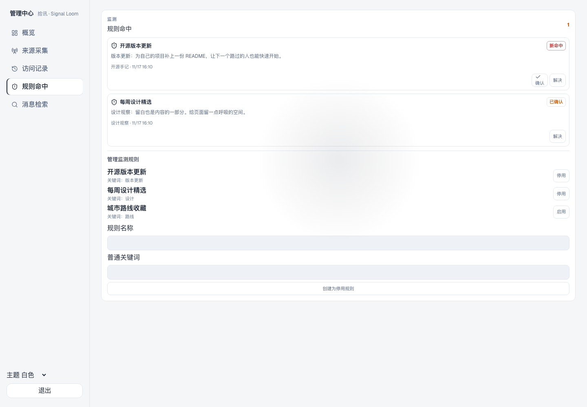

</details>

<details>
<summary><strong>消息检索</strong> · 按来源、关键词和媒体类型查询</summary>

管理端提供独立检索工作区，便于核查采集内容，并保留历史孤儿消息的查询能力。

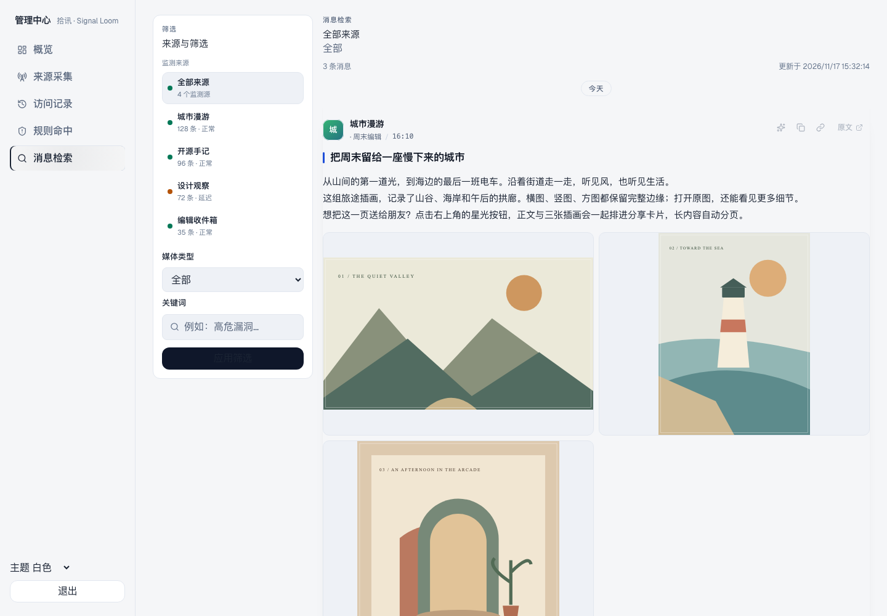

</details>

<details>
<summary><strong>访问记录</strong> · 观察阅读站的使用情况</summary>

按 IP 去重统计今日、近 7 日和累计访问，列出最近访问时间、路径、来源与设备。实际 IP 识别依赖可信代理配置；截图中的 IP 使用文档保留网段。

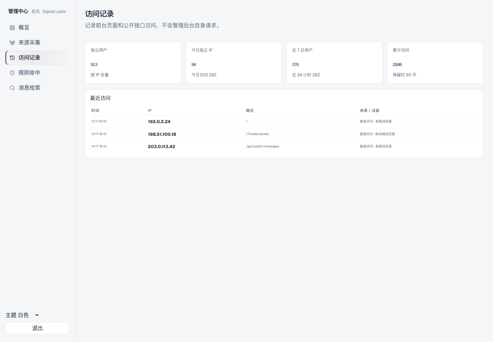

</details>

> 本页 18 张截图来自当前前端的本地浏览器实拍，使用隔离的演示来源、消息、插画和统计数据；不展示真实密钥、访客地址或生产后台数据。公开界面支持简体中文、English、日本語和 Español；频道原文保持原语言，管理端目前使用中文。

### 07 · 收藏、继续阅读与单条消息分享

点击消息书签即可收藏，收藏只在本机保存消息 ID。打开“收藏”时重新验证来源公开权限；私有化或停用后的内容会显示不可用，可以移除失效条目。阅读页提供“继续上次阅读”，恢复筛选条件与消息位置。

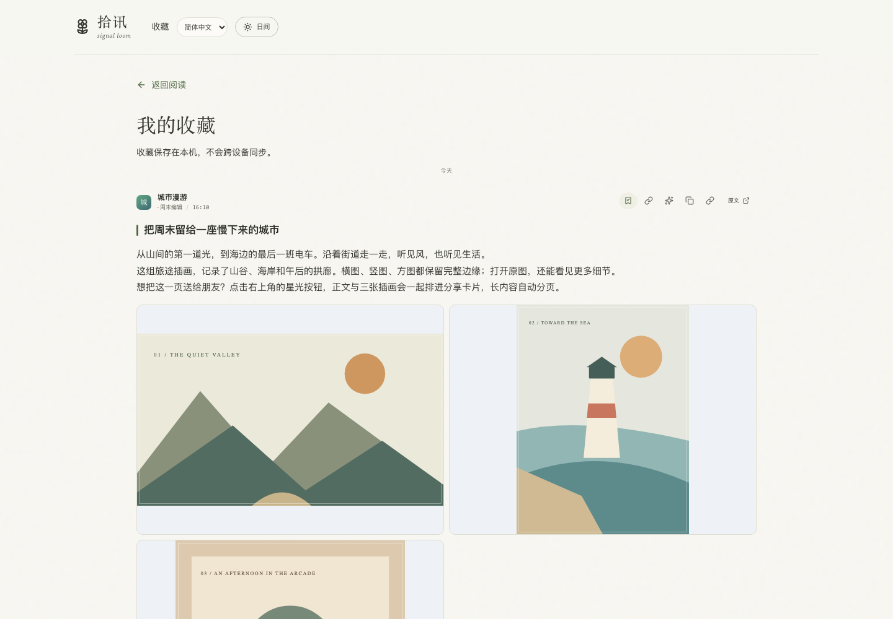

<details>
<summary>查看本站单条消息页面</summary>

每条消息提供 `/message/:id` 独立地址，可从消息工具栏复制，也可以扫描分享卡片二维码打开。公开权限与列表、媒体保持一致。

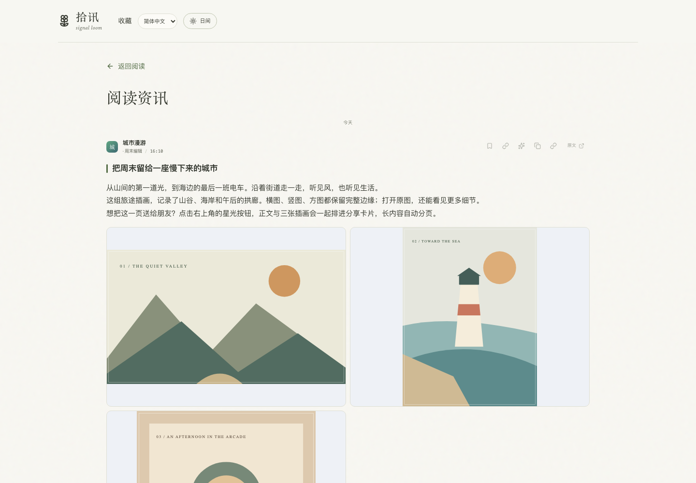

</details>

### 08 · 四语言阅读与缓存维护

公开页的语言选择器支持中文、English、日本語、Español，并记住本机选择。菜单、日期、媒体类型、分享文案和错误提示随语言切换，频道正文不自动翻译。非中文词典与二维码按需加载。

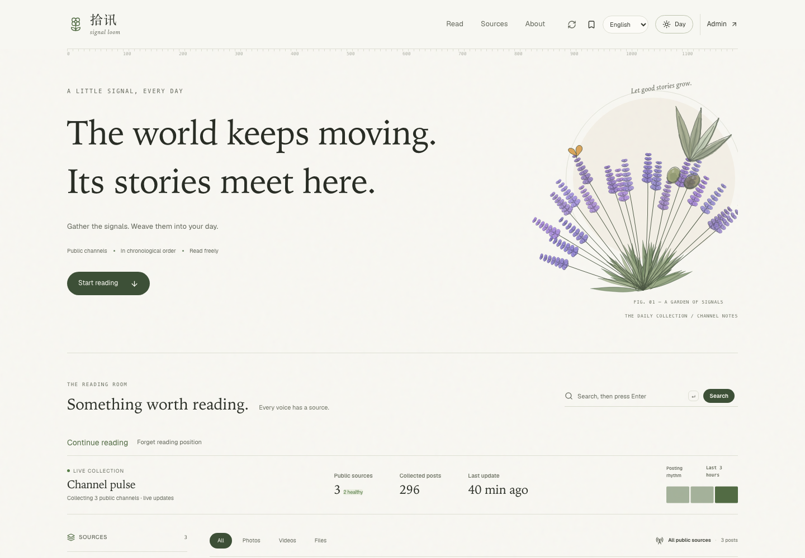

<details>
<summary>缓存空间：容量、文件数与保留策略</summary>

管理端“缓存空间”显示使用量、总量上限与保留天数，可以立即执行维护。默认 5 GiB / 30 天，启动及每 15 分钟检查；仅回收媒体缓存，不删除消息数据库。

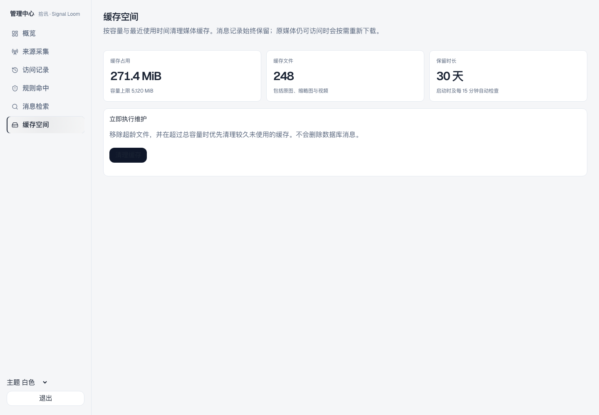

</details>

## 多语言文档

| 语言 | 阅读入口 | 内容 |
| --- | --- | --- |
| 简体中文 | [README](README.md) | 完整功能图解、部署、开发与运维说明 |
| English | [English guide](README.en.md) | Features, screenshots, setup, configuration and operations |
| 日本語 | [日本語ガイド](README.ja.md) | 機能紹介・画面・導入・設定・運用 |
| Español | [Guía en español](README.es.md) | Funciones, capturas, instalación, configuración y operación |

## 运行结构

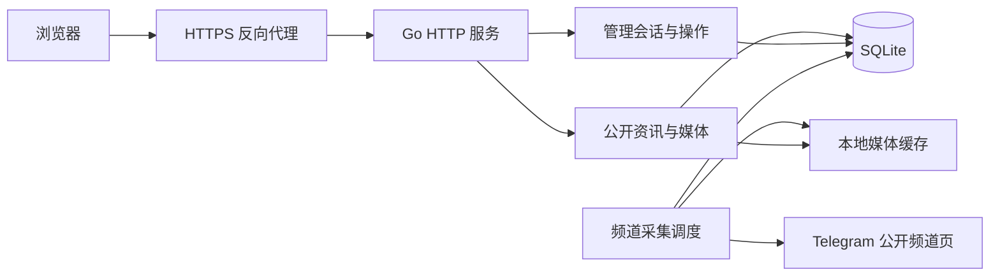

**运行时是 Go + React 19 + SQLite。** 历史 Python/FastAPI 实现保留在 `app/` 和 `tests/`，当前 Docker 镜像执行 `cmd/server` 构建出的 Go 程序。

| 入口 | 路径 | 访问方式 |
| --- | --- | --- |
| 公开阅读 | `/` | 无需登录，只展示已启用且公开的来源 |
| 管理中心 | `/admin` | 管理密钥登录 |
| 公开 API | `/api/public/*` | 来源、消息、媒体与反馈 |
| 管理 API | `/api/admin/*` | 需要有效管理会话 |
| 健康检查 | `/health` | `{"status":"ok"}` |

服务、采集器和 SQLite 写入运行在一个进程中。**同一份数据库只运行一个应用实例**；管理会话在内存中保存，重启后需重新登录。

## 快速开始

需要 Docker Engine、Compose 和可访问 Telegram 频道页的服务器网络。镜像构建需要访问 npm、Go 模块与基础镜像仓库。

### 1. 获取代码与配置

```bash
git clone https://github.com/douxiaohu/signal-loom.git
cd signal-loom
cp .env.example .env
cp config/groups.example.yaml config/groups.yaml
mkdir -p data/media-cache
```

源码托管于 [douxiaohu/signal-loom](https://github.com/douxiaohu/signal-loom)。

### 2. 设置密钥

分别运行以下命令，将输出填入 `.env` 的 `ADMIN_API_KEY` 和 `SESSION_SECRET`：

```bash
openssl rand -hex 24
openssl rand -hex 32
```

确认以下配置：

```dotenv
APP_ENV=production
ADMIN_API_KEY=<第一条命令生成的管理密钥>
SESSION_SECRET=<第二条命令生成的会话密钥>
SESSION_COOKIE_SECURE=true
DATABASE_URL=sqlite:///./data/telegram_forwarder.db
TIMEZONE=Asia/Shanghai
APP_UID=1000
APP_GID=1000
```

Linux 上将 `APP_UID`、`APP_GID` 设置为部署用户对应的 UID/GID，保证持久化目录可写。容器内 `HOST` 保持为空，`PORT` 使用默认 8000。

### 3. 启动

默认 Compose 可独立运行，不需要创建外部网络：

```bash
docker compose up -d --build
docker compose ps
curl -fsS http://127.0.0.1:8000/health
```

如需接入已有服务器的 `ai-internal`，额外应用 `docker-compose.server.yml`，详见[运维说明](docs/operations.md)。

Compose 将服务发布到 **`127.0.0.1:8000`**。生产环境通过同机 HTTPS 反向代理访问；安全 Cookie 要求使用 HTTPS 登录管理中心。

<details>
<summary><strong>Caddy 反向代理示例</strong></summary>

```caddy
signal.example.com {
    encode gzip
    reverse_proxy 127.0.0.1:8000
}
```

反向代理需保留浏览器原始 `Host`，传递 `X-Forwarded-For`。Nginx 对应设置为 `proxy_set_header Host $host;`。服务会校验写请求的 `Origin` 与 `Host`；修改 Host 可能导致登录或操作返回 403。

`TRUSTED_PROXIES` 只配置实际可信的代理 IP/CIDR。通过 CDN 或额外网关接入时，需要结合真实链路配置，才能正确统计客户端地址和执行限流。

</details>

### 4. 管理来源

打开 `/admin`，使用管理密钥登录，再添加频道名称和 `https://t.me/channel`。新增频道默认采集、默认不公开，确认内容后再启用公开展示。

`config/groups.yaml` 用于**空 sources 表的首次初始化**。示例：

```yaml
groups:
  - source: "https://t.me/zaihuapd"
    name: "zaihuapd"
  - source: "https://t.me/s/tnews365"
    name: "竹新社"
```

初始化文件导入的有效公开频道默认采集且公开；修改 YAML 不会覆盖数据库中的已有来源。启动时采集一次，之后默认每 300 秒继续采集。

> 当前 Go 版本支持 `telegram_public`。`telegram_bot`、Bot 长轮询和 RSS 尚未接入 Go 运行时；`TELEGRAM_BOT_TOKEN` 只为兼容旧配置保留。

## 本地开发

需要 **Go 1.27.4+、Node.js 22.22.2+ 和 npm**。不需要 Python 来运行当前应用。

```bash
cp .env.example .env
cp config/groups.example.yaml config/groups.yaml
mkdir -p data/media-cache
cd frontend
npm ci
npm run build
cd ..
```

在第一个终端启动后端：

```bash
APP_ENV=development \
HOST=127.0.0.1 \
SESSION_COOKIE_SECURE=false \
go run ./cmd/server
```

从 `.env` 读取已设置的密钥。开发环境缺少密钥时会生成临时值，临时管理密钥写入本地启动日志；生产不会使用临时密钥。

在第二个终端启动前端：

```bash
cd frontend
npm run dev -- --host 127.0.0.1
```

Vite 在终端显示本地地址，并把 `/api` 代理到 `127.0.0.1:8000`。本地 HTTP 登录需使用 `SESSION_COOKIE_SECURE=false`；生产必须为 `true`。

## 配置

完整配置及默认值见 [`.env.example`](.env.example)。进程环境变量优先于 `.env`。

| 变量 | 用途 / 默认值 |
| --- | --- |
| `SITE_NAME` / `SITE_DESCRIPTION` | 运行时站点名称与简介 |
| `PUBLIC_BASE_URL` | 本站规范 origin，用于消息链接与分享二维码；为空时使用当前 origin |
| `MEDIA_CACHE_MAX_BYTES` / `MEDIA_CACHE_MAX_AGE_DAYS` | 总缓存软上限 / 保留天数，默认 5 GiB / 30 天 |
| `APP_ENV` | `production` / `staging` / `development` / `test`；无法识别的值拒绝启动 |
| `ADMIN_API_KEY` | 管理密钥，至少 16 字符 |
| `SESSION_SECRET` | 会话 HMAC 密钥，至少 32 字节 |
| `SESSION_COOKIE_SECURE` / `SESSION_TTL_HOURS` | HTTPS Cookie / 会话时长，默认 `true` / `12` |
| `HOST` / `PORT` | 监听地址 / 端口，默认所有网卡 / `8000` |
| `DATABASE_URL` | 默认 `sqlite:///./data/telegram_forwarder.db` |
| `GROUPS_CONFIG_PATH` | 首次初始化来源，默认 `config/groups.yaml` |
| `CRAWL_INTERVAL_SECONDS` | 采集间隔，默认 `300` |
| `SOURCE_STALE_AFTER_SECONDS` | 来源延迟判断阈值，默认 `900` |
| `TIMEZONE` | 静默时段、访问统计时区，默认 `Asia/Shanghai` |
| `TRUSTED_PROXIES` | 可信代理 IP/CIDR 或 `private` / `loopback` / `none` |
| `MEDIA_CACHE_DIR` | 默认 `./data/media-cache` |
| `MEDIA_ALLOWED_HOSTS` | 默认 `telesco.pe,cdn-telegram.org` 及其子域，仅 HTTPS |
| `MEDIA_MAX_BYTES` | 单文件缓存上限，默认 96 MiB |
| `LOGIN_MAX_ATTEMPTS` / `LOGIN_WINDOW_SECONDS` | 登录限流，默认 5 次 / 900 秒 |
| `FEEDBACK_RATE_LIMIT` / `FEEDBACK_RATE_WINDOW_SECONDS` | 反馈限流，默认 5 次 / 60 秒 |

真实 `.env`、`config/groups.yaml`、数据目录、发布包和本地备份不提交到 GitHub。

## 数据与访问边界

- 公开消息与媒体只允许访问**启用且已公开**的来源；指定未公开来源时返回 404。
- 没有公开来源时，公开列表正常返回空集合。
- 管理端保留历史孤儿消息的查询能力，来源删除或变化不等于删除历史消息。
- 管理会话使用 HttpOnly / SameSite=Strict Cookie；登出立即作废。
- 写请求要求 JSON，并执行同源校验和请求体大小限制；开发环境部分规则放宽。
- 媒体由服务端按白名单缓存，返回给浏览器的是本站媒体路径。
- 前端未知无扩展名路径可能回退到首页；不能仅凭 `/docs` 返回 200 判断暴露了 API 文档。未知 `/api/*` 返回 JSON 404。

## 检查与测试

```bash
# Go 后端：接口、认证、采集、SQLite、媒体与配置
go test ./...
go vet ./...

# 前端：组件测试与生产构建
cd frontend
npm ci
npm test
npm run build

# 浏览器回归：首次使用需安装 Chromium
npx playwright install chromium
npm run test:e2e
```

浏览器测试覆盖 1440px、768px 和 390px 三种宽度，使用 API 测试数据验证检索、图片查看、动效、主题、权限入口、长文与多图分享；不会写入生产数据库。

生产构建同时检查原始 JavaScript 体积：阅读代码 **280 KiB**、按需 Assembly **36 KiB**、按需分享导出 **16 KiB**。插画为本地静态资源，接近视口时再加载。

## 备份与升级

SQLite 使用在线备份接口，包含 WAL 中已提交的数据，不直接复制运行中的主库：

```bash
python3 scripts/release.py backup data/telegram_forwarder.db backups/before-upgrade.db
```

正式发布工具只打包程序、前端构建和摘要清单，排除配置、数据与备份。它在服务器先备份，再用独立临时数据库检查候选镜像；切换后核验页面、静态文件、公开权限与匿名管理 401，失败自动恢复原镜像和环境。回滚保留当前数据库。

构建、架构选择、发布与回滚命令见[完整运维说明](docs/operations.md)。部署者可以配置 `SITE_NAME`、`SITE_DESCRIPTION` 和 `PUBLIC_BASE_URL`，不需要修改前端源码；默认 Compose 独立运行，服务器网络覆盖可选。

GitHub Actions 执行后端竞态测试、前端与三尺寸浏览器回归、构建预算、发布工具测试、敏感内容与依赖漏洞检查、Docker 构建。Dependabot 提供 Go、npm 和 Actions 的定期更新 PR。

## 目录导航

```text
cmd/server/             Go 应用入口：配置、仓储、调度与 HTTP 装配
internal/
  api/                  公开 / 管理 API、会话与静态资源路由
  config/               环境配置、来源初始化与校验
  crawler/              Telegram 公开频道采集
  media/                媒体下载、缓存与等比缩略图
  model/                领域数据与 API DTO
  repository/           SQLite 读写、迁移与统计
  safe/                 后台任务容错与错误脱敏
  scheduler/            单进程采集调度
frontend/
  src/components/       阅读、管理、媒体与分享组件
  src/components/editorial/  Assembly、植物与风景页脚
  src/lib/shareCard.ts   完整文字、多图分页与 PNG / ZIP 导出
  src/styles/           日夜主题与界面样式
  src/vendor/delineate/ 上游绘图引擎与 MIT 许可
  public/artwork/       本地插画资源
  test/                 前端单元测试
  e2e/                  三尺寸浏览器测试
config/                 来源配置示例
docs/                   架构决定、设计与发布记录
app/ · tests/           历史 Python 实现与测试
```

## 文档导航

| 主题 | 文档 |
| --- | --- |
| 现行 Go 架构 | [运行架构与权限](docs/architecture/current-go-runtime.md) |
| 统一制品发布、备份与回滚 | [运维说明](docs/operations.md) |
| 贡献与版本记录 | [Contributing](CONTRIBUTING.md) · [Changelog](CHANGELOG.md) |
| 完整环境配置 | [`.env.example`](.env.example) |
| 纸张阅读室与动效集成 | [界面设计决定](docs/architecture/notes/implemented/feature/2026-11-17-editorial-assembly-reading-room.md) |
| 长文、多图与分页导出 | [媒体与分享修复](docs/architecture/notes/implemented/bug-fix/2026-11-17-complete-media-and-paged-share-cards.md) |
| 阅读、四语言界面与统一运维上线 | [本次发布记录](docs/releases/2026-11-17-reader-and-verified-operations.md) |
| 界面发布与回滚 | [前端发布记录](docs/releases/2026-11-17-editorial-ui-release.md) |
| 分享网站链接上线 | [链接修正发布](docs/releases/2026-11-17-share-website-link-release.md) |
| 早期架构取舍 | [模块化单体设计（历史设计，含 Python 阶段）](docs/architecture/2026-08-13-modular-monolith.md) |
| 上游源码与许可 | [delineate 集成说明](frontend/src/vendor/delineate/README.md) |
| 项目统一许可与第三方归属 | [MIT](LICENSE) · [第三方许可](THIRD_PARTY_NOTICES.md) |
| 敏感信息保护与检查结果 | [安全说明](SECURITY.md) · [2026-11-17 审计记录](docs/architecture/notes/implemented/process/2026-11-17-project-license-and-sensitive-content-audit.md) |

## 致谢与许可

界面参考 [appautomaton/delineate](https://github.com/appautomaton/delineate) 的 Assembly、Climate Garden 和 Alfama。复用代码及绘图保留原 MIT 许可，见 [`frontend/src/vendor/delineate/LICENSE`](frontend/src/vendor/delineate/LICENSE) 和插画目录的[许可文件](frontend/public/artwork/LICENSE-delineate.txt)。

项目自身代码和文档统一采用 [MIT 许可证](LICENSE)，允许使用、修改和再分发，需保留版权与许可声明。第三方代码、Geist 字体和依赖保留原始许可；频道内容和其中的图片不纳入代码许可，详见[第三方许可说明](THIRD_PARTY_NOTICES.md)。
