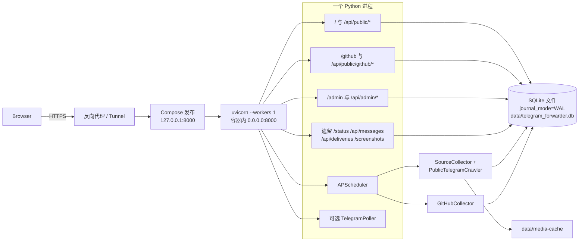
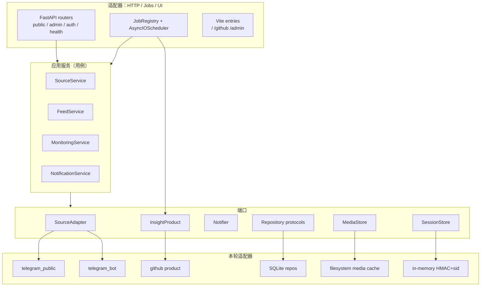
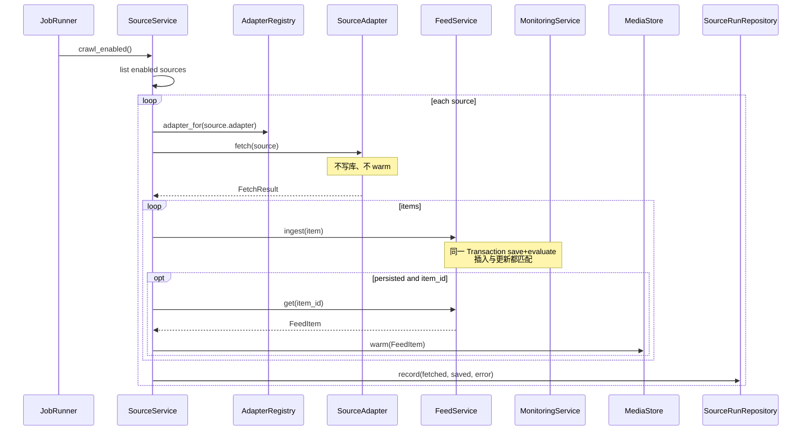

# 模块化单体重构：来源可插拔、领域解耦、单机可部署

| 字段 | 值 |
| --- | --- |
| 作者 | douxiaohu |
| 日期 | 2026-08-13 |
| 状态 | Accepted |
| 适用范围 | `/Users/gulinghao/Documents/telegram fastapi`（公开 Telegram 资讯 + GitHub 趋势 + 单管理员后台） |

---

## Overview

本项目已经完成一次产品转型：从「企业微信投递 / 安全告警台」变成「公开 Telegram 资讯站 + GitHub 趋势 + 单管理员后台」。运行时形态是正确的——单进程 FastAPI、SQLite WAL、进程内 APScheduler、Vite 多入口。容器内 uvicorn 绑定 `0.0.0.0:8000`，Compose **发布** `127.0.0.1:8000`。目标规模也明确：1 核 / 1–4GB VPS、少量 Telegram 来源、GitHub 快照排行。在这个规模下，**语言和框架不是瓶颈，耦合才是**。

当前最大的结构问题是：领域逻辑、持久化、遗留投递、采集调度和 HTTP 装配全部挤在 `app/storage.py`（2070 行）、`app/scheduler.py`（含完整 `Forwarder` / WeCom）、`app/main.py`（新路由 + 旧路由并存）。`SQLiteStorage.create_source()` 把 `source_type` 写死为 `telegram_public`；告警匹配写在 `save_message()` 内部（插入与更新各调用一次 `_match_alert_rules`）；GitHub 排行和 Telegram 资讯共用同一个存储神类。

本文给出的方案是 **模块化单体 + 端口适配器（ports and adapters）**。默认部署仍是一个容器、一个进程、一份 SQLite。不换语言，不拆微服务。

**本轮程序真正交付的开放性**（见下文「本轮开放度」）是：`telegram_public` 与 `telegram_bot` 两个 `SourceAdapter`、GitHub 收成独立 `InsightProduct` 模块、通知留一个零实现端口、SQL 关进 SQLite repository。它**不**让 RSS 立刻能入库，也**不**让第二个榜单只写四个 `dict` 方法就能上线。数据库文件名保持 `data/telegram_forwarder.db`。会话保持进程内 sid 表。

---

## Background & Motivation

### 产品已经变了，骨架还停在转发器时代

2026-07-14 的规格（`docs/superpowers/specs/2026-07-14-public-admin-platform-design.md`）已经把运行时定为「只采集、不投递」。README 也写明：企业微信和截图摘要在运行时退役，历史表只读保留。

实际代码只完成了「新路径并存」，没有完成「旧路径退出核心」：

- 生产调度走 `create_collection_scheduler()` + `SourceCollector`（`app/scheduler.py`），只注册 `crawl_public_sources` 和可选的 `refresh_github_rankings`。
- 同一文件仍保留 `Forwarder`、`create_background_scheduler()`、`build_summary()`，并硬依赖 `WeComClient`、`SummaryImageExporter`。
- `app/main.py` 仍暴露 `/status`、`/jobs/forward-now`、`/api/deliveries`、`/api/alert-rules`、`/api/messages`、`/screenshots` 等旧入口。
- `Dockerfile` 仍安装 `fonts-noto-cjk`（截图摘要字体），数据库文件名仍是 `telegram_forwarder.db`。
- `scripts/deploy.sh` 仍提示「fill webhook_url first」。
- `.env.example` 已经基本不含投递字段；现网 `.env` 仍可能留有 `FORWARD_CRON` / `SCREENSHOT_OUTPUT_DIR`。PR 3 只修文档和「不再要求 Bot token」，不在 Forwarder 删除前拿掉这些字段的解析。

这不是性能问题，是**认知负荷和扩展阻力**：每次加功能都要先绕开一套已经退役的投递模型。

### 当前状态（已验证）

| 层 | 现状 | 评价 |
| --- | --- | --- |
| 部署 | 容器绑定 `0.0.0.0:8000`；Compose 发布 `127.0.0.1:8000`；外部网络 `ai-internal` | 适合目标规模 |
| HTTP | FastAPI 单 worker；`public_api` / `admin_api` / `github_api` 已拆 router | 方向正确，装配根过重 |
| 前端 | Vite 三入口 `/`、`/admin`、`/github` | 入口拆分已做，类型和页面仍混域 |
| 存储 | `SQLiteStorage` 一个类覆盖来源、消息、投递、告警、GitHub、FTS | 最大耦合点 |
| 采集 | 进程内 APScheduler；Telegram 页面抓取 + 可选 Bot poller + GitHub 刷新 | 规模匹配；适配器未抽象 |
| 安全 | HttpOnly + SameSite=Strict 会话、同源校验、CSP、公开范围服务端过滤 | 必须保留，不能在重构中削弱 |
| 遗留 | WeCom / 截图 / 旧 API / 旧测试仍在主干 | 阻碍新模块落地 |

仓库里现有 **17** 个后端 unittest 模块（`tests/test_*.py`）以及前端 Vitest + Playwright。`frontend/scripts/check-bundle.mjs` 把公共入口原始 JS 预算钉在 **250KB**。这些是「不要为换语言扔掉」的活证据。

### 痛点（按扩展代价排序）

1. **加一种来源必须改存储、校验、采集器、管理 API、前端表单。** `create_source()` 只接受 Telegram URL，并用 `canonical_telegram_public_url()` + `public_source_chat_id()` 派生主键。
2. **加一种排行产品只能往 `SQLiteStorage` 和 `AppConfig` 继续堆字段。** GitHub 已经把 AI 解读列、FTS、快照、采集 run 全部塞进同一模块。
3. **加通知只能复活 WeCom 模型，或再复制一套 delivery 表。** 通知没有端口，只有企业微信实现。
4. **想把采集拆到独立进程时，作业函数仍通过 `request.app.state` 和具体 `SQLiteStorage` 交织。** 没有稳定的 `AppContext`。
5. **想换 Postgres 时，SQL 和领域规则（告警匹配、可见性、游标分页、榜单打分）写在一起。** 协议能减痛，但 FTS5 / PRAGMA / 相关子查询仍是 SQLite 形状，本轮不交付第二套适配器。

这些痛点用模块边界就能解。换 Go / Rust / Java / Next.js 不会自动解，反而丢掉现有测试和单容器部署优势。

---

## Goals & Non-Goals

### 本轮开放度（这次 PR 序列真正做到的）

| 能力 | 本轮结束时 | 明确后续（不在本序列承诺） |
| --- | --- | --- |
| Telegram 公开频道 | `telegram_public` adapter：`fetch()` 只拉数据，不写库 | 更多公开页模式 |
| Telegram Bot 来源 | **一等** `telegram_bot` adapter；poller 只读 `sources`；locator = 数字 `chat_id`（真实 Telegram id，不哈希） | 每来源独立 bot token（本轮仍用环境变量里的一个 token） |
| 管理端加来源 | API：`adapter` 缺省 `telegram_public`，允许 `telegram_bot`；未知 → 422。UI 可保持最小（公开 URL 表单即可），Bot 以来源 API 配置 | 完整 adapter/locator 管理表单；RSS 表单 |
| RSS / 网页 / X | 只有列位（`adapter` / `locator` / `config_json`） | `messages.external_id TEXT`、可展示规则泛化、adapter 实现、管理表单 |
| GitHub 榜单 | 整模块迁到 `InsightProduct`，HTTP/JSON 合同不变 | 第二个洞察产品（见清单） |
| 通知 | `Notifier` 端口 + 零 adapter；命中仍只入库。WeCom 运行时与测试删除，无考古 UI | outbox、重试、真实通道 |
| 数据库文件 | 保持 `data/telegram_forwarder.db` | 改名（不在本序列） |
| 会话 | 进程内 HMAC + sid 表 | 拆 worker 前再做持久化 `SessionStore` |
| Postgres | SQL 关进 `persistence/sqlite/` | 第二套 adapter |
| Worker 进程 | `JobSpec.run` 为 async，与今天 `AsyncIOScheduler` 一致 | 独立进程、跨进程会话 |

**本轮 Goals（可验收）：**

- Telegram 公开采集不再把 HTML 解析、写库、媒体预热、规则匹配揉在一个 crawler 方法里。
- Telegram Bot 来源写入 `sources`（`adapter=telegram_bot`），poller 不再读 YAML。
- GitHub 不再往 `SQLiteStorage` 加第三套表方法；刷新走 `InsightProduct` + `JobSpec`。
- 通知有空端口，默认行为与今天一致（不外发、不写 `delivery_*`）。WeCom / Forwarder / 截图代码按 PR 9 删除，无管理端考古 UI；`delivery_*` 表不 DROP。
- 领域服务不依赖 FastAPI `Request`；SQLite 连接经 `connection.py`，每条连接设 `busy_timeout`。
- 默认路径保持「一个镜像、一个进程、一份 SQLite、一份静态资源」。
- 公开 / 管理可见性模型和会话安全属性不回退（含私有 `chat_id` → 404，不是空页）。
- 用一组可独立合并的 PR 落地；`SQLiteStorage` facade 在序列末尾删除，而不是永久双树。

### 后续开放度（单独设计 / 单独 PR，不假装本轮已完成）

第二个洞察产品除实现 `InsightProduct` 外还必须新增：自己的表、`Settings` 片段、`JobSpec`、公共 router（及可选管理刷新）、Vite 入口或 feature 目录、对应 repository。禁止往 `messages` 或 `github_repositories` 加类型列。

RSS 试点必须先有：`external_id TEXT` + 回填、`UNIQUE(source_id, external_id)`、可展示规则不再假设 Telegram poll、管理端 adapter 表单。在此之前 `NormalizedItem.external_id: str` 只能 `int()` 进现有 `messages.message_id`。

### Non-Goals

- 现在不拆微服务、不加消息队列、不加 Redis、不迁对象存储。
- 现在不换 PostgreSQL；SQLite 仍是默认库。
- 现在不做多管理员 / RBAC / OIDC。本轮只抽 `SessionStore`（HMAC cookie + 进程内 sid 表）。不引入未定义的 `Identity` 协议。
- 现在不恢复企业微信投递或截图摘要。
- 现在不把前端改成 Next.js / SSR。
- 现在不开放任意用户提交来源，不做公网可写 API。
- 不为「清理」而 `DROP` 历史 `delivery_*` 表；它们变成未使用的遗留表，不是产品表面。
- 现在不做 RSS / `external_id TEXT` / 管理端完整 adapter 表单。
- 现在不把会话 sid 表落库。
- 不把数据库文件从 `data/telegram_forwarder.db` 改名。

---

## Current Architecture Assessment

### 运行时拓扑（实际在跑的）



生产只跑采集，这是对的。问题是进程内部没有领域边界。

### 问题 1 — `SQLiteStorage` 是跨域神类（高）

文件：`app/storage.py`（2070 行）。一个类同时拥有：

| 职责 | 代表符号 |
| --- | --- |
| Schema 与增量迁移 | `SQLiteStorage.init_db()`，含 `messages` / `sources` / `delivery_*` / `alert_*` / `github_*` |
| Telegram 来源 CRUD | `create_source()`、`update_source()`、`public_chat_ids()` |
| 资讯流查询 | `list_messages_page()`、`build_message_filters()` |
| 投递账本 | `create_delivery_batch()`、`begin_delivery_attempt()`、`list_due_delivery_ids()` |
| 监测规则 | `create_alert_rule()`、`_match_alert_rules()` |
| GitHub 产品 | `upsert_github_repositories()`、`list_github_rank_candidates()`、`save_github_repository_analysis()` |
| 媒体解析辅助 | `media_urls_from_raw_json()`、`source_url_from_raw_json()` |

具体耦合：

- `create_source()` 写死 `source_type='telegram_public'`，并用 `canonical_telegram_public_url()` / `public_source_chat_id()` 生成主键。
- `save_message()` 在**同一次** `with self._connect()` 里：`INSERT OR IGNORE` 成功则 `_match_alert_rules(conn, lastrowid)`；否则 UPDATE 后对已有行再 `_match_alert_rules(conn, row["id"])`（`app/storage.py` 469–521）。入库与匹配同一事务。更新路径每次重采都会再匹配（`alert_matches` 上 `INSERT OR IGNORE`），因此新启用的规则能在下一轮抓取打到已入库消息。
- `list_github_rank_candidates()` 用相关子查询拉最多 10000 行，再由 `build_github_ranking()` 在进程内打分排序。
- `_connect()` 每次 `sqlite3.connect()`，无 `PRAGMA busy_timeout`。`journal_mode=WAL` 只在 `init_db()` 里执行一次，但 WAL **会持久化在数据库文件上**，之后连接会继承文件 journal 模式。真正的锁风险是缺 `busy_timeout`，不是 WAL 没继承。
- `sqlite_path_from_url()` 只接受 `sqlite:///`。
- `_github_fts_available` 是 `init_db()` 里写到实例上的状态（274–285），拆分后必须归 GitHub repository，由 schema 初始化。

### 问题 2 — 调度模块仍是 WeCom 转发器（高）

文件：`app/scheduler.py`。

- 运行时真正使用的是 `SourceCollector` 和 `create_collection_scheduler()`。
- 同文件仍 import `WeComClient`、`SummaryImageExporter`，并实现完整 `Forwarder`。
- `create_background_scheduler()` 仍用 `config.forward_cron` 注册 `forward_telegram_to_wecom`。生产不调用它，但 `tests/test_scheduler.py` 等仍把它当一等公民。因此 **Forwarder 删除之前不能从配置对象拿掉这些字段**。
- `SourceCollector.crawl_public_sources_sync()` 只认识 `PublicTelegramCrawler.crawl_source(StoredSource)`。`PublicTelegramCrawler._crawl()` 自己 `save_message` 并 `_warm_media_cache`（`app/public_telegram.py` 67–84）。Adapter 若继续写库，则「fetch 不持久化」是假的。

### 问题 3 — 装配根过重，新旧 HTTP 双轨（高）

文件：`app/main.py`（623 行）。

`lifespan()` 同时构造存储、两个采集器、可选 `TelegramPoller`，全部挂到 `app.state`。同文件还包含认证、整套遗留 API、与 `api_common.py` 重复的 `message_to_api_dict()`、静态挂载。

遗留路由仍被测试当作规范接口：

- `tests/test_alert_api.py`：`/api/alert-rules`、`/api/alerts`、`/api/deliveries`
- `tests/test_security.py`：`/status`、`/api/groups`（登录后受保护 canary）、`/api/deliveries`；并 `from app.main import list_screenshot_files, message_to_api_dict`、`from app.scheduler import Forwarder, ...`
- `tests/test_source_health.py` 138–145：`GET /api/groups` 与 `GET /api/operations/summary`，并断言 `recent_deliveries` 不含 `payload_preview`。新的 `GET /api/admin/operations/summary` **没有** delivery 字段。

`tests/test_same_origin.py` 只打 `/api/auth/login`，删旧路由时不必改它。

### 问题 4 — 来源身份模型绑死 Telegram chat_id（高）

- `sources.chat_id INTEGER PRIMARY KEY`，`messages` 用 `UNIQUE(chat_id, message_id)`，`message_id` 是 **INTEGER**。
- 公开频道 ID 由 `public_source_chat_id()` 映射到 `-900000000000 - crc32`。
- `TelegramPoller.source_chat_ids` 来自 **YAML `config.groups`**，不是 `sources` 表。
- `GroupConfig` 仍带 `webhook_url`、`screenshot_enabled`、`forward_enabled`。
- `DISPLAYABLE_MESSAGE_SQL` / `message_payload_is_displayable()` 按 Telegram 形状过滤（空文本且无媒体、poll 丢弃）。

本轮不改 `message_id` 类型。RSS GUID 无处可放。

### 问题 5 — GitHub 产品横向切开不够（中）

持久化仍在 `SQLiteStorage`；`GitHubCollector` 依赖整份 `AppConfig`；`create_collection_scheduler(..., github_collector=None)` 用可选参数塞第二个产品。

### 问题 6 — 配置与安全会话缺少端口（中）

- `AppConfig` 单层平铺。
- `SessionSigner.verify()` 要求 HMAC **并且** `_active_sessions[sid] == exp`。只校验签名会让 `revoke` 失效。
- `load_config(require_token=True)` 默认仍要求 Bot token；`main.py` 传了 `require_token=False`。

### 问题 7 — 前端入口拆了，领域没拆（中）

`frontend/src/types.ts` 仍有 `Delivery` / `LegacyDelivery` / `pending_count` / `forwarded_at`。`App.tsx` 是管理端上帝组件。`OperationsRail.tsx` 里的 `SourceComposer` 只有 name + source_url。`vite.config.ts` 仍代理 `/status` 和 `/jobs`。

### 问题 8 — 遗留代码有真实维护成本（中）

WeCom / 截图仍在包内；`init_db()` 每次启动仍修复未完成 delivery 行；测试矩阵很大一块在证明已退役行为。

### 问题 9 — 并发契约未写明（低）

- Dockerfile：`uvicorn ... --workers 1`。这是 SQLite 单写者 + 进程内 scheduler 的正确约束，但只写在镜像里。
- HTTP + scheduler + 可选 poller 已经共享一个 SQLite 文件。缺 `busy_timeout` 才是实际锁风险。
- `SourceCollector._lock` / `GitHubCollector._lock` 是进程内互斥；async 方法里 `asyncio.to_thread` 跑同步体。

### 现有代码里已经做对的部分（重构必须保住）

- `GET /api/public/messages`：先取 `public_chat_ids()`；请求的 `chat_id` 不在集合里 → **404** `Source not found`；全公开且无过滤器 → 200 + 可能空页（`app/public_api.py` 59–61）。`allowed_chat_ids=None` 时 `build_message_filters()` **不加** `IN` 子句（`app/storage.py` 2025–2026），因此公共路径绝不能把 `None` 传进 repo。
- 公共媒体对缺失与未公开一律 **404**，不是 403（`app/public_api.py` 90–95）。`tests/test_public_api.py` 断言这两条。
- 管理写操作同时 `require_session` + `require_same_origin`。
- Cookie：`tg_session`，`HttpOnly`，`SameSite=strict`，`path="/"`，生产 `Secure`；`hmac.compare_digest`；登出 `revoke`。
- 公共 ETag + `Cache-Control: no-cache` 在 `etag_json_response`（`app/api_common.py`），留在 router，不下沉到 repository。
- 来源 URL 不可变。GitHub / AI 失败不阻断其它产品。公共页不请求 `/api/session`。

---

## Proposed Design

### 总原则

1. **模块化单体。** 进程拆分是可选项，不是第一步。
2. **端口在领域，适配器在边缘。** 本轮只落地 Telegram 公开 adapter 与 GitHub product。
3. **SQLite 是默认适配器，不是领域。** 所有 SQL 住在 `app/persistence/sqlite/`。
4. **HTTP 和 Scheduler 都只依赖 Application Service。** 同一 `AppContext`。
5. **先加门面再搬实现，最后拆门面。** 过渡期每个旧模块路径只允许 **一行 re-export**；实现只存在于新路径。序列末尾删除 facade 与 shim。
6. **写路径切换必须一次切完。** 在 crawler / poller / 测试全部改走 `FeedService.ingest()` 之前，匹配继续留在 facade `save_message()` 的同一连接上。

### 目标进程内结构



RSS 与真实 Notifier 不画进「本轮适配器」。`telegram_bot` 在本轮。

### 目标包布局与落地规则

下表是 **序列全部合并后磁盘上应存在的树**，不是愿望清单。每个目录都有对应搬迁 PR。过渡期旧路径只留一行：

```python
# app/public_api.py  （shim，直至删除）
from app.http.public_feed import router
```

禁止两边都写逻辑。CI 在 facade 删除 PR 起拒绝 `SQLiteStorage` 上新增 `def `。

```
app/
  main.py                      # composition + include_router + static
  context.py
  config/
    settings.py
    load.py
    legacy_delivery.py         # 仅存活到删除 Forwarder 的 PR
  security/
    session.py
    origin.py
    limiter.py
  http/
    middleware.py
    auth.py
    health.py
    errors.py                  # sanitize_error_*
    public_feed.py
    public_github.py
    admin_sources.py
    admin_feed.py
    admin_monitoring.py
    admin_github.py
    media.py
  domain/
    sources/models.py
    sources/service.py         # 新 SourceService；旧 seed 改名见 PR 1
    sources/seed.py            # 现 seed_sources_from_groups
    feed/models.py
    feed/service.py
    monitoring/matcher.py
    monitoring/service.py
    insights/ports.py
    insights/github/           # 现 github_service / github_ai / ranking
  ingest/
    ports.py
    registry.py
    telegram_public/           # 纯 fetch，不写库
    telegram_bot/              # PR 16：validate/allocate + poller 读 sources
  persistence/
    protocols.py
    sqlite/connection.py
    sqlite/schema.py
    sqlite/source_repo.py
    sqlite/source_run_repo.py
    sqlite/feed_repo.py
    sqlite/monitoring_repo.py
    sqlite/insight_github_repo.py
    sqlite/legacy_delivery_repo.py
  jobs/
    registry.py
    runner.py
    apscheduler_backend.py
  media/
    cache.py
  notifications/
    ports.py
    service.py
```

前端（PR 12）：

```
frontend/src/
  shared/
  features/public-feed/
  features/github-rankings/
  features/admin/
```

### 连接与事务

`persistence/sqlite/connection.py`（PR 2a）是唯一**打开**连接的地方。事务对象对领域层是不透明的 `Transaction`（见端口），SQLite 适配器里它就是 `sqlite3.Connection`。领域与应用服务**不** `import sqlite3`，只把 `Transaction` 往下传。

```python
BUSY_TIMEOUT_MS = 5000

class ConnectionFactory:
    def __init__(self, database_url: str) -> None:
        self.database_url = database_url

    @contextmanager
    def connect(self) -> Iterator[Transaction]:
        """只对自己打开的连接 commit / rollback / close。"""
        path = sqlite_path_from_url(self.database_url)
        conn = sqlite3.connect(path, timeout=BUSY_TIMEOUT_MS / 1000)
        conn.row_factory = sqlite3.Row
        conn.execute("PRAGMA foreign_keys = ON")
        conn.execute(f"PRAGMA busy_timeout = {BUSY_TIMEOUT_MS}")
        try:
            yield conn
            conn.commit()
        except Exception:
            conn.rollback()
            raise
        finally:
            conn.close()
```

**连接所有权：**

- `ConnectionFactory.connect()` 打开的连接：成功 commit、失败 rollback、退出时 close。
- Repository / `MonitoringService.evaluate` 若收到调用方传入的 `conn`：**禁止** commit、rollback、close。它们只 `execute`。
- 需要独立短事务的读方法（`get`、`list`、`page`）自己 `with self.db.connect()`。
- `FeedService.ingest()` 必须 `with self.db.connect() as conn:`，把**同一个** `conn` 传给 `save_item` 与 `evaluate`，由 factory 一次提交。崩溃不得出现「消息已提交、匹配未写」。
- 禁止在已有 `conn` 上再套一层 `connect()`。

单 writer 不变量写进三处：README 部署节、`Dockerfile` CMD 旁注释、`JobRunner.start()` 旁 assert 或日志（`uvicorn workers != 1` 时警告）。本轮不在运行时强杀多 worker，以免测试客户端误伤。

### 核心端口（完整合同）

错误类型：校验失败 `ValueError`（HTTP 422）；唯一约束由 persistence 译成领域 `AlreadyExistsError`（HTTP 409）；找不到 `KeyError`（HTTP 404）。Adapter 网络失败记入 `FetchResult.error`，不抛到调度器外。

```python
# app/domain/sources/models.py  （今日 StoredSource + 新列）
@dataclass(frozen=True)
class Source:
    source_id: int            # 物理列 chat_id
    name: str
    adapter: str              # 空串视为 telegram_public
    locator: str
    source_url: str           # 与 locator 同值，兼容现 API
    source_type: str          # 与 adapter 同值，兼容现 API
    enabled: bool
    public_visible: bool
    created_at: str
    updated_at: str
    config_json: str          # 默认 "{}"；公共 API 不输出

# app/persistence/protocols.py
class Transaction(Protocol):
    """不透明工作单元。SQLite 适配器 = sqlite3.Connection。
    领域只传递，不 commit/close，也不 import sqlite3。"""
    def execute(self, sql: str, parameters: Sequence[object] = ()) -> object: ...

class ConnectionFactory(Protocol):
    def connect(self) -> ContextManager[Transaction]: ...
```

```python
# app/ingest/ports.py
@dataclass(frozen=True)
class NormalizedItem:
    source_id: int
    external_id: str
    occurred_at: str
    author: str
    title: str
    content: str
    media_type: str | None
    raw: dict
    permalink: str | None

@dataclass(frozen=True)
class FetchResult:
    fetched: int
    items: Sequence[NormalizedItem]
    error: str | None = None

class SourceAdapter(Protocol):
    key: str  # 本轮注册 "telegram_public" | "telegram_bot"

    def validate_locator(self, locator: str) -> str:
        """Canonical locator or raise ValueError."""

    def allocate_source_id(self, locator: str) -> int:
        """telegram_public: 保持 public_source_chat_id()。
        telegram_bot: int(locator)，即真实 Telegram chat_id，禁止再哈希。"""

    def fetch(self, source: Source) -> FetchResult:
        """telegram_public：拉 HTML 并解析。
        telegram_bot：本轮不经此方法拉更新（长轮询在 TelegramPoller）；
        fetch 可返回空列表。禁止调用 save / ingest / media.warm。"""
```

`NormalizedItem` → 现网 `messages` 列映射（本轮）：

| NormalizedItem | `messages` 列 | 规则 |
| --- | --- | --- |
| `source_id` | `chat_id` | 整数，等于今日 chat_id |
| `external_id` | `message_id` | **必须能 `int()`**；不能转换则本轮丢弃并打日志。不写入 TEXT 列 |
| `occurred_at` | `message_time` | ISO-8601 |
| `author` | `sender_name` | |
| `title` | `chat_title` | Telegram 频道名 |
| `content` | `content` | |
| `media_type` | `media_type` | |
| `raw` | `raw_json` | `json.dumps`；公共 API 不回传 |
| `permalink` | （无列） | 写入 `raw["source_url"]`，读时仍用 `source_url_from_raw_json` |

`FeedItem` 领域对象继续暴露今日 `StoredMessage` 字段名（含 `chat_id` / `message_id`），避免一次改前端。

```python
# app/domain/insights/ports.py
@dataclass(frozen=True)
class RankQuery:
    period: Literal["daily", "weekly", "monthly"]
    language: str = ""
    query: str = ""
    sort: Literal["activity", "stars", "star_growth", "forks", "recent"] = "activity"
    page: int = 1
    per_page: int = 24

class InsightProduct(Protocol):
    product_id: str

    async def refresh(self) -> dict: ...
    def rank(self, query: RankQuery) -> dict: ...
    def languages(self) -> list[dict]: ...
    def latest_run(self) -> dict | None: ...
```

`rank()` 返回值保持今日 `build_github_ranking()` 的键：`items` / `total` / `page` / `per_page` / `has_more` / `period` / `cutoff`。router 再补 `languages` 与 `collection`。

```python
# app/notifications/ports.py
@dataclass(frozen=True)
class NotificationEvent:
    kind: str
    source_id: int | None
    payload: dict

class Notifier(Protocol):
    key: str
    def send(self, event: NotificationEvent) -> None: ...

class NotificationService:
    def __init__(self, notifiers: Sequence[Notifier]) -> None: ...
    def emit(self, event: NotificationEvent) -> None:
        """本轮 notifiers 恒为空列表；此方法 no-op。不写库、不建 outbox。"""
```

```python
# app/persistence/protocols.py
class SourceRepository(Protocol):
    def list(self, *, enabled_only: bool = False, public_only: bool = False) -> list[Source]: ...
    def get(self, source_id: int) -> Source | None: ...
    def create(
        self,
        *,
        source_id: int,
        name: str,
        adapter: str,
        locator: str,
        public_visible: bool = False,
        enabled: bool = True,
    ) -> Source: ...
    def update(self, source_id: int, **fields) -> Source: ...
    def public_ids(self) -> list[int]: ...

class SourceRunRepository(Protocol):
    def record(
        self,
        *,
        source_id: int,
        source: str,
        started_at: str,
        finished_at: str,
        fetched_count: int,
        saved_count: int,
        error: str | None,
    ) -> None: ...
    def health(self, source_id: int, *, stale_after_seconds: int) -> dict: ...

@dataclass(frozen=True)
class SaveItemResult:
    item_id: int | None
    inserted: bool
    persisted: bool  # False：未展示（poll / 空内容），不匹配

class FeedRepository(Protocol):
    def save_item(self, item: NormalizedItem, *, conn: Transaction) -> SaveItemResult:
        """不调用 matcher。插入或更新与今日 save_message 相同。不 commit/close conn。"""
    def get(self, item_id: int) -> FeedItem | None: ...
    def get_by_external(self, source_id: int, external_id: int) -> FeedItem | None: ...
    def page(self, query: FeedQuery) -> FeedPage:
        """scope=public 时 allowed_source_ids 必填（空元组 => WHERE 0=1）。
        scope=admin 且未指定 source_id 时不加 IN 子句。"""

class MonitoringRepository(Protocol):
    def list_rules(self) -> list[dict]: ...
    def get_rule(self, rule_id: int) -> dict: ...
    def create_rule(self, **fields) -> dict: ...
    def update_rule(self, rule_id: int, **changes) -> dict: ...
    def list_matches(self, status: str = "") -> list[dict]: ...
    def set_match_status(self, match_id: int, status: str) -> dict: ...
    def enabled_rules(self, *, conn: Transaction) -> list[dict]: ...
    def record_match(self, rule_id: int, item_id: int, *, conn: Transaction) -> None:
        """INSERT OR IGNORE；不改变已有 status。不 commit/close conn。"""
    def last_match_message_time(self, rule_id: int, *, conn: Transaction) -> str | None: ...

class GithubRepository(Protocol):
    """今日 SQLiteStorage 上的 GitHub 方法，原样迁入 insight_github_repo。"""
    def upsert_github_repositories(
        self, repositories: Iterable[dict], *, captured_at: str | None = None
    ) -> int: ...
    def get_github_repository_analysis(self, full_name: str) -> dict | None: ...
    def save_github_repository_analysis(
        self,
        full_name: str,
        *,
        language_breakdown: list,
        source_hash: str,
        explanation: dict,
        model: str,
    ) -> bool: ...
    def list_github_repository_names(self, *, limit: int = 100) -> list[str]: ...
    def list_github_rank_candidates(
        self, *, cutoff: str, language: str = "", query: str = ""
    ) -> list[dict]: ...
    def list_github_languages(self) -> list[dict]: ...
    def record_github_collection_run(self, **fields) -> None: ...
    def get_latest_github_collection_run(self) -> dict | None: ...
```

```python
# app/security/session.py
class SessionStore(Protocol):
    def issue(self, *, now: float | None = None) -> tuple[str, int]:
        """随机 sid 写入 sid->exp 表；token = b64(json{exp,sid}) + HMAC。"""
    def verify(self, token: str, *, now: float | None = None) -> int | None:
        """必须同时：HMAC 通过、exp 未过期、sid 表中的 exp 相等。缺任一则 None。"""
    def revoke(self, token: str) -> None:
        """只删 sid。伪造 token 静默返回。"""

# LoginAttemptLimiter 保持独立类，不并进 SessionStore。
```

默认实现即搬迁后的 `SessionSigner`。禁止做成「只验 HMAC、不查 sid 表」。

```python
# app/media/cache.py
class MediaStore(Protocol):
    def get(self, message: FeedItem, index: int, *, variant: str = "original") -> CachedMedia: ...
    def warm(self, message: FeedItem) -> None:
        """对每条媒体 URL 调 get(..., variant='original')。仅在 persist 成功后由服务调用。"""
```

对应今日 `MediaCache.get(message, index, variant=)`。缓存键用数据库主键：`f"{message.id}:{index}:{url}"`（`MediaCache._cache_base`）。因此 **禁止** 对尚未入库的 `NormalizedItem` 调 `warm`。

`ingest` 之后的顺序：

```python
result = self.feed_service.ingest(item)
if result.persisted and result.item_id is not None:
    stored = self.feed.get(result.item_id)  # 或 get_by_external
    if stored is not None and stored.media_type:
        self.media.warm(stored)
```

warm 替代 crawler 内 `_warm_media_cache`。同一 `message.id` 不得 fetch 一次再 warm 一次下载（第二次走缓存命中）。

### 应用服务

现有 `app/source_service.py` **只有** `seed_sources_from_groups`。PR 1 把它改名为 `app/domain/sources/seed.py`，旧路径一行 re-export。新的 `SourceService` 住在 `app/domain/sources/service.py`，禁止同文件混种子与用例。

```python
class SourceService:
    def list_public(self) -> list[PublicSourceDTO]: ...
    def list_admin(self) -> list[AdminSourceDTO]: ...
    def create(self, *, name: str, locator: str, adapter: str = "telegram_public") -> AdminSourceDTO:
        # adapter 本轮：telegram_public | telegram_bot；其余 KeyError -> 422
        port = self.adapters.get(adapter)  # KeyError -> 422
        canonical = port.validate_locator(locator)
        source_id = port.allocate_source_id(canonical)
        return self.sources.create(
            source_id=source_id,
            name=name.strip(),
            adapter=adapter,
            locator=canonical,
            public_visible=False,
            enabled=True,
        )
    def patch(self, source_id: int, **fields) -> AdminSourceDTO: ...
    async def crawl_one(self, source_id: int) -> dict: ...
    async def crawl_enabled(self) -> list[dict]: ...

class FeedService:
    def ingest(self, item: NormalizedItem) -> SaveItemResult:
        """with db.connect() as conn: save_item(conn) +（若 persisted）evaluate(conn)。
        插入与更新都 evaluate。不在此处 warm。"""
    def public_page(self, *, source_id: int | None, query: str, media: str,
                    cursor: str, limit: int) -> FeedPageDTO: ...
    def admin_page(self, *, source_id: int | None, query: str, media: str,
                   cursor: str, limit: int) -> FeedPageDTO: ...
    def public_media(self, item_id: int, index: int, variant: str) -> MediaFile: ...
    def admin_media(self, item_id: int, index: int, variant: str) -> MediaFile: ...

class MonitoringService:
    def evaluate(self, item_id: int, *, conn: Transaction) -> list[int]:
        """语义等同今日 _match_alert_rules。不 import sqlite3。不 commit/close conn。"""
    def emit_after_commit(self, match_ids: list[int]) -> None:
        """本轮 no-op（通知端口空）。不得在事务内做 IO。"""
```

### 匹配不变量（产品合同，测试必须写明）

1. **插入匹配**：新行（`SaveItemResult.inserted is True`）在同一事务内 evaluate。
2. **更新也匹配**：重采走 UPDATE 时同样 evaluate。新启用的规则因此能在下一轮抓取打到旧消息。`INSERT OR IGNORE` 不覆盖已有 `new/acknowledged/resolved`。
3. **未展示不匹配**：`message_payload_is_displayable` 为假则 `persisted=False`，不写 match。
4. **切流前**：所有活写路径（`PublicTelegramCrawler`、`TelegramPoller`、直接测生产匹配的测试）仍调用 facade `save_message()`，内部继续 `_match_alert_rules(conn)`。
5. **切流 PR**：同一 PR 把上述写路径改为 `FeedService.ingest()`，并删除 `save_message` 内的 matcher 调用。禁止先合并「`save_item` 不再匹配」而 crawler 仍调 `save_message`。
6. **禁止**「只在 `inserted is True` 时 evaluate」——那会静默改产品行为。

### 资讯流与可见性

```python
@dataclass(frozen=True)
class FeedQuery:
    source_id: int | None
    query: str
    media: str
    cursor: str
    limit: int
    scope: Literal["public", "admin"]
    allowed_source_ids: tuple[int, ...] | None
```

**`allowed_source_ids` 只对 `scope="public"` 有意义，且必填。禁止用「全部 sources.id」冒充管理端无过滤。**

| 调用 | `scope` | `source_id` | `allowed_source_ids` | SQL |
| --- | --- | --- | --- | --- |
| `public_page` 全部公开 | `public` | `None` | `tuple(public_ids())`，可为空 | 空元组 → `0=1`；否则 `IN (...)` |
| `public_page` 指定来源 | `public` | 具体 id | 同上（服务覆盖调用方） | id ∉ public_ids → **404**；否则 `chat_id=?` 且 `IN` |
| `admin_page` 全部 | `admin` | `None` | **必须是 `None`** | **不加 IN**。含 YAML poller / 历史孤儿 `chat_id` |
| `admin_page` 指定来源 | `admin` | 具体 id | **必须是 `None`** | 只加 `chat_id=?`。id 不在 `sources` 也查（孤儿行）。无消息 → **200 空页**，不 404 |

今日对照：`GET /api/admin/messages` 调用 `list_messages_page` 时不传 `allowed_chat_ids`（`app/admin_api.py` 140）。本轮必须保持这条语义。PR 16 之后 Bot 来源已在 `sources`（`adapter=telegram_bot`）；**历史孤儿** `chat_id`（从未写入 `sources` 的旧消息）仍须出现在管理列表、不得出现在公共列表。

- `FeedService.public_page(...)` **自己**设 `allowed_source_ids=tuple(self.sources.public_ids())`，忽略任何调用方传入的白名单。router 不得把客户端名单传进 repo。
- `FeedService.admin_page(...)` **禁止**把 `sources.list()` 的 id 填进 `allowed_source_ids`。未指定 `source_id` 时等价于今日无过滤管理查询。
- 公共：请求了具体 `source_id` 且该 id ∉ `public_ids()` → `KeyError("Source not found")` → HTTP **404**。
- 公共：未指定 `source_id` 且公开集合为空 → **200** + `items=[]`。
- 管理：不因「不在 sources 表」对指定 `source_id` 返回 404（历史孤儿行、迁移前 YAML poller 写入的消息）。
- 媒体：公共路径不存在与未公开都是 404，body 同为 `Media not found`。管理媒体按 `item_id` 取行，不套公开白名单。
- ETag / `Cache-Control: no-cache` 留在 `etag_json_response`，router 调用。
- 合并门禁：每条触及 feed 的 PR 必须保持 `tests/test_public_api.py` 两条公共可见性断言；并增加（或保持）一条：**不在 `sources` 的孤儿 `chat_id` 消息出现在 `GET /api/admin/messages`，且不出现在 `GET /api/public/messages`。** PR 16 另测：`adapter=telegram_bot` 且未公开的来源只在管理端可见。

### 来源与身份（本轮）

物理列 `chat_id` 保留。领域名 `source_id`。媒体缓存路径算法不改：`str(chat_id).replace("-", "n")`。

`sources` 增量列一次 `ALTER` 加完，**不做「回填后再改 NOT NULL」**（SQLite 改 NOT NULL 要重建表，与可回滚增量冲突）：

```sql
ALTER TABLE sources ADD COLUMN adapter TEXT NOT NULL DEFAULT '';
ALTER TABLE sources ADD COLUMN locator TEXT NOT NULL DEFAULT '';
ALTER TABLE sources ADD COLUMN config_json TEXT NOT NULL DEFAULT '{}';

UPDATE sources SET adapter = source_type WHERE adapter = '';
UPDATE sources SET locator = source_url WHERE locator = '';
```

应用层：`SourceService.create` / `AdapterRegistry.get` 要求非空 adapter。读到空 adapter 的旧行视为 `telegram_public`。

本轮 **已决** ID 空间：

| adapter | `source_id` / 物理 `chat_id` | locator |
| --- | --- | --- |
| `telegram_public` | `-900000000000 - crc32(username)`（现 `public_source_chat_id()`） | 规范化 `https://t.me/<username>` |
| `telegram_bot` | **真实 Telegram `chat_id`**（`int(locator)`）。禁止 CRC / 再映射，以免打散已有 Bot 消息行 | 十进制整数字符串，例如 `-1001234567890` |

RSS 数值空间仍不在本轮。

YAML 只做**空库一次性种子**：`seed_sources_from_groups` 在 `sources` 为空时导入 `telegram_public` **和** `telegram_bot` 组（后者 `adapter=telegram_bot`，`source_id=group.chat_id`，`locator=str(chat_id)`）。种子之后运行时 **不再**用 YAML 构造 poller。`TelegramPoller.source_chat_ids` 每轮（或启动时）来自 `sources` 中 `adapter='telegram_bot' AND enabled=1`。未配置 `TELEGRAM_BOT_TOKEN` 时即使有 Bot 来源也不启动 poller，打 warning。

### 采集流水线



`saved` = `ingest().persisted` 为真的条数（含更新，对应今日 `save_message` 对更新返回 `False` 的差异：今日 `CrawlResult.saved` 只计 **新插入**。保持该语义：`saved` 只计 `inserted is True`，与 `PublicTelegramCrawler` / `SourceCollector` 现日志一致）。匹配仍对更新执行，但不计入 `saved`。

媒体只在 `persisted` 且已用 `item_id` 重新加载 `FeedItem` 之后 `warm`，避免对 `NormalizedItem` 取不到数据库 `message.id`（缓存键依赖该 id）。

`JobSpec` 对齐今天的异步作业：

```python
@dataclass(frozen=True)
class JobSpec:
    id: str
    interval_seconds: int
    run: Callable[[AppContext], Awaitable[object]]
    enabled: bool = True
```

`create_collection_scheduler` 继续把 coroutine function 交给 `AsyncIOScheduler`。禁止把同步阻塞函数直接注册进事件循环。现有 `SourceCollector.crawl_public_sources` / `GitHubCollector.refresh` 已是 async + `to_thread`；registry 包一层 `async def job(ctx): return await ...`。

独立 worker 仍是后续：HTTP 不 `scheduler.start()`。本轮不实现。内存 `SessionStore`、进程锁、SQLite 单写者都是拆进程的前置，列在 Rollout，不假装 JobSpec 已经够用。

### GitHub 作为第一个 InsightProduct

`build_github_ranking()`、`GitHubCollector`、`RepositoryAiExplainer` 迁入 `domain/insights/github/`。采集器只收 `GitHubSettings`。`_github_fts_available` 属于 github repo。

算法保持。测例落在 `_ranked_repository()`。HTTP 合同不变。

### 通知

默认 `notifiers=[]`。`NotificationService.emit` no-op。不建 `notification_outbox`。WeCom 不得作为默认 adapter。

### 应用上下文

```python
@dataclass
class AppContext:
    settings: Settings
    db: ConnectionFactory
    sources: SourceRepository
    source_runs: SourceRunRepository
    feed: FeedRepository
    monitoring: MonitoringRepository
    github: GithubRepository
    source_service: SourceService
    feed_service: FeedService
    monitoring_service: MonitoringService
    notification_service: NotificationService
    insight_products: dict[str, InsightProduct]
    media: MediaStore
    sessions: SessionStore
    adapters: AdapterRegistry
    jobs: Sequence[JobSpec]
```

`lifespan()`：读配置、`init_schema()`、构造 `AppContext`、启动 runner、`app.state.ctx = ctx`。PR 16 之后若存在 `TELEGRAM_BOT_TOKEN`，用 `sources` 中 enabled 的 `telegram_bot` 行构造 `TelegramPoller`，不再读 `config.groups`。过渡期保留 `app.state.storage` 等别名直到 facade 删除 PR。

### 配置拆分

```python
@dataclass(frozen=True)
class SecuritySettings:
    admin_api_key: str
    session_secret: str
    session_ttl_hours: int
    session_cookie_secure: bool
    login_max_attempts: int
    login_window_seconds: int
    app_env: str

@dataclass(frozen=True)
class GitHubSettings:
    enabled: bool
    token: str
    refresh_interval_seconds: int
    languages: tuple[str, ...]
    candidates_per_language: int
    min_stars: int
    ai_enabled: bool
    ai_api_key: str
    ai_base_url: str
    ai_model: str
    ai_timeout_seconds: int
    ai_repositories_per_refresh: int

@dataclass(frozen=True)
class LegacyDeliverySettings:
    """仅供 Forwarder / create_background_scheduler / 旧测试使用，直到删除 PR。"""
    forward_cron: str
    screenshot_output_dir: str

@dataclass(frozen=True)
class Settings:
    database_url: str
    timezone: str
    crawl_interval_seconds: int
    media_cache_dir: str
    source_stale_after_seconds: int
    security: SecuritySettings
    github: GitHubSettings
    legacy_delivery: LegacyDeliverySettings
    telegram_bot_token: str = ""
    groups_config_path: str = "config/groups.yaml"
```

`GroupConfig` 在 Forwarder 删除前 **继续**携带 `webhook_url` / `screenshot_enabled` / `forward_enabled`。YAML 继续解析这些键。`Settings` 顶层不再把它们当成产品配置，但 `legacy_delivery` 与 `GroupConfig` 必须让 `create_background_scheduler` 仍可构造。

PR 3 只做：拆文件、`load_config(require_token=False)` 成为默认、修正 `scripts/deploy.sh`、README。不删除投递字段。投递字段随 Forwarder 一起在删除 PR 去掉。

`validate_security_config()` 生产约束原样保留。

### 前端

| 入口 | 允许的 API | 禁止 |
| --- | --- | --- |
| `/` | `/api/public/sources`、`/api/public/messages`、`/api/public/media` | session、admin、github 管理 |
| `/github` | `/api/public/github/*` | admin、Telegram 写 |
| `/admin` | `/api/auth/*`、`/api/session`、`/api/admin/*` | `/api/alert-rules`、`/api/deliveries` |

本轮管理 UI 可以保持 `SourceComposer`（`OperationsRail.tsx` 内部）的 name + source_url，用于公开频道。Bot 来源以 `POST /api/admin/sources` + `adapter=telegram_bot` 为先，不强制做完整下拉。RSS 表单不做。

---

## API / Interface Changes

### 保持不变

公共：`GET /health`、`/api/public/sources`、`/api/public/messages`、`/api/public/media/{id}/{index}`、`/api/public/github/rankings`。

管理：`/api/auth/login|logout`、`/api/session`、`/api/admin/sources`、`crawl-now`、`/api/admin/messages`、`/api/admin/media`、`/api/admin/operations/summary`、`/api/admin/rules`、`/api/admin/matches`、`/api/admin/github/refresh`。

会话属性冻结。

### 兼容期新增

`POST /api/admin/sources` 可多一个 `"adapter"`，缺省 `telegram_public`。本轮允许 `telegram_public` | `telegram_bot`，其余 422。响应多返回 `"adapter"`，与 `"source_type"` 同值。

Bot 创建示例：

```json
{
  "name": "Internal group",
  "source_url": "-1001234567890",
  "adapter": "telegram_bot"
}
```

`source_url` / `locator` 对 Bot 都是数字 chat_id 字符串。PR 5a 可仍只放行 `telegram_public`；PR 16 把 allowlist 扩到 `telegram_bot`。管理 UI 不必先做完整下拉，API 必须能配置。

`GET /api/admin/operations/summary` 增加 `jobs: [{id, next_run_time}]`。不加投递字段。`test_source_health.py` 在删旧路由前改为打这个端点，并 **删除** `recent_deliveries` 断言。

### 明确删除

| 路径 | 处理 |
| --- | --- |
| `GET /status` | 删除 |
| `POST /jobs/forward-now` | 删除 |
| `GET /telegram/chats` | 删除 |
| `GET /api/groups` | 删除；安全测试 canary 改为 `/api/admin/sources` |
| `GET /api/operations/summary` | 删除 |
| `/api/alert-rules`、`/api/alerts*` | 删除 |
| `/api/deliveries*` | 删除 |
| `GET /api/messages`、`GET /api/media/...` | 删除 |
| `GET /screenshots*` | 删除 |

顺序：先改测试 → 部署一版弃用日志（PR 7.5）→ 再删路由（PR 8）。删完后 `/api/groups` 不得再当隐藏 canary。

`sanitize_error_*` 在 PR 4 从 `scheduler.py` 挪到 `app/http/errors.py`，避免 admin 为脱敏去 import 调度器。

---

## Data Model Changes

### 策略

`init_db()` + `_ensure_column()` 迁到 `schema.py`。不引入 Alembic。SQLite **不能**便宜地把已有可空列改成 `NOT NULL`（要重建表）。本轮不加「回填后变 NOT NULL」步骤。默认库路径保持 `sqlite:///./data/telegram_forwarder.db`，**不改文件名**。

### 表：继续使用

`sources`、`messages`、`source_runs`、`bot_state`、`alert_*`、`github_*`、FTS。

### 表：停止写入，不 DROP

`forward_logs`、`delivery_*`。`init_db` 对进行中 delivery 行的修复随 Forwarder 删除 PR 一起去掉。

### `sources` 增量

见上文 `ALTER ... DEFAULT ''`。`config_json` 默认 `'{}'`。公共 API 不输出 `config_json`。

### `messages`

本轮不改列。`external_id TEXT` 是后续 RSS PR。

### 通知表

本轮不建。

### 迁移与回滚

1. 部署前备份 `data/telegram_forwarder.db` 与 `data/`。
2. 新列带 DEFAULT，旧进程可读新库。
3. 回滚二进制时多出来的列可忽略。
4. 禁止 DROP / 改 PK / 重建 `sources` 只为 NOT NULL。
5. YAML 种子：`sources` 非空则不再导入。空库时导入公开频道与 Bot 组；文件名保持 `data/telegram_forwarder.db`。

---

## Alternatives Considered

### 方案 A — 用 Go / Rust 重写后端，或 Next.js 重写前端

**反对证据（含活仓库，不只旧规格）：**

- 负载：少量频道 + `GITHUB_REFRESH_INTERVAL_SECONDS` 默认 1800s；`uvicorn --workers 1`；Compose 发布回环端口。
- **延迟数字 0.24ms / 40–136ms 来自 2026-07-14 规格，本次设计未重新基准测试**，只作历史旁证。
- 活测试：17 个后端模块覆盖可见性、会话、媒体、采集；前端 Vitest + 250KB bundle 门禁。换语言等于扔掉它们。
- Next.js 引入第二运行时，破坏「一个容器一个进程 + 三套静态入口」。

**结论：不采用。**

### 方案 B — 现在拆 API / worker / Postgres / Redis

多进程立刻碰到内存 `SessionStore`、SQLite 单写者、重复调度。与 1–4GB VPS 相反。本轮只留 `AppContext` + async `JobSpec`。

### 方案 C — 平铺文件只删 WeCom

GitHub 已证明平铺会把第二产品堆进 `storage.py`。`create_source()` 写死 Telegram 是结构问题。`SourceComposer`（`OperationsRail.tsx` 内）仍会被迫改。不够。

### 方案 D — Django / SQLAlchemy

现有 SQL 含 FTS5、游标、相关子查询。换 ORM 是另一场重写。手写 SQL 进 sqlite 包即可。

### 选定方案

模块化单体 + 端口适配器 + 增量搬迁 + **门面必须删除**。语言保持 Python 3.11 / FastAPI / React 19 / Vite / SQLite。

---

## Security & Privacy Considerations

| 威胁 | 现有控制 | 重构要求 |
| --- | --- | --- |
| 未公开来源被枚举 | `public_chat_ids()` + 媒体二次校验 + 私有 chat_id **404** | `public_page` 强制覆盖白名单；门禁测试不改 |
| 管理密钥进前端包 | 独立 admin 入口 | 继续 |
| CSRF | `require_same_origin` + SameSite=Strict | 迁到 `security/origin.py` |
| 会话伪造 / 登出失效 | HMAC **且** sid 表 | `SessionStore.verify` 必须双条件；`revoke` 删 sid |
| 媒体 SSRF | `telesco.pe` allowlist | 本轮不引入通用 fetcher |
| 错误泄漏 | `sanitize_error_text()` | PR 4 迁到 `http/errors.py` |
| 管理扫描 | 关闭 OpenAPI | 保持 |
| 绑定面 | Compose 发布 `127.0.0.1:8000` | 容器仍绑 `0.0.0.0`；禁止把宿主 8000 映到 `0.0.0.0` |
| 通知打内网 | 今日无通知 | 本轮无 adapter；未来 webhook 必须有 allowlist |

会话回归（可抽 helper，PR 11 与 PR 8 共用）：

1. Cookie 名 `tg_session`，`httponly=True`，`samesite="strict"`，`path="/"`。
2. 生产 `secure=True`，否则拒绝启动。
3. 登录限流；`hmac.compare_digest`。
4. 登出后重放同一 cookie 不能再访问受保护 API。
5. 公共媒体私有来源 404 不是 403。

PR 11 **不得**同时改 cookie 名 / SameSite / 默认存储。PR 8 **先**把 `test_login_session_logout_and_protected_api` 的 canary 从 `/api/groups` 改到 `/api/admin/sources`（或 `/api/admin/operations/summary`），再删 `/api/groups`。

---

## Observability

### 日志

PR 4 起，采集 / GitHub job 使用结构化 `extra=`（不要同时上 JSON formatter）：`job_id`、`source_id`、`adapter`、`fetched`、`saved`、`duration_ms`、`product_id`、`run_status`、`rate_limit_remaining`。

来源可见性变更、创建来源、改规则打 `event=...`。

### 弃用日志

PR 7.5 在遗留路由打 `WARNING`（`event=deprecated_route`、`path=`）。至少部署一个生产版本后再跑 PR 8 删除。若不做 7.5，不得在风险表里写「先打日志再删」。

### 指标

仍先用日志计数：`source_crawl_failure`、`source_stale`、GitHub rate limit、refresh status、`media_fetch_fail`、`login_rejected`。

### 健康检查

`/health` 保持 `{"status":"ok"}`。深度健康只在管理 `operations/summary`。

---

## Rollout Plan

1. 连接层 + 按域拆 repo（2a–2f），facade 仍对外。
2. JobSpec + 脱敏搬家 + 结构化 job 日志。
3. adapter 列与纯 fetch，再挂 collector。
4. **一次切完** ingest + 匹配。
5. router 改走服务（不含 GitHub 文件）。
6. 弃用日志一版 → 删旧 HTTP（先改含 `test_source_health.py` 在内的全部测试）。
7. 删 Forwarder / WeCom，并在此时才去掉 `LegacyDeliverySettings`。
8. GitHub 整包迁 InsightProduct（唯一动 `github_api.py` 的 PR）。
9. 文件搬迁 + 删 facade + CI。
10. 前端 feature 目录。

### 何时才拆 worker / Postgres

启用来源经常超过 ~30 且单轮超过采集间隔；或日志证明 SQLite 写阻塞公共读；或需要独立采集容器。那时还要先做持久化 `SessionStore` 与单 writer 调度，而不是只起第二个进程。

### 回滚

镜像回滚。新列无害。数据回滚只用备份。

---

## Risks

| 风险 | 严重度 | 缓解 |
| --- | --- | --- |
| 搬迁漏测可见性 / 游标 / FTS | 高 | facade 保签名；`test_public_api` + 管理端孤儿 `chat_id` 测例为门禁 |
| 匹配与写入拆成两次提交 | 高 | 同一 `conn`；切流前 matcher 留在 `save_message` |
| 只对 insert 匹配，改掉「新规则打旧消息」 | 高 | 不变量 2；切流 PR 必须有 recrawl 测例 |
| 删除旧 API 打断外部调用 | 中 | PR 7.5 先打一版 WARNING，再删 |
| 安全测试仍打 `/api/groups` | 高 | PR 8 第一批提交先改 canary |
| `chat_id` 改名弄坏媒体路径 | 高 | 物理列与 `_cache_base` 不改 |
| PR 2 变成 flag-day | 高 | 拆成 2a–2f |
| facade 永驻成为新神类 | 中 | 末尾删除 PR + CI `grep` |
| 拆包循环 import | 中 | 领域不 import FastAPI；事务类型用 `Transaction` Protocol，不 import sqlite3 |
| JobSpec 误写成同步堵事件循环 | 中 | `run` 类型为 `Awaitable`；沿用现有 async+to_thread |

---

## Open Questions

本轮产品拍板已全部落地，不再留未决项。

1. **Bot API 来源 — Resolved：** 做成一等 `telegram_bot` `SourceAdapter`。Poller 只读 `sources`（`adapter=telegram_bot` 且 `enabled`）。locator / 主键使用真实 Telegram `chat_id`，不哈希。YAML 里的 bot 组仅空库种子。管理 API 可创建；UI 可保持最小。见 PR 16、Key Decision 4。
2. **企业微信 / 投递 UI — Resolved：** 无考古管理 UI。WeCom / Forwarder / 截图运行时与测试按 PR 9 删除。`delivery_*` 表不 `DROP`，磁盘上已有数据保留为未使用遗留表。
3. **数据库文件名 — Resolved：** 不改名。继续 `data/telegram_forwarder.db`。
4. **第一个非 Telegram 来源 — Resolved：** RSS 不在本序列。不做 `external_id TEXT`，不加完整管理 adapter 表单。
5. **会话是否落库 — Resolved：** 保持进程内 sid 表。拆 worker 之前不持久化会话。

---

## Key Decisions

1. **保持 Python 3.11 + FastAPI + React 19 + Vite + SQLite，不换语言、不上 Next.js、不拆微服务。**  
   活证据：单 worker、回环发布、17 个后端测试模块、Vitest + 250KB 预算、可见性/会话/媒体已覆盖。0.24ms / 40–136ms 仅为 2026-07-14 历史数字，未复测。

2. **模块化单体 + 进程内 ports-and-adapters。**

3. **定向重写持久化神类与遗留投递/双轨 HTTP。** 解析、打分、缩略图、会话密码学不重写。

4. **本轮两个来源 adapter：`telegram_public` 与 `telegram_bot`。物理列仍叫 `chat_id`。**  
   - `telegram_public`：继续 `public_source_chat_id()` CRC 空间。  
   - `telegram_bot`：`source_id = int(locator)`，即真实 Telegram chat_id，禁止新主键方案。  
   管理 API 缺省 `adapter=telegram_public`，并接受 `telegram_bot`。Poller 只读 `sources`。RSS ID 空间不在本轮。

5. **GitHub 是第一个 `InsightProduct`，单独迁文件。** 第二个产品还要表、配置、router、job、前端，不在本轮。

6. **`Notifier` 零实现。** 不建 outbox。WeCom 代码按 PR 9 删除，不回核心。不把「只实现 Notifier」写成已交付的通知产品。

7. **匹配切流必须覆盖全部写路径，且插入+更新都 evaluate。** 切流前 matcher 留在 facade `save_message` 同一连接。禁止只对 insert 匹配。

8. **SQLite 默认库；SQL 只在 `persistence/sqlite`。** 协议不是第二适配器。每条连接 `busy_timeout=5000`。WAL 文件级持久化，不再把「只在 init_db 设 WAL」当成运行时缺陷。

9. **`JobSpec.run` 为 `Callable[[AppContext], Awaitable[object]]`，继续挂 `AsyncIOScheduler`。** 不在本轮拆 worker。

10. **前端三入口保留，按 feature 目录拆。** 本轮管理 UI 可保持公开 URL 表单；Bot 来源以 API 为先，不强制完整 adapter 下拉。RSS 表单不做。

11. **安全合同冻结。** `SessionStore` = HMAC + **进程内存** sid 表（本轮不落库）；limiter 独立。PR 8 先改测试再删 `/api/groups`。Compose 发布回环；容器绑定 `0.0.0.0`。公共列表强制 `public_ids()`；管理列表**不加** `IN (sources.id)`，以保留历史孤儿 `chat_id`。

12. **遗留 HTTP / WeCom 删除，历史表保留。** 无投递考古 UI。Forwarder 用的配置留到 PR 9 再删。`delivery_*` 不 DROP。数据库文件名不改。

13. **`SQLiteStorage` facade 有明确死亡点。** 最后一个后端 PR 删除它（或贬为 re-export 后立即再删）；CI 拒绝该类新增公开方法。过渡期旧模块只有一行 re-export。

14. **ingest 与 match 同一事务。** `saved` 计数仍只计新插入，与今日 crawler 一致。

15. **本轮开放度以「本轮开放度」表为准，不以远期例子为准。** `telegram_bot` 在本轮；RSS、会话落库、库文件改名不在本轮。

---

## References

- `README.md`
- `docs/superpowers/specs/2026-07-14-public-admin-platform-design.md`（含历史延迟数字）
- `docs/superpowers/plans/2026-07-14-public-admin-platform.md`
- `app/main.py`、`app/storage.py`、`app/scheduler.py`、`app/config.py`、`app/public_api.py`、`app/admin_api.py`、`app/github_service.py`、`app/public_telegram.py`、`app/telegram_client.py`、`app/security.py`、`app/source_utils.py`、`app/source_service.py`、`frontend/src/App.tsx`、`frontend/src/types.ts`、`frontend/src/components/OperationsRail.tsx`
- `Dockerfile`（`--workers 1`，`--host 0.0.0.0`）、`docker-compose.yml`（`127.0.0.1:8000`）
- `tests/` 17 个模块；`frontend/scripts/check-bundle.mjs`

---

## PR Plan

每条 PR 独立可审、可合并、测试可绿。编号带字母的必须按字母顺序合并。

过渡期 import 规则：**实现只在新路径；旧路径一行 re-export。**

### PR 1 — 包骨架、AppContext、种子模块改名

- **标题：** `refactor: introduce package skeleton, AppContext, and rename source seed`
- **影响：** `app/context.py`；空包 `http/` `domain/` `persistence/` `jobs/` `ingest/` `notifications/`；`app/source_service.py` → `app/domain/sources/seed.py` + 旧路径 re-export `seed_sources_from_groups`；`lifespan` 构造 `AppContext`，暂保留 `app.state.storage` 别名
- **依赖：** 无
- **说明：** 无行为变化。消除与未来 `SourceService` 的文件名碰撞。

### PR 2a — 连接层 + schema 迁出 + busy_timeout

- **标题：** `refactor: extract sqlite connection and schema with busy_timeout`
- **影响：** `persistence/sqlite/connection.py`、`schema.py`；`SQLiteStorage._connect` / `init_db` 改委托；facade 仍拥有全部领域方法
- **依赖：** PR 1
- **说明：** 每条连接 `PRAGMA busy_timeout=5000`。`init_db` 仍含 delivery 修复。不改 matcher 时机。文档/注释写明单 writer。

### PR 2b — source + source_run repository

- **标题：** `refactor: extract source and source_run repositories`
- **影响：** `source_repo.py`、`source_run_repo.py`；facade 转调；`protocols.py` 中对应协议
- **依赖：** PR 2a
- **说明：** `create_source` 仍写死 `telegram_public`（adapter PR 再改）。

### PR 2c — feed repository（过滤 / 游标）

- **标题：** `refactor: extract feed repository`
- **影响：** `feed_repo.py`；`list_messages*`、`save_message` 仍在 facade 或转调；**`save_message` 继续在同一 conn 上调用 `_match_alert_rules`**
- **依赖：** PR 2a
- **说明：** `page()` 若在本 PR 出现，facade 包装保持今日语义：`allowed_chat_ids=None` 表示不加 IN（管理端）；公共强制白名单等 PR 7。不要把「全部 source id」当成管理端默认过滤。

### PR 2d — monitoring repository

- **标题：** `refactor: extract monitoring repository`
- **影响：** `monitoring_repo.py`；规则 / 命中 CRUD；`_match_alert_rules` 仍由 `save_message` 调用，可改为调 repo 方法但必须同一 conn
- **依赖：** PR 2a、PR 2c
- **说明：** 不引入 `FeedService.ingest`。

### PR 2e — GitHub repository

- **标题：** `refactor: extract github sqlite repository`
- **影响：** `insight_github_repo.py`；`_github_fts_available` 移到该 repo，由 schema 初始化
- **依赖：** PR 2a
- **说明：** 不改 `github_api.py` / collector 装配。可与 2b–2d 并行。

### PR 2f — legacy delivery repository

- **标题：** `refactor: extract legacy delivery repository`
- **影响：** `legacy_delivery_repo.py`；facade 转调 delivery / forward_logs
- **依赖：** PR 2a
- **说明：** 不删表、不改 Forwarder。

### PR 3 — 拆 Settings，保留 LegacyDeliverySettings

- **标题：** `refactor: split Settings and stop requiring TELEGRAM_BOT_TOKEN`
- **影响：** `app/config.py` → `app/config/`；`legacy_delivery.py`；`load.py` 默认 `require_token=False`；`scripts/deploy.sh`；README。**不改** `.env.example` 的实质键（它已基本无投递项）。`GroupConfig` 仍有 webhook/screenshot
- **依赖：** PR 1
- **说明：** `create_background_scheduler` / Forwarder 测试必须仍能构造。禁止在本 PR 删除 `forward_cron`。

### PR 4 — async JobSpec + 脱敏搬家 + job 日志

- **标题：** `refactor: register async JobSpecs and move error sanitization`
- **影响：** 新 `app/jobs/`；`create_collection_scheduler` 遍历 `JobSpec`；`sanitize_error_*` → `app/http/errors.py`；admin 改 import；采集/GitHub 日志加 `extra=`
- **依赖：** PR 1、PR 3
- **说明：** job id 不变。`run` 为 async。不删除 Forwarder。`create_background_scheduler` 仍用 `legacy_delivery.forward_cron`。

### PR 5a — sources 列 + API 默认 adapter

- **标题：** `feat: add sources.adapter/locator/config_json and optional API adapter`
- **影响：** `schema.py`；回填 SQL；`admin_api` POST 可选 `adapter`（仅允许 `telegram_public`）；`SourceRepository.create` 开始接收 `source_id` / `adapter` / `locator`；测试未知 adapter 422、重复 409
- **依赖：** PR 2b、PR 3
- **说明：** crawler **仍**直接 `save_message`。不加管理表单字段。

### PR 5b — 纯 fetch adapter（不写库）

- **标题：** `refactor: extract telegram_public SourceAdapter that does not persist`
- **影响：** `app/ingest/ports.py`、`telegram_public/`（从 `public_telegram.py` 抽出 `fetch_public_posts` / parser）；旧 `PublicTelegramCrawler._crawl` 改为 fetch + 自己 `save_message` + warm（行为暂时不变）
- **依赖：** PR 5a
- **说明：** 本 PR 不把 collector 改成只调 fetch。纯函数/adapter 测例覆盖 HTML 解析。

### PR 5c — collector 走 registry

- **标题：** `refactor: crawl through AdapterRegistry and count saved in collector`
- **影响：** `SourceCollector`；`ingest` 尚未存在时，collector 对 fetch 结果仍调 facade `save_message` + 条件 warm；`saved` 仍只计 `save_message is True`
- **依赖：** PR 5b
- **说明：** 匹配仍在 `save_message`。为 PR 6 切流做准备，但不在本 PR 拆 matcher。

### PR 6 — 匹配切流（全部写路径同一 PR）

- **标题：** `refactor: ingest+match in one transaction on every writer`
- **影响：** `domain/feed/service.py`、`domain/monitoring/`；`PublicTelegramCrawler` / collector / `TelegramPoller` 改为 `FeedService.ingest`；`save_message` 去掉 `_match_alert_rules`（或变成对 `ingest` 的薄封装，但生产路径不得绕过）；`tests/test_storage.py`、`tests/test_alert_api.py`、`tests/test_public_telegram.py`、`tests/test_telegram_client.py`、任何直接 `save_message` 再查 matches 的测试
- **依赖：** PR 2c、PR 2d、PR 5c
- **说明：**  
  - 插入与更新都 evaluate；新增 recrawl 测例：先入库、再启用规则、再 ingest 同一 external_id → 出现 match。  
  - 同一 `conn`。  
  - 禁止只改服务层却让 crawler 继续 `save_message` 且其中已无 matcher。  
  - `saved` 计数语义不变（只计插入）。

### PR 7 — 公共/管理 router 改走应用服务（不含 GitHub）

- **标题：** `refactor: public and admin feed/source routers use application services`
- **影响：** `public_api.py`、`admin_api.py`（或已搬的 `http/public_feed.py` / `admin_*.py`）；`domain/sources/service.py`、`FeedService.public_page`；**不修改** `github_api.py`
- **依赖：** PR 2b、PR 5a、PR 6
- **说明：** `public_page` 强制白名单并保持 404。`admin_page` 不加 `IN (sources)`。门禁：`test_public_api.py` 两条公共断言 + 孤儿 `chat_id` 仅管理可见。ETag 留在 router。

### PR 7.5 — 遗留路由弃用日志

- **标题：** `chore: log deprecated leftover HTTP routes`
- **影响：** `main.py` 旧路由各加 `LOGGER.warning`；可选响应头 `Deprecation: true`
- **依赖：** PR 7
- **说明：** 部署至少一个版本。不删路由。

### PR 8 — 测试改挂新路径后删除遗留 HTTP

- **标题：** `chore: retarget tests then remove retired HTTP surface`
- **影响：** `main.py` 旧路由；`tests/test_alert_api.py`、`tests/test_security.py`、`tests/test_source_health.py`（必须改；去掉 `recent_deliveries`）；中间件前缀；`frontend/vite.config.ts` 去掉 `/status` `/jobs` 代理。`test_same_origin.py` 不必因删路由而改。`list_screenshot_files` / `message_to_api_dict` 从 `main` 挪到仍存在的模块或随截图删除而改测试 import（若测试仍引用截图 helper，挪到 `legacy` 直到 PR 9）
- **依赖：** PR 7.5
- **说明：** **第一批提交只改测试 canary**（`/api/groups` → `/api/admin/sources` 或 operations/summary），确认全绿，再删路由。此后 `/api/groups` 不得存在。

### PR 9 — 删除 WeCom / Forwarder / 截图，并去掉遗留配置

- **标题：** `chore: drop WeCom forwarder, screenshots, and LegacyDeliverySettings`
- **影响：** `scheduler.py` 删除 `Forwarder`、`create_background_scheduler`、`build_summary`；删除或移走 `wecom_client.py`、`image_exporter.py`；`tests/test_scheduler.py`、`test_wecom_client.py`、`test_image_exporter.py`、`test_alerts_delivery.py`；`test_security.py` 去掉 Forwarder / screenshot import；`Dockerfile` 去掉 `fonts-noto-cjk`；`schema.py` 停止修复 in-flight delivery；`LegacyDeliverySettings` / `GroupConfig` 投递字段删除
- **依赖：** PR 4、PR 8
- **说明：** 不 DROP 历史表。这是唯一允许拿掉 `forward_cron` / webhook 解析的 PR。

### PR 10 — GitHub 收拢为 InsightProduct（唯一改 github HTTP 的 PR）

- **标题：** `refactor: isolate GitHub ranking as an InsightProduct`
- **影响：** `app/github_*.py` → `domain/insights/github/` + `http/public_github.py` / `admin_github.py`；`GitHubCollector` 只收 `GitHubSettings`；JobSpec 调 `product.refresh`；`insight_github_repo`
- **依赖：** PR 2e、PR 4
- **说明：** 不要与 PR 7 并行改同一文件。榜单 JSON 不变。可与 PR 8/9 并行，但不要同时改 `main.py` include 顺序以外的 GitHub 装配。

### PR 11 — SessionStore 协议（内存实现）

- **标题：** `refactor: extract SessionStore protocol from SessionSigner`
- **影响：** `app/security.py` → `security/session.py` 等；登录/登出改用 `ctx.sessions`；`tests/test_security.py`
- **依赖：** PR 1
- **说明：** `issue` / `verify`（HMAC+sid）/ `revoke`。limiter 独立。不改 cookie 名与 SameSite。若本 PR 在 PR 8 之前合并，受保护 canary 仍用当时存在的路径；若在 PR 8 之后，用 `/api/admin/sources`。加 cookie `Path=/` 与生产 Secure 的显式断言 helper。

### PR 12 — 前端 feature 目录

- **标题：** `refactor(frontend): split feature modules and drop delivery types`
- **影响：** `frontend/src/types.ts`、`api.ts`、`App.tsx`、`OperationsRail.tsx`（内含 `SourceComposer`）、测试与 e2e；`features/*`
- **依赖：** 建议 PR 8 之后
- **说明：** 不加 adapter UI。250KB 与 E2E 视口保持。删除 `Delivery` / `pending_count`。

### PR 13 — 文件搬迁到目标树并删除 shim

- **标题：** `refactor: move HTTP, security, and media modules to target packages`
- **影响：** `public_api.py` → `http/public_feed.py` 等；`admin_api.py` 拆或整文件进 `http/`；`main.py` 的 login/session/health/middleware 迁出；旧路径一行 re-export 随后在同一 PR 或紧随提交删除；更新全部 import
- **依赖：** PR 7、PR 8、PR 11
- **说明：** 这是目标布局的兑现 PR。结束后 `main.py` 只剩 composition + `include_router` + static。

### PR 14 — 删除 SQLiteStorage facade + CI 门禁

- **标题：** `refactor: delete SQLiteStorage facade and gate new methods`
- **影响：** 删除 `app/storage.py` 类（helper 如 `row_to_message` 迁到 `feed_repo` / `feed/models`）；jobs/routers/测试改为 import repo 或服务；CI 脚本或测试断言不存在 `class SQLiteStorage`
- **依赖：** PR 2f、PR 6、PR 9、PR 10、PR 13
- **说明：** 之后新功能不得在已删除的神类上堆方法。

### PR 15 — 通知空端口（无通道）

- **标题：** `feat: add NotificationService with zero adapters`
- **影响：** `notifications/`；`MonitoringService.emit_after_commit` 接上；测试：默认不外发、不写 delivery
- **依赖：** PR 6
- **说明：** 不建 outbox。可较早合并；放在 facade 删除前后均可。

### PR 16 — telegram_bot 一等 adapter（必做）

- **标题：** `feat: first-class telegram_bot SourceAdapter backed by sources`
- **影响：**
  - 新建 `app/ingest/telegram_bot/`（`validate_locator` 解析整数 chat_id；`allocate_source_id` 返回该整数，不哈希；`fetch` 可空）
  - `AdapterRegistry` 注册 `telegram_bot`
  - `domain/sources/seed.py`：空库时同时种子 `telegram_public` 与 YAML 中的 `telegram_bot` / 带 `chat_id` 无 `source` 的组
  - `TelegramPoller` 与 `lifespan`：`source_chat_ids` 来自 `storage`/`sources` 中 `adapter='telegram_bot' AND enabled=1`，**禁止**再读 `config.groups`
  - `SourceService.create` / `POST /api/admin/sources`：allowlist 增加 `telegram_bot`；`locator`/`source_url` 为数字 chat_id
  - `tests/test_sources.py`、`tests/test_telegram_client.py`、`tests/test_collection_runtime.py`、新增或扩展 admin 来源测试
- **依赖：** PR 5a（`adapter`/`locator` 列与 `create(..., adapter=)`）；建议同时依赖 PR 6（poller 写路径已走 `ingest`）。可在 PR 7 之前或之后合并：若在 7 之前，facade `create` 对 `telegram_bot` 不得走 `canonical_telegram_public_url()`
- **说明：**
  - 已有 Bot 消息的 `chat_id` 就是 Telegram 真实 id，新来源行必须用同一整数做主键。
  - 无 `TELEGRAM_BOT_TOKEN` 时不启动 poller，即使 `sources` 里有 bot 行。
  - 种子之后 YAML 不再参与运行时 poller。
  - 默认 `public_visible=false`。
  - 管理 UI 可以仍只有公开 URL 表单；本 PR 以 API + 种子 + poller 为准。
  - 测例：YAML bot 组空库种子后出现在 `sources`；poller 的 chat_id 列表等于表中 enabled bot 行；`POST` `adapter=telegram_bot` 创建成功；公开 API 看不到未公开 bot 消息；重复真实 chat_id → 409。

以上合并后：默认部署仍是单容器单进程；文件名仍是 `data/telegram_forwarder.db`。本轮开放性见「本轮开放度」表。RSS / 第二洞察产品 / 真实通知 / Postgres / worker / 会话落库需要后续专门序列。
