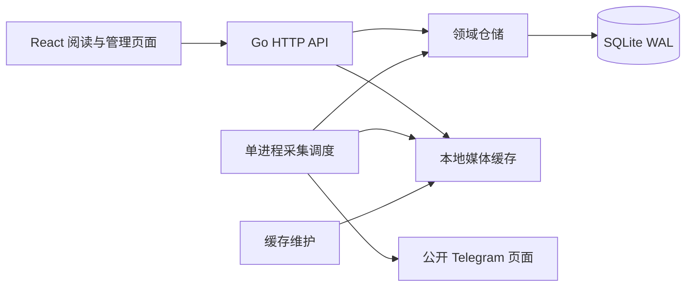

# 拾讯运行架构（现行 Go 版本）

本文对应 `cmd/server`、`internal/` 与 `frontend/`。`app/`、`tests/` 为保留的 Python 历史实现，不参与当前 Docker 运行；旧架构方案不作为现行功能清单。

## 组件与依赖

- `cmd/server/main.go` 负责配置、仓储、媒体、单进程采集器、HTTP 服务和优雅停机。
- `internal/api/` 负责公开与管理路由、消息序列化、静态页面托管和错误处理；`middleware/` 处理会话、同源校验、可信代理、限流与异步访问记录。
- `internal/repository/` 分开维护来源、消息、规则、反馈和访问数据。SQLite 使用 WAL、busy timeout 和明确的写事务；同一数据库只运行一个应用实例。
- `internal/crawler/` 获取 Telegram 公开页并标准化消息，`scheduler/` 管理定时与手动采集、来源互斥和媒体预热。当前支持 `telegram_public`。
- `frontend/src/main.tsx` 装配阅读首页、`/message/:id` 与 `/saved`。管理入口独立为 `admin-main.tsx`。

## 公开配置与权限

`GET /api/public/config` 仅返回 `name`、`description` 和 `base_url`。`SITE_NAME`、`SITE_DESCRIPTION`、`PUBLIC_BASE_URL` 来自运行配置；公开响应永远不序列化内部 Config。规范网址只接受无凭据、路径、查询和片段的 HTTP(S) origin；为空时浏览器使用当前 origin，服务端不信任请求 Host 生成外部链接。

公开消息列表、单条详情和媒体都必须属于 enabled 且 public_visible 的来源。`/api/public/messages/:id` 每次读取重验权限，并返回 `no-store`；不存在、私有和停用统一为 404。收藏只保存本机消息 ID，打开收藏时重新获取公开正文，不能绕过权限。

管理端使用内存会话和 HttpOnly / SameSite=Strict Cookie；重启后重新登录。写接口执行同源、JSON 与请求体大小限制。管理缓存统计和清理接口同样要求登录，统计不返回宿主路径。

## 阅读与分享

阅读页提供四语言界面、日夜主题、来源与媒体筛选、关键词检索、收藏与继续阅读。阅读进度保存筛选 URL、消息 ID 与视口偏移；通过用户点击恢复，缺失或失效来源遵循公开接口规则。频道内容不自动翻译。

长文与全部静态图片按字体与原图比例生成有界 PNG 分页。每页附站点名称、本站消息 URL、页号与二维码。二维码、非中文词典、收藏详情页面、分享弹窗、图片查看器和 Assembly 按需加载，各自设置构建预算。

媒体缓存按原 URL 的摘要命名，原图与缩略图单独存储。首次启用时，过期历史文件先获得一个完整年龄保留周期的宽限；标记只在完成后写入。启动与每 15 分钟按默认 5 GiB / 30 天维护，优先清理较久未使用的文件；只删除本缓存命名规则匹配的普通文件，不跟随符号链接。清理与下载、打开文件互斥，已经打开的传输继续读取文件句柄。消息数据库不随缓存清理删除；重新下载依赖原始媒体 URL 仍然有效。

## 构建、验证与发布

仓库工作流执行 Go 测试与竞态检查、静态检查、前端测试与构建预算、三尺寸浏览器回归、发布工具测试、依赖漏洞检查、完整 Git 历史和源码敏感扫描、Docker 构建。Gitleaks 对配置解析测试的少量固定假数据做“路径且精确值”例外，其他测试内容仍扫描。

`scripts/release.py` 是正式制品发布入口，打包白名单只包含 Linux 二进制、前端 dist 与文件校验清单。生产配置、数据库、备份、源码工作区和扫描原始报告不进入发布包。在线备份包括 SQLite WAL 的已提交内容并做完整性检查；候选在独立临时数据库、无网络和无宿主端口的容器验证后再切换。回滚只恢复镜像与运行环境，保留当前数据库。具体命令见[发布运维](../operations.md)。

默认 Compose 只需本身网络。需要共享 `ai-internal` 的现有服务器可额外应用 `docker-compose.server.yml`，不会改变已有容器与数据库名称。
